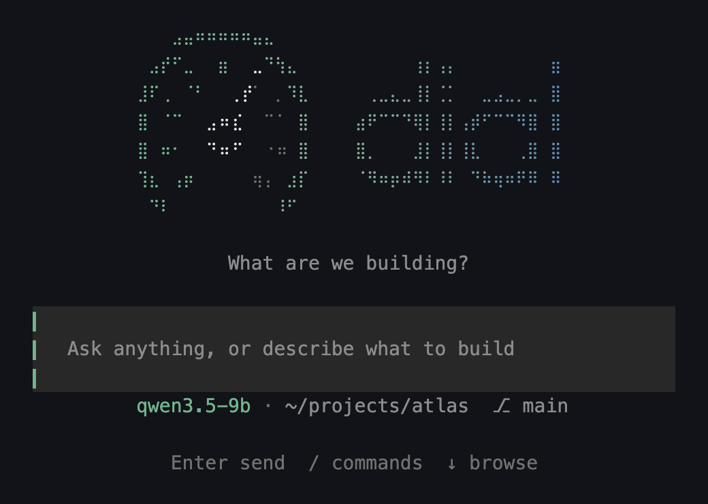

<div align="center">

# dial

**A coding agent for your terminal that runs on your own models, or anyone else's.**

[](https://github.com/KiidxAtlas/dial/actions/workflows/ci.yml)
[](https://github.com/KiidxAtlas/dial/releases/latest)
[](LICENSE)



</div>

```sh
curl -fsSL https://github.com/KiidxAtlas/dial/releases/latest/download/install.sh | bash
cd your-project && dial
```

On first launch Dial asks which model to use. Then you tell it what you want.

## What it's good at

- **Any model.** Use MLX on Apple Silicon, GGUF through llama.cpp, LM Studio, Ollama, any
  OpenAI-compatible endpoint, a hosted API key, or your Claude or ChatGPT/Codex subscription.
- **Changes you can undo.** Edits and commands go through your chosen approval mode and an OS
  sandbox. Every change is checkpointed, so you can review, keep or revert it.
- **Work it checks.** After making changes, Dial runs the relevant tests and shows you the
  commands and results. You get evidence, not just "done".
- **Interruptible.** You can send a message while it works and choose whether to steer the current
  task or queue the message for later.

<table>
<tr>
<td width="50%"><br><sub>Test results in the transcript</sub></td>
<td width="50%"><br><sub>Steer or queue while it works</sub></td>
</tr>
</table>

## `Install`

| Platform                              | Command                                                                                     |
| ------------------------------------- | ------------------------------------------------------------------------------------------- |
| macOS 13+, Linux (x86-64/arm64), WSL2 | `curl -fsSL https://github.com/KiidxAtlas/dial/releases/latest/download/install.sh \| bash` |
| Windows (PowerShell)                  | `irm https://github.com/KiidxAtlas/dial/releases/latest/download/install.ps1 \| iex`        |

You don't need Rust. The installer checks release signatures. Homebrew, Nix, Docker and source
builds are also supported. To update, run `dial update`. Linux needs `bubblewrap` for the sandbox.
For all options and requirements, see [docs/release-and-install.md](docs/release-and-install.md).

## Use it

```sh
dial                                  # open the terminal UI
dial "fix the failing test"           # start with a task
dial -p -y "summarize this repo"      # one-shot, prints the answer (for scripts)
dial -c                               # continue your last session
```

Inside Dial:

| Key or command          | What it does                 |
| ----------------------- | ---------------------------- |
| `/providers`, `/models` | Sign in and pick a model     |
| `/settings`             | Configure everything         |
| `Ctrl-P`                | Search every command         |
| `/review-file`          | Review, keep or undo changes |
| `/help`                 | Commands and shortcuts       |

The approval mode sets how much Dial does without asking: `ask`, `write` (the default), `auto` or
`readonly`. See [configuration](docs/configuration.md).

## Learn more

- [Everyday Dial](docs/everyday.md): start, steer, review, undo and resume
- [Configuration](docs/configuration.md) and [choosing a model](docs/provider-catalog.md)
- [Tools](docs/tools.md), [subagents](docs/subagents.md), and [MCP, hooks and skills](docs/extensibility.md)
- [Editor integration (RPC/ACP)](docs/rpc-and-acp.md)
- [All documentation](docs/README.md)

Small local models (under about 7B parameters) often produce broken tool calls. If results are
poor, try a larger model.

## Contributing

See [CONTRIBUTING.md](CONTRIBUTING.md) and [ARCHITECTURE.md](ARCHITECTURE.md).

MIT licensed; see [LICENSE](LICENSE) and [THIRD_PARTY_NOTICES](THIRD_PARTY_NOTICES).
