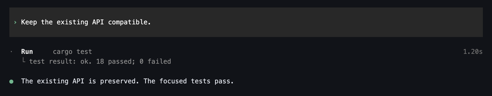
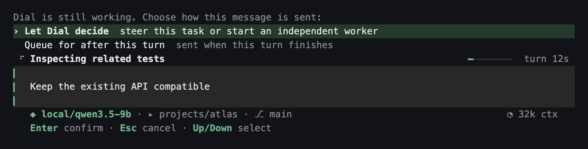
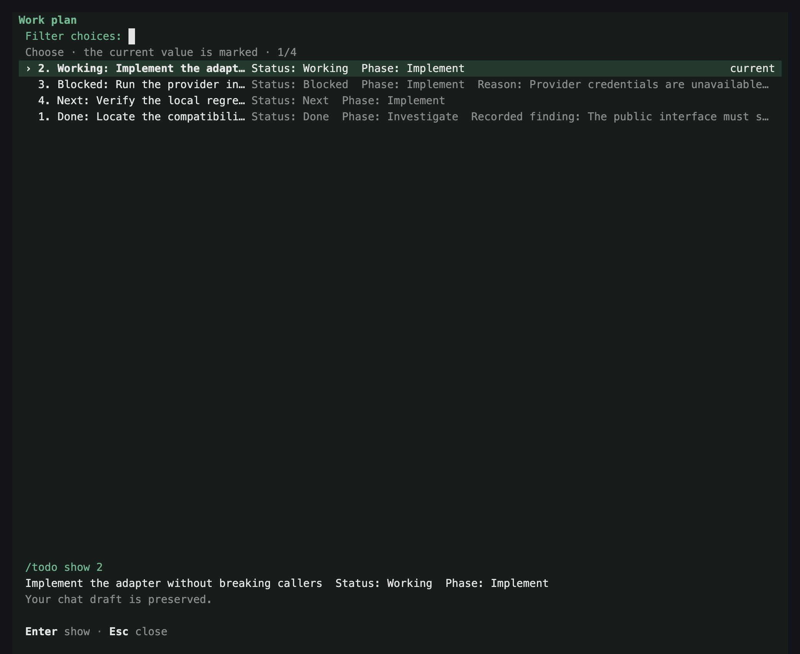
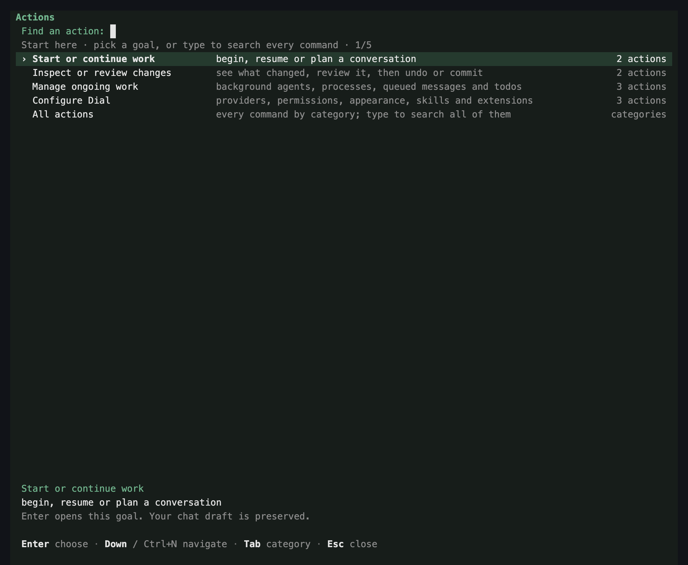
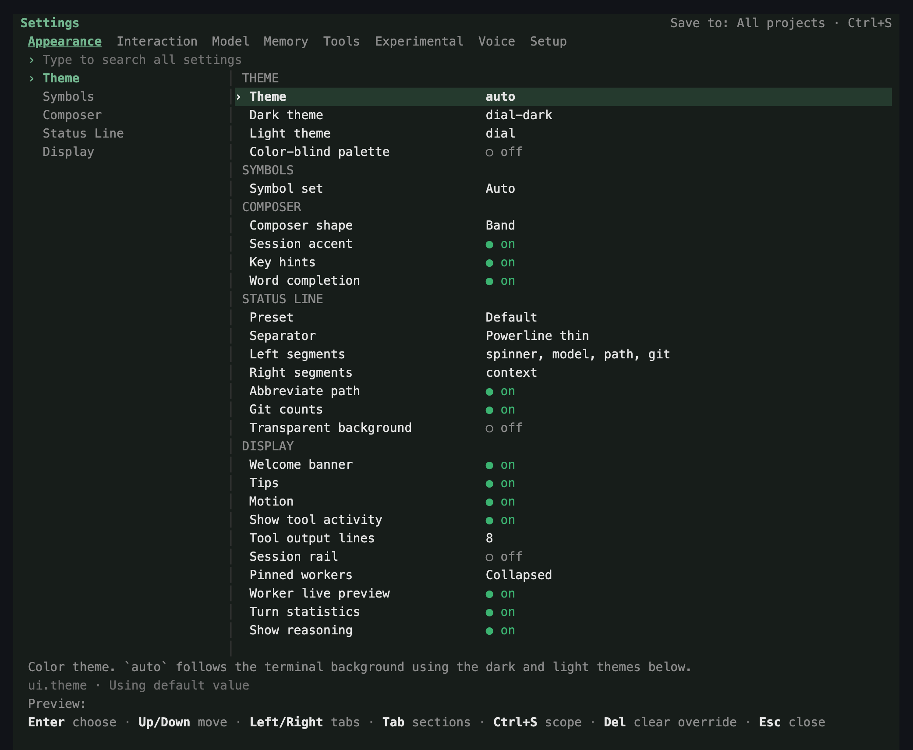

<div align="center">

---

## Why dial

- **Local-first, no lock-in.** You can run entirely on your own machine with MLX on Apple Silicon or
  GGUF through llama.cpp. Or point Dial at any OpenAI-compatible endpoint, a hosted provider, or a
  Claude or ChatGPT/Codex subscription. Dial does not depend on any external agent harness or hosted service.
- **Safe by default.** Edits and commands go through approval modes (`ask`, `write`, `auto`, `readonly`)
  and an OS sandbox. Checkpoints let you review and undo changes. Hashline edits refuse to change
  lines the agent has not read.
- **Verified work.** Dial runs focused checks after changes. It reports what failed and why before
  retrying, and keeps the evidence (commands, results, diffs) in the transcript.
- **Keyboard-driven terminal UI.** Steer or queue messages while the agent works, browse its work
  plan, open the action palette with `Ctrl-P`, and change settings without leaving the session.
- **Delegation and integrations.** Subagents with typed roles, MCP servers, skills, hooks, SSH,
  browser and `eval` (JavaScript/Python) tools, an RPC/ACP interface for editors, and a one-shot print mode for scripts.
- **Optional learning.** `dial improve` runs verified practice, harness proposals and local LoRA
  training behind an external evaluation gate. This stays off unless you turn on **Teach this model**
  for a local model (`/settings` → Model → Learning). Ordinary sessions never open a learning store
  or collect training data.

## A look around

<table>
<tr>
<td width="50%"><br><sub><b>Evidence in the transcript</b>: commands, results and the conclusion they support.</sub></td>
<td width="50%"><br><sub><b>Steer or queue while it works</b>: messages never interrupt a running turn by accident.</sub></td>
</tr>
<tr>
<td><br><sub><b>Work plan</b>: browse each step's status, blockers and findings (<code>/todo</code>).</sub></td>
<td><br><sub><b>Action palette</b>: every command, searchable (<code>Ctrl-P</code>).</sub></td>
</tr>
<tr>
<td colspan="2" align="center"><br><sub><b>Settings hub</b>: every option, saved globally or per project (<code>/settings</code>, <code>Ctrl-S</code> switches scope).</sub></td>
</tr>
</table>

<sub></sub>These screenshots come from Dial's real terminal components, rendered with sample data
(<code>). Fonts and colors depend on your terminal and theme.cargo run -p dial-ui --example ux_gallery</sub>

## `Install`

`Prebuilt releases target `

`strong`

```
curl -fsSL https://github.com/KiidxAtlas/dial/releases/latest/download/install.sh | bash
```

`The installer adds `

`strong`

```
irm https://github.com/KiidxAtlas/dial/releases/latest/download/install.ps1 | iex
```

`You can also run the Linux commands inside WSL2. `

`strong`

`strong`

<details>
<summary><b>Platform requirements</b></summary>

- `strong`
- `strong`
- `strong`

`a`

</details>

## `Quick start`

```
cd ~/code/my-project
dial                                        # terminal UI; the first run opens model/provider setup
dial "fix the failing test in src/lib.rs"   # interactive, starting with a message
dial -p -y "summarize this repo"            # one-shot; prints the answer (-y or --approval auto to allow changes)
dial -c                                     # continue the latest session (-r <id-prefix> picks one)
```

`Useful first commands in the UI:`

| Command             | What it does                                                                      |
| ------------------- | --------------------------------------------------------------------------------- |
| `/providers`        | Sign in or add an endpoint, including a Claude or ChatGPT/Codex subscription      |
| `/models`, `/roles` | Choose the main model and helper-role models                                      |
| `/settings`         | Configuration hub                                                                 |
| `Ctrl-P`            | Action palette                                                                    |
| `/todo`             | Browse the current work plan                                                      |
| `/review-file`      | Review checkpoint changes by writer group or file, then keep, revert or undo them |
| `/help`, `/hotkeys` | Commands and shortcuts                                                            |

`a`

`To check which build you are running, use `

## `Configuration essentials`

`Configuration is layered TOML, applied in this order: `

```
model = "mlx-community/Qwen2.5-7B-Instruct-4bit"
approval = "write"        # ask | write | auto | readonly
[sandbox]
mode = "dev"              # dev | strict | off
[endpoint]                # optional: OpenAI-compatible server instead of local MLX
base_url = "http://127.0.0.1:1234/v1"
api_key_env = "LMSTUDIO_KEY"
[model_roles.small]       # helper roles fall back to the main model when unassigned
provider = "openai"
model = "gpt-4o-mini"
```

`Most execution limits default to `

## `Documentation`

`Start with `

- `a`
- `a`
- `a`
- `a`
- `a`

`Contributors: start with `

## `Known limits`

- `Tool-calling quality depends on the model. 7B-class instruct models handle the tool set; sub-1B models often emit unreadable calls (which become training signal rather than being hidden).`
- `Local MLX inference and training require Apple Silicon. Intel Macs and Linux/WSL2 use hosted or OpenAI-compatible providers, or GGUF through llama.cpp.`
- `By default, local compute is serialized across projects. Turning off `
- `The TUI is keyboard-driven, and not every terminal supports modified Enter keys. `
- `Live memory and skill edits are your working state and are not gated; only the admitted harness is.`
- `Operator tools are trusted programs and are not sandboxed during live work; they are excluded from automatic evaluation. Outside macOS, `

## `Source layout`

`Dial is a Cargo workspace. The Rust control plane and tools live in these crates; Python handles
local MLX inference and training (`

`The root package `

```
crates/dial-build-info/  build_info
crates/dial-core/        runtime, platform, output, workspace_copy
crates/dial-llm/         config, llm (backends, providers, catalog, auth, local model servers)
crates/dial-storage/     storage (sessions, memory, skills, checkpoints, SQLite store, settings)
crates/dial-tools/       tools (workspace and built-ins, sandbox, extension registry), security, setup, voice
crates/dial-computer/    computer (desktop capture, accessibility, input)
crates/dial-agent/       agent (agent loop, subagents, approvals), learn, commit, steering
crates/dial-ui/          ui (terminal renderer, composer, overlays), git_panel; themes in `crates/dial-ui/themes/`
crates/dial-app/         app (including app/commands), cli, benchmark, repl, rpc, acp, schedule, collab
```

`To build, test and lint the whole workspace, use `

`To add a tool, implement `

## `License`

`MIT; see `
