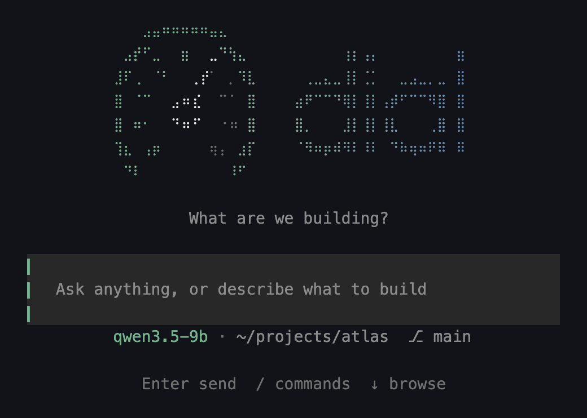
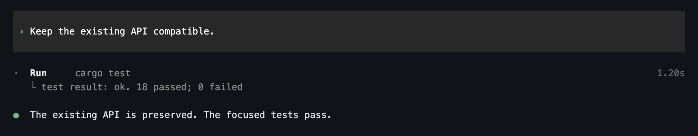
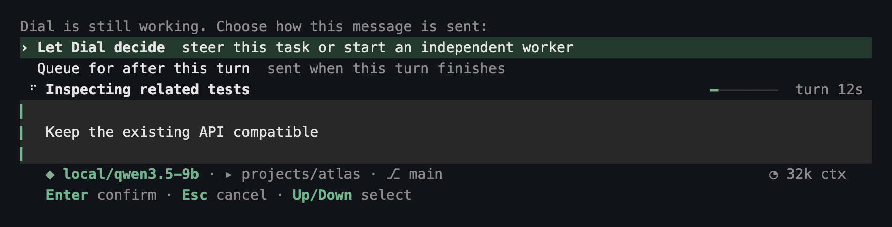
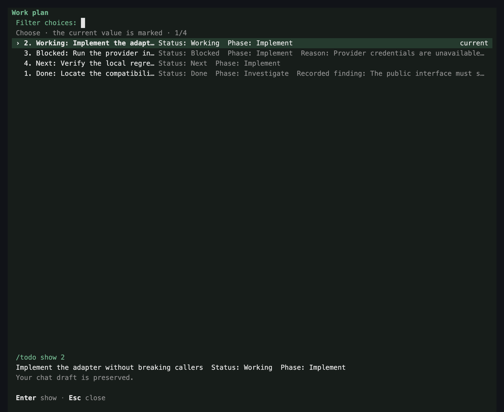
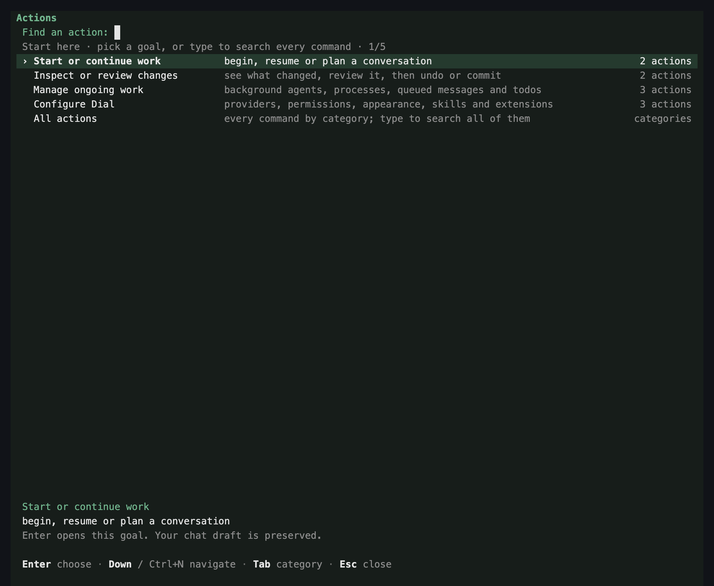
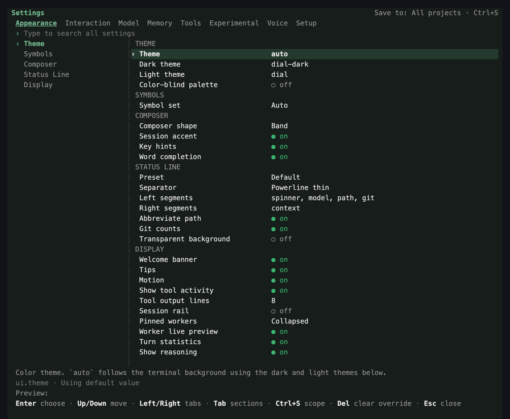

<div align="center">

# dial

**A local-first coding agent for your terminal.**

Run it in any project directory on macOS, Linux or Windows. Use local models (MLX, GGUF, LM Studio,
Ollama) or hosted providers, with approvals, sandboxing and checkpoints included.

[](https://github.com/KiidxAtlas/dial/actions/workflows/ci.yml)
[](https://github.com/KiidxAtlas/dial/releases/latest)
[](LICENSE)

[Install](#install) · [Quick start](#quick-start) · [Screenshots](#a-look-around) · [Configuration](#configuration-essentials) · [Docs](#documentation)



</div>

---

## Why dial

- **Local-first, no lock-in.** You can run entirely on your own machine with MLX on Apple Silicon or
  GGUF through llama.cpp. Or point Dial at any OpenAI-compatible endpoint, a hosted provider, or a
  Claude or ChatGPT/Codex subscription. Dial does not depend on any external agent harness or hosted service.
- **Safe by default.** Edits and commands go through approval modes (`ask`, `write`, `auto`, `readonly`)
  and an OS sandbox. Checkpoints let you review and undo changes. Hashline edits refuse to change
  lines the agent has not read.
- **Verified work.** Dial runs focused checks after changes. It reports what failed and why before
  retrying, and keeps the evidence (commands, results, diffs) in the transcript.
- **Keyboard-driven terminal UI.** Steer or queue messages while the agent works, browse its work
  plan, open the action palette with `Ctrl-P`, and change settings without leaving the session.
- **Delegation and integrations.** Subagents with typed roles, MCP servers, skills, hooks, SSH,
  browser and `eval` (JavaScript/Python) tools, an RPC/ACP interface for editors, and a one-shot print mode for scripts.
- **Optional learning.** `dial improve` runs verified practice, harness proposals and local LoRA
  training behind an external evaluation gate. This stays off unless you turn on **Teach this model**
  for a local model (`/settings` → Model → Learning). Ordinary sessions never open a learning store
  or collect training data.

## A look around

<table>
<tr>
<td width="50%"><br><sub><b>Evidence in the transcript</b>: commands, results and the conclusion they support.</sub></td>
<td width="50%"><br><sub><b>Steer or queue while it works</b>: messages never interrupt a running turn by accident.</sub></td>
</tr>
<tr>
<td><br><sub><b>Work plan</b>: browse each step's status, blockers and findings (<code>/todo</code>).</sub></td>
<td><br><sub><b>Action palette</b>: every command, searchable (<code>Ctrl-P</code>).</sub></td>
</tr>
<tr>
<td colspan="2" align="center"><br><sub><b>Settings hub</b>: every option, saved globally or per project (<code>/settings</code>, <code>Ctrl-S</code> switches scope).</sub></td>
</tr>
</table>

<sub>These screenshots come from Dial's real terminal components, rendered with sample data
(<code>cargo run -p dial-ui --example ux_gallery</code>). Fonts and colors depend on your terminal and theme.</sub>

## Install

Prebuilt releases target **macOS 13+ (Apple Silicon or Intel)**, **Linux x86-64 (Ubuntu 22.04 or
newer, also under WSL2)** and **native Windows x86-64**. You do not need a Rust toolchain to install a release.

**macOS and Linux**

```sh
curl -fsSL https://github.com/KiidxAtlas/dial/releases/latest/download/install.sh | bash
```

The installer adds `~/.local/bin` to your shell profile if it is not already on `PATH`
(`DIAL_NO_MODIFY_PATH=1` skips this). It checks the archive's SHA-256 against the release's
`SHA256SUMS`. When OpenSSL 3 is available (`brew install openssl@3` on macOS), it also verifies that
file's Ed25519 signature; set `DIAL_REQUIRE_SIGNATURE=1` to make the signature mandatory.

**Windows** (PowerShell 5.1 or 7; no OpenSSL or admin rights needed)

```powershell
irm https://github.com/KiidxAtlas/dial/releases/latest/download/install.ps1 | iex
```

You can also run the Linux commands inside WSL2. [docs/windows.md](docs/windows.md) covers pinned
versions and next steps.

**Homebrew, Nix and Docker** are also published; see
[docs/release-and-install.md](docs/release-and-install.md#other-distribution-channels).

**Updating.** Run `dial update` in a terminal, or `/update` inside Dial (then `/restart`). It
updates the way Dial was installed: installer copies get the latest signed release (or
`dial update --version 0.2.6` for a specific one), Homebrew and Cargo installs run `brew upgrade` or
`cargo install` for you, and a source build pulls its checkout (`git pull --ff-only`) and runs
`make update`. Nix installs are left to the flake. The interactive terminal tells you when a newer
release is available.

<details>
<summary><b>Platform requirements</b></summary>

- **Linux/WSL2** needs `bubblewrap` and `ca-certificates`, working unprivileged user namespaces and
  a normal (non-root) user. Under WSL2, **Windows executable interop must be disabled** in
  `/etc/wsl.conf`; Dial refuses sandboxed commands while it is enabled.
- **Local MLX inference and training** require macOS on Apple Silicon plus `uv`. **GGUF models** need
  llama.cpp's `llama-server` on `PATH` (or `DIAL_LLAMA_SERVER`) and are used for inference and evaluation only.
  Hosted and OpenAI-compatible providers work everywhere without Python.
- **From source:** `make update` builds and installs the faster, incremental `local` profile
  from a checkout; `make update SLIM=1` leaves out optional integrations. Use
  `cargo install --path . --locked` for full shipping optimization.

[docs/release-and-install.md](docs/release-and-install.md#platform-installation-details) covers
manual installation for each platform, WSL2 interop settings, the Linux sandbox model, building from
source, the development loop and release publishing.

</details>

## Quick start

```sh
cd ~/code/my-project
dial                                        # terminal UI; the first run opens model/provider setup
dial "fix the failing test in src/lib.rs"   # interactive, starting with a message
dial -p -y "summarize this repo"            # one-shot; prints the answer (-y or --approval auto to allow changes)
dial -c                                     # continue the latest session (-r <id-prefix> picks one)
```

Useful first commands in the UI:

| Command | What it does |
| --- | --- |
| `/providers` | Sign in or add an endpoint, including a Claude or ChatGPT/Codex subscription |
| `/models`, `/roles` | Choose the main model and helper-role models |
| `/settings` | Configuration hub |
| `Ctrl-P` | Action palette |
| `/todo` | Browse the current work plan |
| `/review-file` | Review checkpoint changes by writer group or file, then keep, revert or undo them |
| `/help`, `/hotkeys` | Commands and shortcuts |

[docs/terminal-interface.md](docs/terminal-interface.md) covers shortcuts and panels.

To check which build you are running, use `dial --version`. It shows the compiled revision and
whether the sources differed from that revision at build time. `dial --build-info` prints JSON with
the target, profile, build time and executable path. Neither command reads your configuration or
contacts a model. Builds without Git metadata report `unknown`; release and archive builders can set
`DIAL_BUILD_REVISION` and `SOURCE_DATE_EPOCH` explicitly.

## Configuration essentials

Configuration is layered TOML, applied in this order: `~/.dial/config.toml`, then the private
per-project file `~/.dial/projects/<name>-<hash>/config.toml`, then command-line flags. Dial never
reads configuration from the project directory itself. You can also edit most settings in
`/settings`, which saves them globally or per project (`Ctrl-S`).

```toml
model = "mlx-community/Qwen2.5-7B-Instruct-4bit"
approval = "write"        # ask | write | auto | readonly
[sandbox]
mode = "dev"              # dev | strict | off
[endpoint]                # optional: OpenAI-compatible server instead of local MLX
base_url = "http://127.0.0.1:1234/v1"
api_key_env = "LMSTUDIO_KEY"
[model_roles.small]       # helper roles fall back to the main model when unassigned
provider = "openai"
model = "gpt-4o-mini"
```

Most execution limits default to `0`, which means unlimited.
[docs/configuration.md](docs/configuration.md) has the full annotated example, layering rules and
defaults; [docs/model-routing.md](docs/model-routing.md) covers model roles and fallback chains.

## Documentation

This README is an overview. Detailed documentation lives in [`docs/`](docs/), and
[`ARCHITECTURE.md`](ARCHITECTURE.md) describes the module layout, dependency boundaries and invariants.

**Getting started and everyday use**

- [Release and installation](docs/release-and-install.md): installers, manual platform setup, signing, building from source, publishing releases
- [Optional dependencies and one-key setup](docs/setup.md): `/settings` Ctrl+L, `/setup`, `dial doctor --fix`, verified runtime downloads
- [Configuration](docs/configuration.md): layers, unlimited execution defaults, annotated example
- [Terminal interface](docs/terminal-interface.md): composer, slash commands, steering and queueing, shortcuts, `/settings`, model settings, themes, image previews
- [Composer and editor](docs/composer.md), [TUI rendering](docs/tui-rendering.md), [Voice](docs/voice.md), [Windows](docs/windows.md)

**Models and providers**

- [Provider and model catalog](docs/provider-catalog.md): discovery, local MLX/LM Studio/Ollama/llama.cpp, API keys, Claude and ChatGPT/Codex subscriptions, `/compute`, cost accounting
- [Model routing](docs/model-routing.md): model roles, picker role assignment, retries and fallback chains
- [LLM transport](docs/llm-transport.md): model profiles, protocols, prompt caching, request headers, retries, image input

**The agent and its tools**

- [Agent loop and context maintenance](docs/agent-loop.md): coding workflow, verification and completion, shared context economy, human questions and checkpoints, compaction policies, live phase policy
- [Tools, safety and context](docs/tools.md): tool roster and integrations, approvals and sandbox, context sources, [editing grammars](docs/tools.md#editing-grammars-and-safety), tool reliability
- [Execution and web tools](docs/execution-and-web.md): kernels, browser, web access, DAP
- [Shell tool](docs/shell.md), [Terminal shell](docs/terminal-shell.md), [SSH](docs/ssh.md)
- [Subagents](docs/subagents.md): delegation, typed roles, isolation, live tasks, worker panel

**Extending and automating**

- [Extensions and project context](docs/extensibility.md): skills import and toggles, custom tools, Rust SDK, [hooks, path permissions and schedules](docs/extensibility.md#lifecycle-hooks-path-permissions-isolated-workers-and-schedules), [git tool, budgets, custom agents and HTTP MCP](docs/extensibility.md#git-tools-budgets-custom-agents-and-http-mcp)
- [RPC and ACP](docs/rpc-and-acp.md): print mode JSON output, session CLI, persistent RPC, ACP
- [Background services](docs/background-services.md), [Encrypted collaboration](docs/collab.md), [Sharing, statistics and telemetry](docs/share-stats-telemetry.md)

**Memory, learning and measurement**

- [Memory and background learning](docs/memory-and-learning.md): memory backends, saved codebase understanding (`/understanding`), architecture synthesis, experience reuse
- [Optional learning and harness improvement](docs/improvement.md): `dial improve` cycles, LoRA and fast weight candidates, verified local-model workflows, repository exercises, activation steering, portable packs
- [Benchmarks and measurement](docs/benchmarks.md): `dial bench`/`dial benchmark` suites, efficiency measurement, regression checks, configuration comparisons, assistance ablation
- [Autoresearch and archive](docs/autoresearch-and-archive.md)

## Known limits

- Tool-calling quality depends on the model. 7B-class instruct models handle the tool set; sub-1B models often emit unreadable calls (which become training signal rather than being hidden).
- Local MLX inference and training require Apple Silicon. Intel Macs and Linux/WSL2 use hosted or OpenAI-compatible providers, or GGUF through llama.cpp.
- By default, local compute is serialized across projects. Turning off **Compute locks** in Settings → Model → Local worker (`compute_locks = false`) allows concurrent model work, but this can exhaust RAM or GPU memory. Laya roles never require the compute lock. With locks enabled, a session that queues improvement releases compute once it is idle and its child agents have finished; a later turn waits if the cycle holds compute. Dial makes no claim of zero-downtime training.
  While a turn waits for compute, the elapsed timer keeps running and commands follow the same live/deferred/interrupting policy as during inference. Turn duration includes the wait; once compute is acquired, the status returns to Working.
- The TUI is keyboard-driven, and not every terminal supports modified Enter keys. `dial schedule` handles scheduling but does not install a daemon. Voice (text-to-speech, push-to-talk dictation and protocol live sessions) is described in [docs/voice.md](docs/voice.md). The browser and `eval` tools require OS containment; they fail closed rather than falling back to unrestricted execution.
- Live memory and skill edits are your working state and are not gated; only the admitted harness is.
- Operator tools are trusted programs and are not sandboxed during live work; they are excluded from automatic evaluation. Outside macOS, `bash` is unavailable for live use unless `sandbox.mode = "off"`, while generated evaluations still require the strict sandbox.

## Source layout

Dial is a Cargo workspace. The Rust control plane and tools live in these crates; Python handles
local MLX inference and training (`mlx-lm`, plus `mlx-vlm` for vision), and GGUF models run through llama.cpp's `llama-server`.

The root package `dial` holds the binary and a facade library (`src/lib.rs`) that re-exports every
crate module, so `dial::<module>` paths keep working. Binary startup lives in `src/main.rs`;
arguments, overlays, routing and chat launch are in separate sibling modules, and binary-only
command handlers live in `src/cmd/`. Each crate's modules live under `crates/<crate>/src/`:

```
crates/dial-build-info/  build_info
crates/dial-core/        runtime, platform, output, workspace_copy
crates/dial-llm/         config, llm (backends, providers, catalog, auth, local model servers)
crates/dial-storage/     storage (sessions, memory, skills, checkpoints, SQLite store, settings)
crates/dial-tools/       tools (workspace and built-ins, sandbox, extension registry), security, setup, voice
crates/dial-computer/    computer (desktop capture, accessibility, input)
crates/dial-agent/       agent (agent loop, subagents, approvals), learn, commit, steering
crates/dial-ui/          ui (terminal renderer, composer, overlays), git_panel; themes in `crates/dial-ui/themes/`
crates/dial-app/         app (including app/commands), cli, benchmark, repl, rpc, acp, schedule, collab
```

To build, test and lint the whole workspace, use `make test-lib`, `make lint`, or
`cargo test --workspace --lib <filter>`. `make test-module MOD=llm::provider` runs one module's
tests, searching every crate. `cargo build -p dial` builds only the shipped binary.

To add a tool, implement `tools::ext::Tool` in its own module, return it from a `tools()` constructor, and list it in `Registry::standard`.

## License

MIT; see [LICENSE](LICENSE). Bundled third-party notices are in [THIRD_PARTY_NOTICES](THIRD_PARTY_NOTICES).
