# Architecture, implementation, UX and output-quality audits

## Scope and evidence contract

This is an actionable audit of the **current working tree**, including pre-existing staged and unstaged changes. It is not a review of HEAD alone. Production code, existing plans and user changes are left untouched. **All implementation changes below are proposed, not applied.** The delivered change is this report, updated after each completed audit.

Five complementary passes cover: (1) architecture/build/release contracts; (2) agent/provider/configuration orchestration; (3) tools, permissions and process ownership; (4) durable state, provenance and learning; (5) external protocols, runtimes and presentation. This is a broad source-based audit with deep selected traces, not a claim to have executed every branch or certified every platform.

Evidence labels:

- **Confirmed / source**: a concrete trigger and consequence follow from inspected code; not necessarily reproduced at runtime.
- **Confirmed / executed**: a named local check exercised the behavior.
- **Risk / [INFERENCE]**: plausible impact requiring the stated experiment or product decision.
- **Coverage gap**: an absent guarantee or unexercised boundary, not itself a demonstrated runtime defect.

Severity: **P1** security, data loss, or materially wrong completion; **P2** correctness/reliability or a significant assurance gap; **P3** maintainability/documentation. Priorities do not imply an exploit was executed. Source locations are working-tree references and can drift after later edits.

## Implementation status (applied after the audits)

All findings in this report were implemented in the working tree. The sections below are the original audit text; their "proposed, not applied" wording is historical. `cargo check --all-targets` succeeds after the changes. **No tests, clippy or hosted CI have been run yet**, as requested, so regression tests added alongside the fixes are unexecuted.

Findings implemented with a qualification:

- **A3-05** — `ureq` exposes no socket handle or idle read deadline, so idle MCP listeners are released at a finite stream lifetime (600 s streamable HTTP with reopen, 3600 s legacy SSE with explicit error), not immediately on cancel.
- **A3-03** — write-through is owner-local; a session binds its workspace on its first `lsp` call, so edits by a session that never called `lsp` get no write-through.
- **A2-04** — the tree already rebound usage at both replacement sites; the fix centralizes it in one installer rather than closing a confirmed gap. Compaction applied in the background or on overflow retry does not yet reset duplicate-observation state (A13-04).
- **A5-R1** — wire protocol bumped (`COLLAB_PROTO` 1002); older peers are incompatible.
- **A6-06** — reviewers still read the checked-out workspace; ref reviews and changed trees are published as `Partial` instead of pinning a snapshot.
- **A1-03** — Unix activation is crash-safe; the Windows deferred path is unchanged and still needs its own design. **A1-02** — Windows contract filters are untested on a real Windows host.
- **A13-02** — the document-reader (`documents::read_streaming`) path keeps its page limit and is not plumbed with the model budget.
- **A8-04** — an endpoint with no environment variable still sends unauthenticated after its key is removed (existing no-key contract).
- **A9-03/A9-04** — anonymization is now stricter by design: text content blocks and unknown keys become placeholders.
- Product-decision items took the report's suggested defaults (A9-R1 branch-aware share with an explicit whole-journal mode; A4-D1 documentation aligned to the tested policy; A12-R1 call ids on approvals).
- Not exercised for lack of a harness or runtime: A2 clock-injected end-to-end tests, A5-R3 browser viewer, A5-R2 real Chrome reconnect, A5-05 real stalled peer, A11 terminal interaction, A14-06/A14-08 scripted runs.

Next step: `cargo fmt`, `make test-rust`, `make lint`, `make test-integration`, `python3 scripts/test-build.py`, `python3 scripts/test-packaging.py`, then the Python and offline benchmark suites.

## Audit completion ledger

| Pass | Scope                                | Report status | Source changes |
| ---- | ------------------------------------ | ------------- | -------------- |
| 1    | Architecture, build and release      | Complete      | None           |
| 2    | Agent, providers and configuration   | Complete      | None           |
| 3    | Tool authority and execution         | Complete      | None           |
| 4    | Persistence, provenance and learning | Complete      | None           |
| 5    | External runtimes and surfaces       | Complete      | None           |

## 1. Architecture, build and release audit

### Coverage and method

Inspected the declared boundaries and invariants in `ARCHITECTURE.md`, crate exports (`src/lib.rs`), CLI entry declarations (`src/main.rs:1-200`), all of the dependency-boundary checker, Cargo features/profiles, `build.rs`, Make build/install/test targets, CI, release packaging/publication through its signing step, self-update verification/activation, build tests, package manifests, and release documentation. Existing review prose was treated as context, not proof. Installer internals, hosted CI results, live releases, Docker/Nix builds and signing credentials were not exercised.

The project is one Rust crate with module-level rather than compiler-enforced subsystem boundaries. `main` mounts binary-only CLI modules; `app` and protocol adapters compose the agent, tools, providers and storage. Optional integrations are Cargo features; platform-specific desktop behavior also uses build-script cfgs. Runtime facts and presentation are intentionally separate. This is a reasonable shape for the current product: no evidence here justifies a multi-crate rewrite.

### Current relationships and data flow

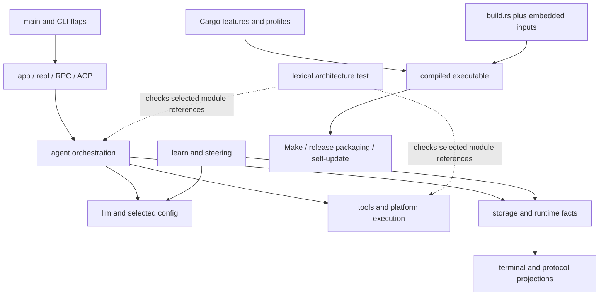

**Preserve:** provider/tool/UI boundaries; role adapters over shared execution; typed effect certainty; private durable state; immutable evidence; fail-closed sandboxing; exact signed-manifest verification; package-manager ownership; tests that distinguish unavailable environments from success. `src/cli/update.rs:91-105,135-146` verifies signature before trusting the selected digest; `122-134` avoids overwriting recognized package-manager installations. These are positive implementation observations, not full supply-chain certification.

### A1-01 — Architecture guard misses ordinary module aliases

- **P2 · Confirmed / source · high confidence.** `tests/integration/architecture.rs:285-328` only records a module when its name is followed by `::`. Consequently `use crate::tools;`, `use crate::tools as t;`, or `use crate::{tools, config::types::Config};` can introduce the forbidden module without a recorded dependency. Calls through the alias do not contain `crate::tools::`. Whitespace between `crate` and `::`, relative paths, and deliberately excluded `$crate::` paths are additional lexical limits.
- **Trigger/consequence:** introduce a forbidden module import in `ui` using one of these legal forms; the architecture test can remain green while the documented boundary is violated. This is a defect in the guard, **not evidence that the present production graph already violates it**.
- **Proposed change:** extend import/path recognition to module imports and aliases, ideally using an already available Rust syntax parser rather than growing a bespoke token heuristic. Explicitly document macro/relative-path coverage if it remains incomplete. Fail on source enumeration errors rather than silently treating unreadable directories as empty (`13-24`).
- **Acceptance:** positive/negative fixtures for direct module imports, aliases, grouped imports, whitespace, nested test modules, macro paths and relative references; production code after tests must remain checked. Keep comments/string exclusions. Report missing/unreadable module roots distinctly.
- **Existing evidence:** all four current architecture tests passed in a standalone Rust test harness. They do not cover alias imports (`381-442`).

### A1-02 — Native Windows release lacks a Rust test gate on Windows

- **P2 · Coverage gap · high confidence.** `.github/workflows/ci.yml:15-16` runs Rust build/test on two macOS variants and Linux. The Windows CI job (`115-131`) only runs installer tests. `.github/workflows/release.yml:98-153` builds/packages Windows and runs version/help and installer checks, but not Rust library/integration tests.
- **Trigger/consequence:** Windows-only process, filesystem, projected-isolation or UI regressions can compile and pass installer checks without their behavioral tests being run before publication. **[INFERENCE]** This increases release risk; it does not demonstrate that those implementations currently fail.
- **Proposed change:** add a Windows Rust job, initially a supported focused contract suite plus a clearly tracked exclusion list; gate publication on that job. Expand to the portable full suite as fixtures become supported. Keep unsupported capability reporting explicit.
- **Acceptance:** execute native process-group/job ownership, filesystem replacement, cancellation and protocol tests on Windows; fail on real regressions rather than globally ignoring platform errors. Record exact skipped tests and reasons.

### A1-03 — Self-update removes the active executable before replacement

- **P1 · Confirmed / source · high confidence.** `src/cli/update.rs:256-284` deletes an old backup, renames the current executable to the backup, then renames the staged executable into place. Error returns attempt rollback, but a process crash or power loss between those two renames leaves the normal executable path absent. `docs/release-and-install.md:15` describes activation as atomic, which is stronger than this implementation.
- **Trigger/consequence:** interruption immediately after line 261; subsequent invocations cannot find the executable even though a backup may remain. No crash injection was executed in this audit. Windows uses a separate deferred two-move script (`217-234`) and needs its own design and validation.
- **Proposed change:** under an install-location mutation lock, preserve a verified backup without first removing the active name; atomically replace that name with the same-filesystem staged file and perform the appropriate directory durability barrier. Use platform-specific replacement primitives. Recovery must retain both the original failure and any failed rollback.
- **Acceptance:** inject failures/crashes before and after backup creation, replacement, durability barrier and post-check; active path must always be a complete old/new executable or have a documented recoverable startup path. Include concurrent update attempts. Signed-content and package-manager checks must remain unchanged.

### A1-04 — Make update can continue after backup failure and overwrite same-second backups

- **P2 · Confirmed / source · high confidence.** `Makefile:44-55` runs `cp -p` followed by `printf` without fail-fast handling. A failed copy can be masked by the succeeding print/loop status, allowing install recipes (`62-64`) to replace the original without the promised backup. Backup names have only second resolution; two updates within a second overwrite the same backup. Pruning also happens before activation (`56-60`).
- **Trigger/consequence:** make an existing backup destination unwritable, or run two quick updates with an unchanged timestamp; backup preservation can fail or the older rollback point can be lost. These paths are source-confirmed but not fault-injected here.
- **Proposed change:** make each backup failure fatal before any install, use collision-safe backup creation, then activate and prune only after successful replacement/checks. Do not consolidate development installation with the signed updater unless their distinct contracts remain explicit.
- **Acceptance:** extend `scripts/test-build.py` with failed backup, timestamp collision, partial multi-location activation, invalid retention input, and failed post-install check. Existing four build tests pass but cover happy backup creation and build failure, not these failure paths.

### A1-05 — Nix package identity can disagree with its compiled source

- **P3 · Confirmed / source · high confidence.** `flake.nix:14-16` labels the package `0.1.7` while building `self`; `Cargo.toml:3` is `0.1.8`. A build from this tree therefore has package metadata detached from the Rust version. The Homebrew formula also references 0.1.7, but it downloads explicitly versioned 0.1.7 assets; **that alone is not a defect** because a released formula can intentionally lag unreleased source.
- **Proposed change:** derive the source-built Nix version from `Cargo.toml`; keep release-fed binary formula updates separate. Add a packaging consistency check. Do not blindly bump Homebrew hashes without actual release artifacts.
- **Acceptance:** evaluate Nix package metadata against Cargo version; build/version agreement where Nix is available. No Nix command was executed here.

### Target architecture and change relationships


This is an evolutionary target, not a new framework. A1-01 strengthens the existing architecture owner; A1-02 makes platform support an executable contract; A1-03/A1-04 align the two installation paths around explicit publication guarantees without conflating their trust models; A1-05 removes duplicated source-package identity.

### Verification performed for audit 1

- Standalone harness: `CARGO_MANIFEST_DIR="$PWD" rustc --edition=2024 --test tests/integration/architecture.rs -o <temporary-binary>` followed by that binary with `--nocapture`: **4 passed, 0 failed**. This runs the exact checker against the current source without compiling the whole application.
- `python3 scripts/test-build.py`: **4 passed**. This uses its disposable fake-Cargo fixture; it did not build/install Dial or modify the real installation.
- No full Rust suite, hosted CI, release signing/publication, installer execution against the real installation, cross-platform runtime, or performance measurement was run. Existing review documents mention earlier unresolved suite failures; those claims are not replaced by these focused results.

### Audit 1 actionable queue

- [ ] **A1-03** Fix crash-safe updater publication; add fault and concurrency tests.
- [ ] **A1-04** Fail closed on backup failure; preserve collision-safe rollback points.
- [ ] **A1-01** Close architecture-checker alias and source-enumeration gaps.
- [ ] **A1-02** Add native Windows behavioral CI with explicit supported coverage.
- [ ] **A1-05** Derive Nix source-package version from Cargo.

**Report update 1:** completed the architecture/build/release pass, recorded five findings, current/target diagrams, preserved invariants, and the two executed checks. No implementation fix is represented as applied.

## 2. Agent lifecycle, delegation, context and provider audit

### Coverage and preserved relationships

Deep traces covered parent lifecycle/turn settlement, the shared engine, serial and parallel admission, steering and interruption, completion verification, role configuration, startup fallback, worker slots/isolation/resume, compaction commit, provider retry and usage binding. Every provider serializer/OAuth implementation, every mode, native/speculative compaction, all live-task messaging and platform isolation backends were **not** exhaustively audited. No live provider or Rust regression execution was performed for this pass.

| Owner / relationship                                             | Inspected invariant to preserve                                                                                                        |
| ---------------------------------------------------------------- | -------------------------------------------------------------------------------------------------------------------------------------- |
| `agent/engine.rs:53-73,105-123` → parent/child adapters       | Shared recovery stops automatic continuation/completed publication after uncertain effects.                                            |
| `agent/dispatch.rs:365-437,491-539` → tools                   | Pre-hook rewrite is followed by argument revalidation, fresh authorization and cancellation checking.                                  |
| `agent/turn.rs:1765-1788`; `agent/child.rs:2644-2660`        | Parallel candidates are admitted individually; pre-tool hooks disable the batching path.                                               |
| `agent/turn.rs:1599-1616` → conversation                      | Superseded pending calls receive closure before steering is appended; actual prefetched results remain results.                        |
| `agent/turn_loop.rs:545-805` → completion                     | Repairs share the turn budget; stop-hook continuations reenter verification.                                                           |
| `config/mod.rs:1101-1121` → workers                           | Role configuration inherits controls and disables main-only steering/adaptation.                                                       |
| `agent/task_slots.rs:18-35`; `agent/child.rs:2041-2092`      | Worker counts are bounded; provider slots bracket inference, not nested execution.                                                     |
| `agent/isolation.rs:553-620`; `agent/subagents.rs:2331-2364` | Cooperating merges are serialized, parent content rechecked, conflicts/recovery copies retained, owned resources stopped before merge. |
| `agent/worker_resume.rs:64-102,120-155`                        | Workspace/execution identity and unresolved effects are checked before resume.                                                         |
| `agent/compaction_ops.rs:267-290,321-406`                      | Compaction validates snapshot/config/history/tool groups, fit, replay and cancellation before commit.                                  |

All paths in this table are under `src/`. These are source observations, not newly executed guarantees.

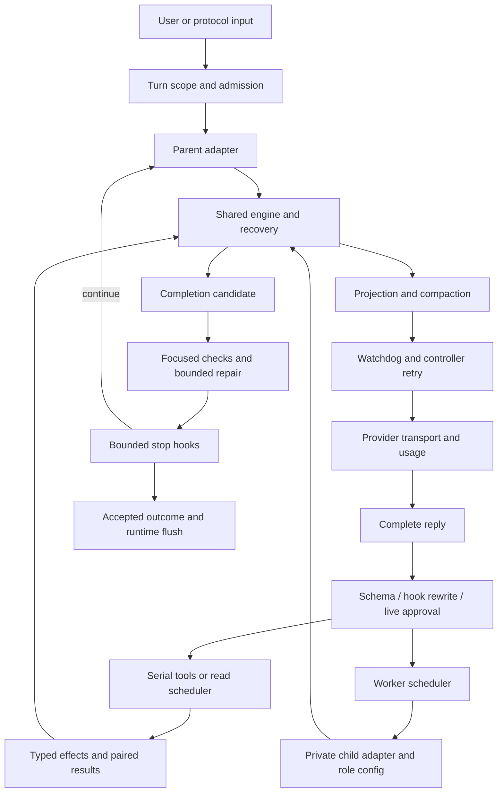

### A2-01 — Silence recovery interrupts legitimate provider backoff

- **P2 · Confirmed / source · high confidence.** `src/agent/chat.rs:66-71,343-350,550-568` arms remote silence detection and resets its clock for a retry event, but retains no backoff-active state. `src/llm/provider.rs:1668-1687` emits one waiting event and then sleeps until the retry deadline. `chat.rs:151-164` can restart an empty silent failure.
- **Trigger/consequence:** a valid provider retry delay exceeds the agent silence timeout while remaining within the configured transport maximum. The documented 180-second maximum and 120-second silence default permit this. The controller cancels a healthy wait, potentially resends before `Retry-After`, or pauses unnecessarily. Transport compliance in isolation does not establish controller compliance (`docs/llm-transport.md:5,64-70`).
- **Proposed change:** retain explicit request phase; suspend generation-silence detection during transport backoff and rearm on `waiting: false`. Keep user cancellation/heartbeat responsive; do not fabricate token progress.
- **Acceptance:** test the full chat wrapper with a scaled/injected clock, retry delay greater than silence threshold, no premature resend, prompt explicit cancellation, and genuine post-backoff silence still bounded. Nearby backend-delay tests (`provider.rs:4037-4063`) and silent-agent tests (`tests/integration/agent.rs:476-515`) do not establish this composed contract.

### A2-02 — Parent fallback retains primary context and output planning

- **P2 · Confirmed / source · high confidence.** `src/agent/turn.rs:53-55` computes output budget once; `889-899` resolves `next_config` but replaces only the backend. `src/agent/accessors.rs:244-260` still derives context planning from primary `auth_config`/`context_cap`; `turn.rs:215-235,351-355,455-469,509-529` uses that identity/capacity in preparation/admission.
- **Trigger/consequence:** a fallback has a smaller context/output capacity. The request can be prepared and compacted for the primary, rejected by the fallback, and retried against the same wrong capacity. Qualification: adaptive selection does receive `backend.model_profile()` at `turn.rs:232`; not every profile field is stale.
- **Proposed change:** retain active resolved configuration with the backend, and recompute request bounds/compaction identity on route transitions. Preserve the operator's primary selection separately. Reuse `Config::with_selection` (`src/config/mod.rs:1008-1024`) and the worker startup pattern that supplies alternate `Env.config` (`src/agent/subagents.rs:2010-2037`).
- **Acceptance:** large-window primary fails, small-window fallback succeeds with a request within its own context plus output reserve; exercise same-provider/different-model and alternate-provider routes, and verify overflow recovery does not keep primary-sized requests.

### A2-03 — Fallback backend outlives the state needed to restore the primary

- **P2 · Confirmed / source · high confidence.** `src/agent/turn.rs:53-54` stores fallback index/deadline locally; `607-615` requires those locals to restore primary; `894-899` installs fallback/cooldown. `src/agent/turn_loop.rs:544-548,824` retains the backend across turns.
- **Trigger/consequence:** fallback completes before cooldown expires; the next turn starts after expiry. It receives the fallback backend but initializes index zero/no deadline, so the restoration branch cannot run. Verification/stop-hook loop reentry has the same lifetime mismatch. The session can remain on fallback while configured selection still names primary.
- **Proposed change:** either persist temporary-route state at agent/session lifetime or restore primary when leaving the owning loop. Do not persist a backend without its routing state.
- **Acceptance:** primary failure → fallback completion → advance clock past cooldown → next turn uses primary; repeat across verification and stop-hook reentry. Before expiry, retained fallback must be explicitly represented and reported.

### A2-04 — Replacing a backend loses runtime usage attribution

- **P2 · Confirmed / source · high confidence.** Fresh backends start with `usage_scope: None` (`src/llm/provider.rs:285-315`), and accounting is conditional on scope (`941-955`). Parent turn binding happens before the loop (`src/agent/turn_loop.rs:43-49`); replacements at `src/agent/turn.rs:611-612,899` do not rebind it.
- **Trigger/consequence:** fallback or in-loop primary restoration makes subsequent ordinary requests disappear from runtime-ledger request counts, coverage, model/purpose breakdown and observed cost. **This is not a demonstrated budget bypass:** parent legacy metrics and successful-reply cost still update at `turn.rs:1038-1048`; the finite step limit remains separate.
- **Proposed change:** one backend-installation helper binds current session identity and usage scope for every route transition. Reuse `Backend::set_usage_scope` (`provider.rs:497-525`) and child scope handling (`src/agent/child.rs:1578-1591`).
- **Acceptance:** scripted primary failure → fallback success → restoration records every request/attempt/outcome exactly once, under the correct model and original turn; cover ordinary and repair-purpose inference.

### A2-05 — Duplicate-call identity strips meaningful nested fields

- **P2 · Confirmed / source · high confidence.** `src/agent/guard.rs:78-94` recursively deletes `i` and `__intent` keys. That identity drives streak detection/result matching (`154-179,195-219`); `src/agent/turn.rs:1532-1563` suppresses matched calls and substitutes earlier-result pointers. `src/agent/stream_guards.rs:71-73` sets the repeat threshold.
- **Trigger/consequence:** an admitted tool receives distinct payloads such as `{"filter":{"i":1}}`, `{"filter":{"i":2}}`, etc. They collapse to one identity; after the repeat threshold, a genuinely new call can be withheld and answered with a result pointer for different arguments.
- **Proposed change:** use one deterministic normalizer stripping only defined **top-level** harness metadata. `normalized_arguments` already preserves nested fields (`guard.rs:7-26`); the second implementation contradicts it. Reconcile legacy `__intent` and `_intent` without stripping application data.
- **Acceptance:** varying nested `i`/`__intent` never forms a duplicate streak or short-circuits a new call; top-level presentation-only differences still count as repeats. Run an admitted nested-schema tool through the parent loop and assert distinct calls execute. Existing tests (`guard.rs:237-268,280-303`) cover ordinary paths/top-level intent, not this boundary.

### Ideal architecture and change relationships

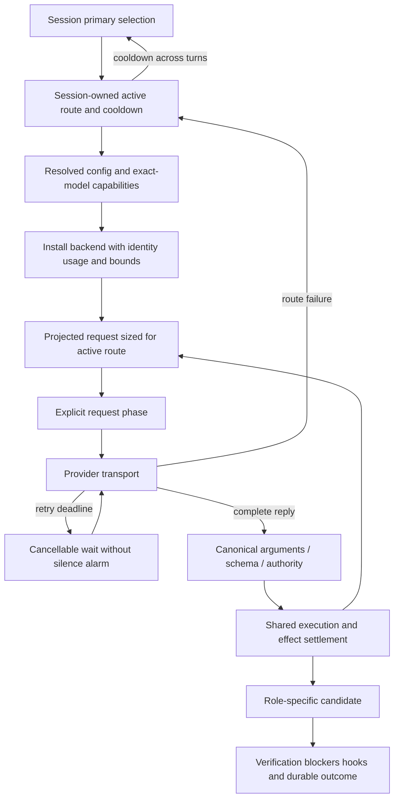

A2-02 through A2-04 have one root architectural problem: route transitions update the backend independently of its configuration, lifetime and accounting. A small active-route owner and installation helper are justified; a replacement orchestration framework is not. A2-01 needs consumption of existing retry-phase events; A2-05 needs removal of contradictory normalization, not another guard layer.

**Additional risks / [INFERENCE]:** worker teardown joins cooperatively cancelled tasks (`src/agent/live_tasks.rs:1224-1230`); end-to-end liveness depends on tool cancellation and must be evaluated with audit 3. A completed isolated worker and its merge outcome are separate contracts: conflict metadata does not mean all changes landed. This appears intentional, not a confirmed defect. Large parent/child adapters alone do not justify mechanical deduplication.

### Tests and actionable queue

Inspected nearby coverage includes shared-engine uncertainty (`src/agent/engine.rs:183-246`), recovery bounds (`turn_recovery.rs:87-147`), complete tool-group compaction (`compaction.rs:1613-1641`), stop-hook finite budget (`tests/integration/agent.rs:6956-6979`), worker startup fallback without replay (`10192-10243`), isolation conflicts (`src/agent/isolation.rs:748-781`), backend partial-tool discard (`src/llm/provider.rs:4084-4125`), session model pinning (`src/config/session_models.rs:118-150`) and worker slots (`src/agent/task_slots.rs:41-65`). These tests were **not executed** in this audit; their existence is not evidence that the five composed-boundary regressions pass.

- [ ] **A2-02, A2-03, A2-04** Implement one coherent route-state transition with context, cooldown and accounting tests.
- [ ] **A2-01** Make provider backoff an explicit watchdog phase; test cancellation and deadline precedence.
- [ ] **A2-05** Share the top-level-only argument-identity policy and test nested application fields.

**Report update 2:** completed the agent/provider/configuration pass; added five source-confirmed defects, preserved invariants, both flows, explicit risks, regression criteria and coverage limits. Production changes remain unapplied.

## 3. Tool authority, confinement and process ownership audit

### Coverage and existing architecture

Deeply traced native execution/registry lifecycle, workspace and protected paths, Unix transaction staging/rollback, process capture and foreground/background transfer, LSP write-through/forks/formatting, MCP event framing/listener lifetime, and web resolver/redirect credentials. Sampled Linux mount policy, Windows Job Objects/initial edit handling, DAP admission/launch, embedded-shell state, and tool-contract identity. No commands, sandbox probes or Rust tests were executed for this pass. Browser internals belong to audit 5; SSH/plugin runtime internals, the whole Windows rollback/PTY/ACL implementation, and every protocol action were not comprehensively examined.

| Boundary                       | Inspected protection / relationship                                                                                                                                                                                                                                                                                   |
| ------------------------------ | --------------------------------------------------------------------------------------------------------------------------------------------------------------------------------------------------------------------------------------------------------------------------------------------------------------------- |
| Controller → native tools     | `src/tools/ext.rs:13-36,63-69,173-187` separates mutation authorization/controller callbacks from native tool dispatch; `execution.rs:93-181` owns pre-start cancellation, panic containment and typed effects.                                                                                                   |
| Registry → external contracts | `src/tools/ext.rs:424-448` validates registration and semantic revisions. MCP read-only hints are masked by operator trust (`src/tools/mcp/mod.rs:529`, `tool.rs:153-159`).                                                                                                                                     |
| Workspace → private state     | `src/tools/mod.rs:711-839` checks canonical confinement, traversal, symlink escape and protected paths, including mutation of protected ancestors.                                                                                                                                                                  |
| Edit → publication            | `src/tools/edit_transaction.rs:18-33` acquires leases/checks cancellation; `edit_transaction_unix.rs:439-554` validates/observes/stages before installation; `556-644` retains originals and explicitly reports unsettled recovery. This is rollback atomicity, not simultaneous multi-file or crash atomicity. |
| Locks                          | `src/tools/document_transaction.rs:20-49` sorts reentrant leases and rejects nested lock-order inversion.                                                                                                                                                                                                           |
| Sandbox                        | `src/tools/sandbox/linux.rs:29-165` uses explicit mounts/masks and refuses unsafe overlaps; `src/tools/sandbox.rs:297-300` refuses unsupported Windows isolation.                                                                                                                                                 |
| Web                            | `src/tools/web/fetch.rs:59-68,164-214` disables proxy/automatic redirects, rechecks hops and scopes credentials to origin; `guard.rs:133-155` checks resolved addresses. Operator-configured MCP local endpoints intentionally have a different trust model.                                                      |
| Processes                      | `src/runtime/process.rs:303-540` owns bounded nonblocking capture/deadlines/group cleanup. `src/platform/unix.rs:249-268` reserves the unreaped leader PID; `windows_process.rs:29-68` assigns a suspended process to a kill-on-close job before resuming.                                                      |
| Extensions / shell             | DAP requires approval/fresh session state (`src/tools/dap.rs:130-139,355-394`). Embedded shell skips profiles (`src/embedded_shell/mod.rs:108-115`); returned state/cwd is bounded/validated (`state.rs:26-65`, `src/tools/shell.rs:662-691`).                                                                |

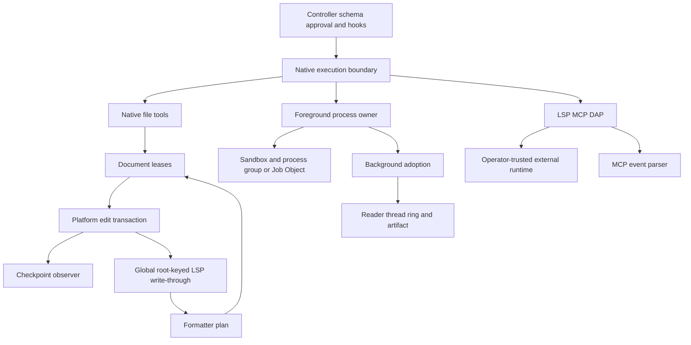

### A3-01 — MCP SSE events are unbounded despite individual line limits

- **P1 · Confirmed / source · high confidence.** `src/tools/mcp/http.rs:595-633` appends each `data:` field to an unbounded vector; the GET stream uses `limit(u64::MAX)` (`415-424`). Cancellation is checked at completed-event delivery, not during accumulation.
- **Trigger/consequence:** a configured server sends indefinitely many short legal `data:` lines without an empty event terminator. Aggregate memory grows until failure, including while shutdown is requested. The per-line cap does not bound an event.
- **Proposed change:** enforce cumulative event bytes/field count before allocation, check cancellation during incremental parsing, and close malformed/oversized streams with an explicit transport failure.
- **Acceptance:** aggregate-over-budget multiline input fails with bounded `InvalidData`, including without a final blank line; cancellation between lines releases transport; preserve CRLF/multiline semantics. Existing tests at `http.rs:655-679` cover assembly/event names, not aggregate exhaustion.

### A3-02 — Background capture readers outlive their job indefinitely

- **P2 · Confirmed / source · high confidence.** `src/tools/background/table.rs:163-241,515-545,661-668` sets a process stop flag but does not give it to `spawn_reader`; pipe reads block and PTY `WouldBlock` retries can continue. `finish_reader` waits 300 ms then drops an unfinished thread handle. Completion requires `ring.closed` (`601-612`).
- **Trigger/consequence:** a POSIX descendant escapes the original process group/session and retains stdout/PTY, on macOS or an explicitly unsandboxed execution. Killing/dropping the job can leave Dial's reader, spool and ring alive, and never publish completion. The documented limitation on escaped descendants does **not** require leaking Dial-owned resources.
- **Proposed change:** owner-cancellable/nonblocking readers, bounded post-kill drain, close read side, finalize incomplete artifact and join. Reuse foreground bounded drain (`src/tools/shell.rs:582-613`). Correct the stronger guarantee at `src/tools/background/mod.rs:10-14` only together with an explicit contract.
- **Acceptance:** controlled `setsid` writer retains output; drop/kill finishes reader within the grace bound, produces one terminal notification and a retrievable partial artifact; repeated cycles do not grow resources. Clean up the escaped fixture child explicitly. Existing ordinary-descendant test (`background/tests.rs:450-487`) does not establish this boundary.

### A3-03 — Workspace-global LSP write-through bypasses forked session ownership

- **P2 · Confirmed / source · high confidence.** `src/tools/lsp/mod.rs:44-69,1370-1382`, `src/tools/ext.rs:317-338` and `src/tools/edit_transaction.rs:43-44` show fresh forked client/action state, but native commits consult global `WRITE_THROUGH[workspace_root]`. Only initial `lsp::tools(config)` registers there, not the fork.
- **Trigger/consequence:** child starts its own server and edits, or two registries share a root with different config. Formatting/diagnostics use the parent or most recently registered service rather than the executing owner. Child cancellation targets its own running map (`lsp/mod.rs:1363-1367`), not the foreign service used by write-through. This is an ownership defect, not a demonstrated workspace escape.
- **Proposed change:** attach post-commit LSP services to the execution/workspace owner; preserve fresh-session lifecycle and the existing observer. If sharing is desired, make it explicit and multiplexed rather than last-registration-wins.
- **Acceptance:** distinguishable parent/child fake-server diagnostics and settings; child edits reach only the intended owner; cancelling/dropping one owner does not affect another; same-root and copy-isolated cases both behave correctly.

### A3-04 — Format-on-write recursively formats its own commits

- **P2 · Confirmed / source · high confidence.** Cycle: `src/tools/lsp/mod.rs:217-245` requests formatting and commits a plan → `src/tools/lsp/workspace_edit.rs:497-535` uses the native transaction → `src/tools/edit_transaction.rs:18-48` calls write-through again. Reentrant document leases do not break this cycle.
- **Trigger/consequence:** format-on-write is enabled and a server returns changed content on every pass (toggle or changing generated text). Repeated requests/commits continue until error, cancellation or resource/stack exhaustion. Idempotent formatters stop because unchanged results are omitted (`workspace_edit.rs:428-439`), not because there is an explicit bound.
- **Proposed change:** separate notification from formatting or mark formatter-origin commits to suppress recursive formatting. Keep final synchronization/diagnostics and checkpoint observation. If multipass is intended, make it iterative and strictly bounded.
- **Acceptance:** toggling fake formatter returns after a bounded number of requests; idempotent format applies once; formatting failure reports the original committed edit honestly; formatter edits remain observed/checkpointed.

### A3-05 — Idle MCP event listeners have no bounded shutdown lifetime

- **P2 · Confirmed / source · high confidence.** `src/tools/mcp/http.rs:356-420,473-510,536-556` spawns listeners retaining `Arc<Http>`/protocol state; GET/body reads have no shutdown handle or finite read deadline. Stop flags are observed only after events, and listeners are not joined.
- **Trigger/consequence:** server accepts SSE then stays idle, or legacy startup never announces the endpoint. Caller timeout/cancellation returns while a thread/socket/state graph survives; reconnect/replacement repeats the leak. Unlike A3-01, this requires no incoming data.
- **Proposed change:** own a cancellable socket/transport or a finite lifetime with explicit reconnect semantics. Caller timeout is not cleanup. Session-end DELETE remains best effort, not the only way to release an unresponsive stream.
- **Acceptance:** fake endpoint sends headers then stalls; cancelled startup and session drop release listener/socket within a bound; repeated failures remain bounded; preserve legacy endpoint/session semantics.

### A3-06 — Named embedded-shell sessions busy-poll after auto-background deadline

- **P2 · Confirmed / source · high confidence.** `src/tools/shell.rs:503-508` permits adoption only when `session.is_none()`, but `563-575` always includes the adoption deadline in wait budgeting. `src/tools/execution.rs:157-164` forwards the configured threshold for named sessions too.
- **Trigger/consequence:** a named session lasts beyond a nonzero automatic-background threshold. It correctly stays foreground, but `saturating_sub` repeatedly yields zero waits, producing CPU-intensive polling until completion.
- **Proposed change:** derive one effective adoption deadline only when adoption is allowed; use it for both eligibility and waiting.
- **Acceptance:** instrument wait durations or a pure deadline helper; named sessions beyond the threshold retain state without zero-timeout loops, unnamed commands still adopt, and cancellation/deadline latency remains bounded. Avoid host-dependent CPU assertions.

### A3-R1 — Hard-cancel versus adoption ordering needs controller-level proof

**P2 · Risk / [INFERENCE].** `src/tools/shell.rs:503-534` checks adoption before hard cancellation. If both become true in one iteration, this routine transfers the live child and returns adoption success; `src/tools/execution.rs:93-125` aggregates facts but does not itself kill that child. The enclosing controller may still clean it up, so **survival across session cancellation is not established**. Add simultaneous hard-cancel/steering and hard-cancel/threshold tests asserting the documented policy and eventual owner cleanup.

### Documentation and contract findings

- **A3-D1 · P3:** qualify sandbox prose (`ARCHITECTURE.md:62-70`, `src/tools/mod.rs:6-7`) as **no implicit unsandboxed fallback**. An explicit operator opt-out exists at `src/tools/mod.rs:485-488`; that is a separate trust mode, not proof of approval bypass.
- **A3-D2 · P3:** background bounded-drain/incomplete-output prose (`src/tools/background/mod.rs:10-14`) exceeds the A3-02 implementation. Make the guarantee executable.
- **A3-D3 · P3:** LSP description (`src/tools/lsp/mod.rs:251-255`) says create/rename/delete resource edits are refused, while `workspace_edit.rs:320-325` dispatches them and `src/tools/lsp/tests.rs:510-559` covers transactions. Reconcile model-facing description, policy and implementation; do not silently broaden permission through a prose-only edit.

### Ideal flow and actionable changes

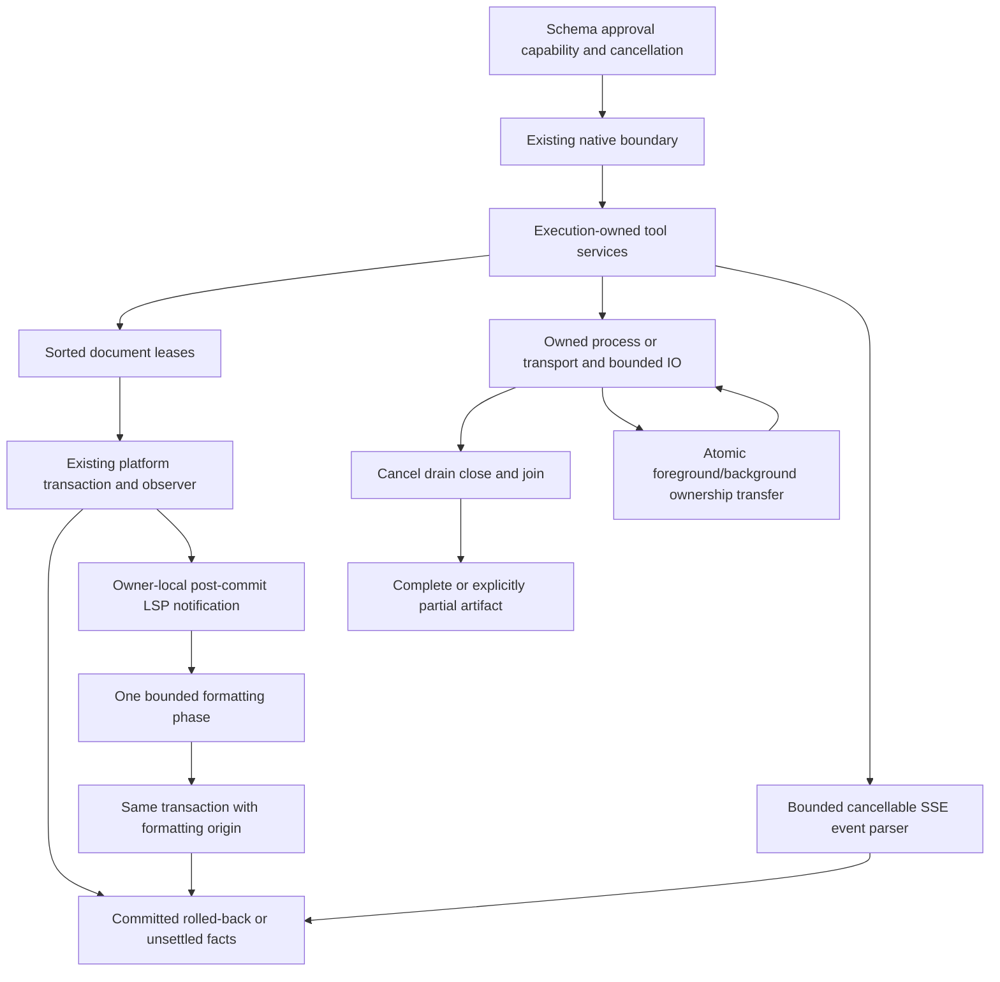

The cohesive work is owner association and finite lifetimes, not a universal new execution framework. A3-03/A3-04 share the native post-commit boundary; A3-01/A3-05 share transport ownership but require separate event-budget and idle-shutdown fixes. A3-02 ties directly to worker teardown liveness from audit 2.

- [ ] **A3-01** Bound full MCP events and incremental cancellation.
- [ ] **A3-02, A3-05** Close/join capture and transport resources independently of external EOF.
- [ ] **A3-03, A3-04** Make write-through owner-local and formatting nonrecursive.
- [ ] **A3-06** Share effective adoption deadline calculation.
- [ ] **A3-R1** Resolve hard-cancel/adoption precedence with end-to-end ownership evidence.
- [ ] **A3-D1–D3** Align documented trust and resource-operation contracts with tested behavior.

**Report update 3:** completed tool/security/process pass; added six source-confirmed defects, a separately qualified cancellation risk, three documentation findings, relationship diagrams and concrete regression criteria. No claim is made that platform security or these regressions were executed.

## 4. Persistence, provenance, learning and recovery audit

### Coverage and ownership

Deeply traced atomic publication/locks, session ownership/append/flush/reclamation/recovery/relocation, checkpoints, runtime bodies and execution/cancellation facts, provenance revisions and source freshness, harvest admission/splitting/torn-tail recovery, held-out gating and activation transactions, immutable training snapshots, compute handoff/accounting, steering promotion and benchmark resume/scoring. Sampled archive/retention/history, local and managed memory backends, exercise registration and adjacent tests.

Not exhaustive: all session FTS/media retention, dump/export/share/GC, semantic/Hindsight/Sharpshooter backends, platform private-directory implementations, full Python training algorithms or weight-integrity execution. No crash injection, permission experiment, multiprocess race, oversized-stream probe or real training was executed. Exact prompt/group separation does not prove semantic held-out disjointness.

| Owner                                                                  | Inspected responsibility and invariant                                                                                                                                                       |
| ---------------------------------------------------------------------- | -------------------------------------------------------------------------------------------------------------------------------------------------------------------------------------------- |
| `src/storage/session.rs:792-820,2022-2035`                           | Claim the real journal before parsing; partial append removes writer ownership before returning.                                                                                             |
| `src/runtime.rs:95-108,202-210`                                      | Journal changes before exposing body revisions; failed publication remains visible.                                                                                                          |
| `src/storage/session.rs:2295-2315` → stream reclamation             | Main-journal `sync_data` precedes durable revision acknowledgements. Ordinary visible appends are not all independently fsynced.                                                           |
| `src/storage/session.rs:2318-2381`                                   | Recover active branch, reserve abandoned IDs, connect reachable stream parents and mark unfinished bodies interrupted.                                                                       |
| `src/storage/atomic.rs:65-95,104-129`                                | Separate private/workspace/checkpoint policies; reject private-target links/foreign ownership and sync directory on Unix. Atomic file replacement is not a transaction across several files. |
| `src/storage/checkpoint.rs:407-440,574-596`                          | Original bytes precede manifest/public mutation; restore validates added-root membership.                                                                                                    |
| `src/storage/provenance.rs:289-359`                                  | SQLite transactions, revision-qualified corrections, history, expiry and logical deletion; do not promise physical erasure.                                                                  |
| `src/storage/codebase.rs:753-819,877-927,1291-1317`                  | Recheck source/dependency scope and expected revision; freshness is not behavioral verification.                                                                                             |
| `src/storage/memory_backend/local.rs:97-116,169-189,248-265`         | Redact before persistence; commit extraction only with matching lease and source digest.                                                                                                     |
| `src/storage/memory_backend/managed.rs:159-174,261-290`              | Immutable generation staging plus SQLite revision/transaction publication; clean uncommitted staging.                                                                                        |
| `src/learn/harvest.rs:118-196,251-342`                               | External outcomes and repair evidence have distinct admission; connected groups constrain train/validation crossover.                                                                        |
| `src/learn/improve.rs:1001-1043` → `src/storage/store.rs:483-565` | Bounded immutable train/validation inputs; lineage/active-baseline CAS; activation, audit and consumed training window commit together.                                                      |
| `src/learn/gate.rs:368-454,531-569`                                  | Distinguish infrastructure/model failures, bound paired exclusions, abort unknown/fatal failures; incomplete evaluation is not a pass.                                                       |
| `src/learn/compute.rs:55-76,169-216`                                 | Live locks determine pending ownership; foreground handoff discards/retries partial background generation.                                                                                   |
| `src/steering.rs:95-117,172-195,445-473`                             | Pending/active leases, exact-strength evaluation and regression checks precede promotion; failed automatic replacement preserves incumbent.                                                  |
| `src/benchmark.rs:876-979`                                           | Frozen source, per-case isolation, explicit unavailable checks and successful-agent completion in result eligibility.                                                                        |

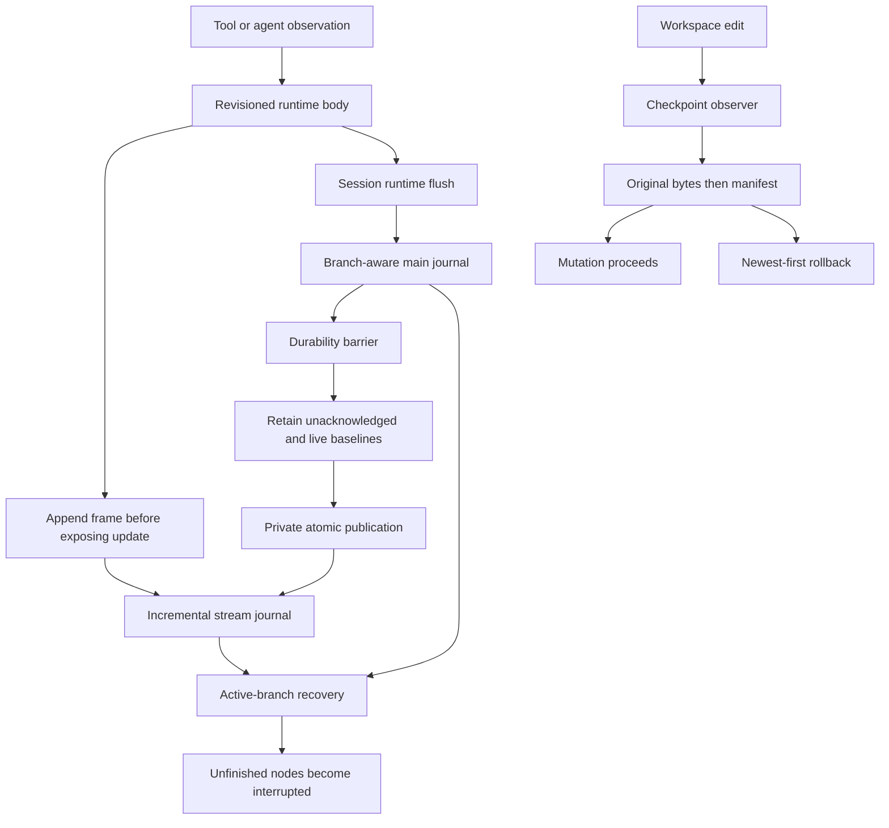

```mermaid
flowchart LR
    Live[Live trajectories and exact requests] --> Outcomes[External outcomes or validated repair]
    Practice[Isolated practice verifier] --> Outcomes
    Outcomes --> DB[Per-model learning store]
    DB --> Harvest[Screen group deduplicate split]
    Harvest --> Dataset[Training and validation JSONL]
    Dataset --> Snapshot[Immutable bounded snapshot]
    Snapshot --> Candidate[Harness or adapter candidate]
    Candidate --> Gate[Paired held-out and regression gate]
    Gate --> CAS[Transactional baseline CAS]
    CAS --> Active[Admitted version and watermark]
    Active --> Serving[Serving selection and runtime confirmation]
    Archives[Archived sessions] --> Advice[Advisory memory]
    Sources[Current source identity] --> Advice
    Advice -. not proof or success labels .-> Live
```

### A4-01 — Benchmark resume forgets nonsecret token-budget changes

- **P2 · Confirmed / source · high confidence.** `src/benchmark/records.rs:75-116` recursively strips keys containing `token`/`env` before computing config digest; `134-174` accepts equal contracts and reuses completed cases. The real caller supplies serialized `Config` (`src/cli/benchmark/mod.rs:178-190`).
- **Trigger/consequence:** resume after changing only `harness.max_tokens`. That legitimate execution limit is scrubbed, so the digest can stay equal and old/new-budget cases are mixed under one purported contract. Privacy redaction has erased evaluation identity.
- **Proposed change:** typed credential-free execution config or precise secret exclusions. Retain all outcome-affecting limits; reuse `Contract`/`Recorder` and private publication.
- **Acceptance:** token-budget changes (including nested ones) alter the digest and reject resume; API-key-only changes do not expose credentials or unnecessarily change the public contract. Preserve existing credential-omission coverage (`records.rs:214-240`).

### A4-02 — Retrying partial multi-turn rollback can reintroduce an undone edit

- **P2 · Confirmed / source · high confidence.** `src/storage/checkpoint.rs:485-510` retains failed newer manifests but proceeds to older manifests; successful entries within the retained manifest are not marked consumed. Added-root detachment provides a recoverable failure (`580-587`); retry restores originals again (`600-615`).
- **Concrete trigger:** A starts at A0; turn 1 writes A1; turn 2 writes A2 and B in an added root. Detach B's root and roll back two turns: turn 2 restores A1 but fails B and remains; turn 1 restores A0 and is deleted. Reattach the root and retry the retained turn: it restores A1, undoing the already successful rollback to A0.
- **Proposed change:** conservatively stop traversing older manifests after any selected manifest fails. If cross-turn partial progress is required, persist a per-entry consumption/rollback plan making retry idempotent. Reuse the existing restore engine.
- **Acceptance:** detached-root scenario cannot move A0 back to A1; repeat across restart; test single-turn retry and checkpoint-directory deletion failure. Existing tests cover normal multistep rollback (`808-864`) and single-manifest detached roots (`1023-1055`), not their composition.

### A4-03 — Torn multibyte UTF-8 prevents harvest's intended tail recovery

- **P2 · Confirmed / source · high confidence.** `src/learn/harvest.rs:98-99,1118-1129` reads existing digests with `read_to_string` before handling an unterminated record. Byte-oriented truncation exists later (`1161-1169`) but is unreachable after UTF-8 decode failure.
- **Trigger/consequence:** a crash/short write cuts the last JSONL record inside a multibyte character. Every later harvest fails before repairing the tail, even though earlier records are valid.
- **Proposed change:** delimit records as bytes, strictly decode complete records, repair/discard only a malformed unterminated final record. Share this policy between digest scanning and append; preserve fail-closed interior corruption.
- **Acceptance:** truncate after every byte of 2/3/4-byte characters; keep all complete records and accept the next append; preserve complete JSON missing only newline; reject malformed complete/interior records without rewriting; cover train and validation files. Existing recovery tests (`2175-2200`) use torn ASCII, not invalid UTF-8.

### A4-04 — Stream reclamation's helper limit can poison a valid live session

- **P2 · Confirmed / source · high confidence.** `src/runtime/stream_journal.rs:37,232-260` starts reclaiming at 4 MiB, retains every running baseline and publishes them together through a private-file helper; `src/storage/atomic.rs:67-70` rejects files above 8 MiB. Non-worker body text has no corresponding aggregate limit (`src/runtime.rs:175-210`). Reclamation error is latched, blocking body updates (`95-108`) and normal session appends (`src/storage/session.rs:2078-2097,2275-2283`).
- **Trigger/consequence:** several individually valid running bodies (for example three roughly 3 MiB bodies) flush to valid individual main-journal entries but require an aggregate retained baseline above 8 MiB. Optional reclamation hits an unrelated settings-style whole-file limit and turns into a permanent journal failure. Typical-workload frequency was not measured.
- **Proposed change:** define a stream-owned capacity contract. Defer reclamation without poisoning a still-usable writer when retained data cannot fit, or use a dedicated bounded streaming publisher. Do not remove the generic private-state cap for every caller. Keep fsync-before-reclaim.
- **Acceptance:** aggregate live baselines above 8 MiB survive append/settle/flush/reopen with revisions intact; capacity refusal does not block unrelated messages; real I/O/fsync failures still fail visibly/closed.

### A4-05 — File-absence verifier treats inaccessible files as successfully deleted

- **P2 · Confirmed / source · high confidence.** `src/learn/verify.rs:88-90` treats every `symlink_metadata` error as absence; confinement also fails to reject metadata errors while walking (`121-127`). Curriculum uses this verifier (`src/learn/curriculum.rs:2193,2717`).
- **Trigger/consequence:** a still-existing target is under a non-searchable directory for a normal non-root account. Metadata returns `PermissionDenied`, but deletion verification passes. Inaccessible evidence can become a successful learning/evaluation outcome.
- **Proposed change:** only definite `NotFound` proves absence; other errors yield false or an explicitly unavailable check. Keep confinement errors separate.
- **Acceptance:** missing passes, existing fails, permission/I/O errors never pass, symlink components remain rejected. Restore fixture permissions before cleanup; use injected metadata or explicitly skip privileged real-permission cases. Nearby tests (`verify.rs:255-305`) establish normal absence, not error classification.

### A4-06 — Concurrent compute settlement loses usage when compute locks are disabled

- **P2 · Confirmed / source, conditional configuration · high confidence.** `src/learn/resources.rs:189-200` does read-add-atomic-replace without a lock. `src/learn/compute.rs:284-303,326-338` still accounts leases with `compute_locks=false` but without exclusive compute ownership. Daily admission consults persisted usage plus the current thread's lease (`src/learn/auto.rs:73-78`).
- **Trigger/consequence:** two background leases sharing a user directory settle concurrently, both read U and publish U+A/U+B. Last replacement omits one job, undercounting daily usage and permitting excess work. Default exclusive compute ownership mitigates the enabled-lock path; this is not a claim that all jobs race.
- **Proposed change:** lock `compute-usage.json` read-modify-write with the existing stable settings lock, independently of optional scheduling exclusion. Decide corrupt-state handling explicitly instead of silently treating corruption as zero.
- **Acceptance:** deterministic concurrent threads and separate processes with compute locks disabled produce U+A+B; preserve rollover and error behavior. Atomic file validity alone is insufficient.

### A4-07 — Oversized stream row silently hides all following valid frames

- **P2 · Confirmed / source · high confidence.** `src/runtime/stream_journal.rs:285-294` reads at most 32 MiB and breaks when that chunk lacks newline, conflating a cap hit with an actual torn EOF tail. Publication has no matching serialized-frame bound (`176-185`); reclamation retains only recovered nodes (`228-251`).
- **Trigger/consequence:** a row above 32 MiB precedes valid terminated frames. Recovery reports success without reading the later frames; subsequent reclamation can permanently erase that unseen suffix. The row may be corrupt or an oversized unbounded snapshot.
- **Proposed change:** distinguish capped partial scan from true EOF. Explicitly drain/skip an oversized row with a defined error policy, or fail closed and preserve the stream. Never compact a source whose scan was incomplete.
- **Acceptance:** oversized malformed and valid rows followed by valid snapshots/deltas; true torn final row still recovers prefix; no reclamation erases unexamined records.

### A4-D1 — Automatic steering's documented switch differs from its tested policy

**P3 · Documentation/intent conflict, not counted as an accidental implementation defect.** `docs/improvement.md:420-424` describes automatic-vector control as governing creation and use, while `src/steering.rs:208-241` permits an automatic-origin admitted vector when `enabled=true, automatic=false`; `875-889` explicitly tests that policy. Clarify whether manual enable means using the selected admitted vector regardless of origin. Align docs/UI with the deliberate decision rather than changing a tested policy by assumption.

### Ideal data flow and actionable changes

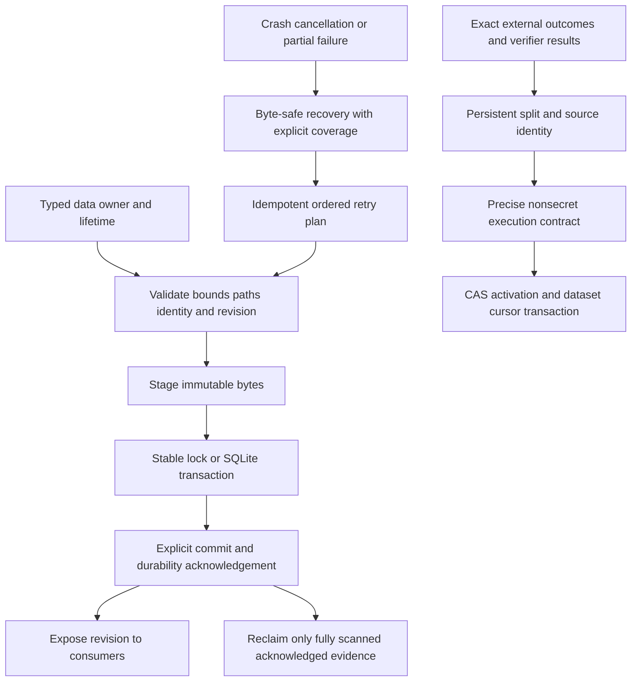

A4-01/A4-05 protect evaluation integrity before improving models. A4-02/A4-03 make recovery repeatable rather than merely best effort. A4-04/A4-07 must be addressed together as stream capacity, scan-completeness and reclamation contracts. A4-06 separates accounting serialization from scheduling policy. Existing owner-specific publication helpers are appropriate; a generalized new persistence platform is unnecessary.

- [ ] **A4-01, A4-05** Preserve exact evaluation configuration and reject unavailable evidence as success.
- [ ] **A4-02, A4-03** Make rollback retries ordered/idempotent and JSONL tail recovery byte-safe.
- [ ] **A4-04, A4-07** Align stream limits and preserve data when recovery/reclamation is partial.
- [ ] **A4-06** Serialize usage accounting in every compute-lock mode.
- [ ] **A4-D1** Resolve the documented steering-switch contract without weakening admission.

**Report update 4:** completed persistence/learning pass; added seven source-confirmed defects, one explicit intent/documentation conflict, three relationship/data-flow diagrams and implementation acceptance criteria. Existing Python/offline benchmark passes do not reproduce these Rust recovery scenarios.

## 5. External runtimes, protocols, collaboration and presentation audit

### Coverage and preserved boundaries

Inspected RPC control/admission/cancellation/cache paths, ACP session/resource/event mapping, collaboration host/guest/socket/relay/crypto/protocol, browser relay authentication/session lifecycle/discovery and extension background worker, selected terminal bridge/transcript/sanitizer paths, computer supervisor/Node transport, voice capture/dictation/live/STT/process ownership, and Python protocol/grammar/thinking entrypoints. Narrow caller traces in commands, agent delegation and managed runtime launch validated the cross-boundary findings.

Not exhaustive: every terminal overlay/event combination, collaboration registry persistence, every CDP route, Python training/vision-cache internals, native desktop backends, every voice backend, or the full output spool. No Chrome/Playwright/extension, ACP client, rendered terminal/PTY, remote TLS deployment, real microphone/STT, native accessibility/screen-capture API, MLX inference/LoRA training or Laya checkpoint loading was exercised. Portable Python tests are not hardware integration proof.

| Owner / boundary        | Inspected safeguards and relationships                                                                                                                                                                                                                                   |
| ----------------------- | ------------------------------------------------------------------------------------------------------------------------------------------------------------------------------------------------------------------------------------------------------------------------ |
| RPC / ACP               | One RPC actor, bounded input lines/command queue, separate abort/approval/query handling; approval IDs match pending requests (`src/rpc.rs:1443-1464`). ACP checks bridges/cwd and uses `open_beneath` for local resources (`src/acp.rs:205-218,299-341,431-455`). |
| Runtime → terminal     | Shared bodies bind through `src/app.rs:9511-9527` and `src/ui/transcript.rs:700-740`; `src/ui/text.rs:9-91` sanitizes split escape sequences statefully.                                                                                                           |
| Collaboration           | Relay rewrites peer IDs and bounds recipient queues/stalled writes (`src/collab/server.rs:249-287,299-331`). Host gates steering on write token and operator setting (`host.rs:51-59,295-315`); plaintext remote links are refused (`protocol.rs:69-90`).          |
| Browser relay           | Token checked before routing; CDP Origin rejected and extension Origin checked (`src/browser_relay/server.rs:84-125,240-277`). Probe clients disable proxies/redirects and have deadlines (`client.rs:74-81`).                                                       |
| Computer                | Existing generations, frame/write limits, cancellation grace and process-group ownership are valuable; fake-worker tests (`src/computer/supervisor.rs:1052-1139`) cover stalled/partial transport, not asynchronous cross-generation callbacks.                        |
| Voice                   | `src/voice/process.rs:92-130` reuses shared bounded process policy; cancellation semantics above that primitive are the issue below.                                                                                                                                   |
| Python inference        | Rust embeds pinned helpers and launches loopback services with parent-PID ownership (`src/llm/server.rs:465-487,651-705`). Malformed tool arguments become non-executable null rather than invented empty objects (`python/dial_server.py:184-215`).                 |
| Python worker / grammar | Eight-MiB request cap, parent-death watcher, diagnostic fd redirection and finite JSON result (`python/dial_worker.py:17-32,1133-1174`). Grammar documents unsupported constraints and authoritative Rust validation (`python/dial_tool_grammar.py:13-22`).          |

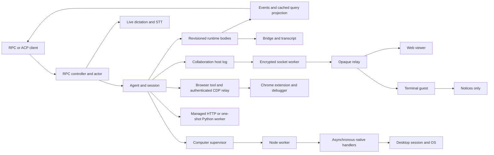

### A5-01 — Computer native replies can cross worker generations

- **P1 · Confirmed / source · high confidence; race not executed.** `src/computer/supervisor.rs:588-635` checks incoming generation but dispatches handlers without it; `782-808` retrieves the current desktop session inside the new thread; `816-828` sends through whichever worker is current. Termination removes the old session/worker without joining these handlers (`967-996`). Each Node process resets `nativeSeq` and correlates only by `native-N` (`src/computer/js/worker.mjs:93-115`).
- **Trigger/consequence:** generation 1's handler is delayed, timeout restarts the worker, and generation 2 reuses the request ID. The old completion can settle the new promise, or the delayed old handler can obtain the replacement desktop session. Even an old cancellation error can fail an unrelated new request; post-cancel OS mutation need not be demonstrated to establish miscorrelation.
- **Proposed change:** capture generation/session at admission, bind response to that generation's writer, discard stale replies, and carry cancellation into handlers. Reuse `Worker.generation`, `stopped` and existing generation-filtered reply patterns.
- **Acceptance:** hold generation-1 response/handler, restart, issue identical ID in generation 2, release old work; no stale result resolves the new promise and no old handler uses the replacement session. Extend the fake-worker harness (`supervisor.rs:1023-1049`).

### A5-02 — RPC voice abort ignores transcription cancellation

- **P1 · Confirmed / source · high confidence.** `src/rpc.rs:866-873` passes interrupt through `src/voice/live.rs:74-77`, but `src/voice/dictation.rs:92-105,117-124` supplies an always-false flag to segment/final transcription. STT timeout can reach 3,600 seconds (`src/voice/stt.rs:175-209`); RPC control fails after ten seconds of cancellation and exits after further cleanup timeout (`src/rpc.rs:1236-1243,1638-1645`).
- **Trigger/consequence:** abort live listening during stalled STT or before final speech flush. Capture can stop while STT ignores abort, tripping process-level cleanup instead of leaving the RPC session usable. Push-to-talk **key release** intentionally flushes speech; protocol **abort** is not the same operation (`docs/voice.md:48-50`).
- **Proposed change:** distinguish finish-recording-and-transcribe from cancel-operation. Preserve held-key release, propagate real abort to STT and skip final transcription after cancellation; reuse existing cancellable process/HTTP primitives.
- **Acceptance:** fake recorder plus stalled transcriber; RPC abort stops promptly, never starts a turn from partial text and leaves `state`/next request usable. Independently retain release-to-transcribe behavior.

### A5-03 — Terminal collaboration guest discards conversation replication

- **P2 · Confirmed / source · high confidence.** Host sends welcome/snapshot (`src/collab/host.rs:263-292`), live entries and reset (`118-133`). `src/collab/guest.rs:45-69,78-100` handles only welcome/notice/error/bye; `src/collab/room.rs:24-30` exposes notices, displayed by `src/app.rs:3141-3146`. `/join` installs this guest (`src/commands/collab.rs:249-262`).
- **Trigger/consequence:** terminal joins successfully but never projects historical/subsequent conversation or rewind. The guest also exposes no prompt/abort sending method, so writable status does not provide functional remote terminal steering.
- **Proposed change:** typed replica reducer for snapshot/entry/reset, separate from the local writable session. Implement remote prompt/abort routing or explicitly present the supported terminal surface as read-only; do not claim writable support that silently runs local turns.
- **Acceptance:** join after two messages, project history exactly once, receive a new entry and rewind/reset replay; ensure guest input targets the advertised owner rather than silently becoming local-agent work.

### A5-04 — Delayed browser attachment resurrects a disconnected client's session

- **P2 · Confirmed / source · high confidence.** Requests run independently of the socket loop (`src/browser_relay/server.rs:369-375`). Disconnect removes currently registered sessions (`src/browser_relay/bridge.rs:303-317`); attach waits outside the lock and later checks only tab existence before inserting a client-owned session/refcount (`550-579`). Detach depends on releasing that refcount (`1011-1045`).
- **Trigger/consequence:** client sends `Target.attachToTarget`, disconnects, then extension reply succeeds. Completion installs an orphan owner/session after disconnect cleanup already ran, retaining debugger attachment state.
- **Proposed change:** revalidate client and extension generation before committing; release successful orphan attach when no live owner needs it. Use a per-tab attach reservation for concurrent first attachments.
- **Acceptance:** delay fake extension response until after client disconnect; no orphan session/refcount and appropriate detach. Also exercise simultaneous clients attaching one initially unattached tab.

### A5-05 — Browser relay lacks slow-consumer and request-fanout bounds

- **P2 · Confirmed / source · high confidence.** `src/browser_relay/server.rs:291-308` sets read but not write timeout with default WebSocket config; `349-375,396-407` uses unbounded output channels and a thread per request. Extension pending RPCs have no admission cap (`src/browser_relay/bridge.rs:984-1003`).
- **Trigger/consequence:** authenticated CDP client stops reading events or floods extension-bound commands. Blocked writes pin socket threads while queues, threads and pending calls grow. This is local/authenticated availability risk, not an unauthenticated remote execution claim.
- **Proposed change:** byte/frame/in-flight budgets, finite stalled-write handling and explicit overload/disconnect scoped to the offending client. Reuse collaboration's bounded recipient queue and write-deadline design (`src/collab/server.rs:22-27,71-75,249-287`).
- **Acceptance:** stalled recipient/flood cannot exceed configured memory/work limits or disrupt healthy peers; overload has an explicit result instead of unbounded thread creation.

### A5-06 — Collaboration snapshot batches evade byte accounting

- **P2 · Confirmed / source · high confidence.** Each hello clones serialized history (`src/collab/host.rs:286-287`); `snapshot_chunks` owns that vector although frame production is lazy (`src/collab/protocol.rs:269-287`). `Pending::Batch` reports zero retained bytes (`src/collab/socket.rs:100-122`), then enters a count/byte-bounded queue (`222-252`).
- **Trigger/consequence:** multiple guests or repeated hellos queue snapshots while a large history drains slowly. The 16 MiB byte limit ignores each retained history copy; the 256-item limit can still permit roughly 256 such copies. Lazy serialization is not bounded retained memory.
- **Proposed change:** immutable shared snapshot storage/cursors or truthful retained-byte charging; coalesce/reject repeated pending admission for a peer.
- **Acceptance:** repeated admissions with a large history and stalled transport stay within retained-memory budget; preserve snapshot order, exactly-once reduction and final markers.

### A5-07 — RPC polling cache stays stale after idle/background mutations

- **P2 · Confirmed / source · high confidence.** `QueryProjection` is materialized JSON (`src/rpc.rs:574-578`). Idle pumping (`744-787`) can mutate worker/runtime/messages via `src/agent/delegation.rs:6-45` without refreshing it; refresh happens after worker commands (`rpc.rs:1153-1154`). `state`/`messages`/`messages_page` answer directly from cache (`1276-1314`).
- **Trigger/consequence:** launch a delayed background worker then only poll state. Idle pumping finishes it, but polling can retain running state indefinitely until an unrelated actor-handled command refreshes the cache. Idle compaction can similarly stale messages. Push events and snapshots disagree.
- **Proposed change:** publish projection after idle mutation, preferably by revision/dirty signal rather than cloning history every 100 ms. Preserve the single canonical projector.
- **Acceptance:** delayed task completes with no status/other actor command; state polling converges to terminal phase/revision. Add idle-compaction cache coverage.

### A5-08 — Collaboration steering is unbounded beyond the transport queue

- **P2 · Confirmed / source · high confidence.** `src/collab/host.rs:43-46,247-258,295-315` accumulates valid prompts/aborts in a plain vector without count/byte limits. During active turns only aborts are removed (`184-189`); running-turn pumping admits frames (`src/app.rs:9383-9388`) while prompts await idle.
- **Trigger/consequence:** when guest steering is explicitly enabled, a writable guest supplies prompts faster than a long-running turn settles. Bounded socket queues do not bound the drained application queue.
- **Proposed change:** independent steering count/byte and individual-prompt limits, coalesced aborts, explicit overload replies. Reuse RPC admission (`src/rpc.rs:1345-1357`) with byte accounting.
- **Acceptance:** prompt flood during stalled turn stays within fixed budget, rejects excess visibly, and preserves abort responsiveness.

### Separate threat-model and integration risks

- **A5-R1 · P2 · Conditional security mechanism:** AES-GCM authenticates ciphertext but no replay/sequence state is retained (`src/collab/crypto.rs:65-98`, `src/collab/socket.rs:653-672`). Valid replayed commands are processed (`src/collab/host.rs:263-315`). A compromised relay could replay captured ciphertext without knowing the key. **[INFERENCE]** Deployment exposure depends on whether the relay is trusted for integrity. Define that assumption; if not trusted, authenticate role/epoch/command identity, maintain replay windows and deduplicate execution. Test identical-ciphertext and old-epoch replay.
- **A5-R2 · P2 · Integration hypothesis:** Rust clears attachment bookkeeping on extension disconnect (`src/browser_relay/bridge.rs:952-974`) while extension reconnect does not explicitly detach/reconcile debugger ownership (`assets/browser-extension/background.js:165-174`; attach at `80-87`). Whether Chrome rejects reattach depends on actual runtime semantics. Test real attached-tab disconnect/reconnect; do not report a confirmed Chrome failure yet.
- **A5-R3 · P2 · Integration hypothesis:** web collaboration viewer has no reconnect reducer and uses independent async decrypt handlers (`assets/collab-web/index.html:21-39`). Out-of-order WebCrypto completion was not demonstrated. Test ordering, reconnect and reset under delayed decrypt, then introduce sequence-aware serialized reduction if needed.
- **A5-R4 · P3 · Latent correlation weakness:** ACP maps by tool name (`src/acp.rs:684-720`) despite RPC call IDs. Ordinary parallel execution presents callbacks serially (`src/agent/turn.rs:1754-1835`), so two reads alone do **not** establish corruption. Test nested/interleaved callbacks before promoting the risk; prefer stable call IDs if overlap is supported.
- **A5-D1 · P3 · Documentation conflict:** `docs/collab.md:3` and crypto prose describe fragment-only keys, but `src/collab/protocol.rs:93-108` formats compact `/r/id.key` links. Parsed socket URLs strip the secret, so this is not proof that current clients send keys to the relay. Explain application links versus browser fragment wrappers and test key-free network URLs.

### Ideal architecture and implementation queue

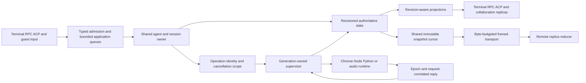

Use existing RPC/queue/process/generation primitives; do not introduce a universal adapter framework. A5-01/A5-04 share stale-owner publication, A5-02 needs distinct cancellation semantics, A5-03/A5-07 require consistent projections, and A5-05/A5-06/A5-08 show why every queue layer needs its own truthful budget.

- [ ] **A5-01, A5-02** Fix generation binding and true abort semantics with fake-runtime regressions first.
- [ ] **A5-03, A5-07** Implement typed guest replication and revision-aware idle projections.
- [ ] **A5-04, A5-05, A5-06, A5-08** Enforce owner validation and retained-byte/in-flight limits across transport and application layers.
- [ ] **A5-R1** Decide relay integrity trust and implement/test replay resistance if required.
- [ ] **A5-R2, A5-R3, A5-R4** Exercise Chrome reconnect, viewer ordering and interleaved ACP callbacks before changing behavior on speculation.
- [ ] **A5-D1** Correct link/key documentation without weakening secret isolation.

**Report update 5:** completed external-runtime/surface pass; added eight source-confirmed defects, four qualified risks, one documentation conflict, current/target flow diagrams and regression criteria. All five audit sections are now complete.

## Consolidated architecture assessment — initial audits 1–5

### Finding inventory

| Audit           |         Main prioritized findings | Additional separately tracked items                                             |
| --------------- | --------------------------------: | ------------------------------------------------------------------------------- |
| 1               | 5 (including one CI coverage gap) | Package-manager lag explicitly distinguished from a source-package mismatch     |
| 2               |                                 5 | Cooperative teardown and worker-completion/merge semantics qualified separately |
| 3               |                                 6 | 1 cancellation risk; 3 documentation/contract items                             |
| 4               |                                 7 | 1 steering intent/documentation conflict                                        |
| 5               |                                 8 | 4 threat-model/integration risks; 1 documentation conflict                      |
| **Total** |        **31 main findings** | **Not 31 runtime-reproduced bugs**                                        |

There are four P1 main findings (A1-03, A3-01, A5-01, A5-02), twenty-six P2 main findings (including the Windows coverage gap), and one P3 main finding (A1-05). Severity is triage, not proof of exploitability or frequency. Related symptoms remain separately tracked when they require different acceptance tests.

### Cross-system root causes

1. **Identity without matching lifetime:** fallback backend versus local routing state; global LSP service versus fork; native callback versus worker generation; attach completion versus disconnected client. The smallest fix is explicit owner/epoch identity at admission and revalidation before publication.
2. **Local bounds mistaken for end-to-end bounds:** line-limited SSE but unlimited event, bounded transport but unlimited steering, lazy snapshot iteration but retained full copies, per-entry journal capacity but incompatible aggregate publication. Budget retained bytes and in-flight work at every accumulation boundary.
3. **Publication mistaken for recoverable transaction:** backup rename gaps, retryable manifests without consumed-state semantics, atomic accounting writes without serialization, reclamation after partial scan. Define commit, durability, retry and reclamation separately.
4. **Distinct states collapsed:** key release versus abort, provider backoff versus silence, unavailable metadata versus absence, freshness versus verification, completed worker versus merged changes. Preserve typed distinctions rather than adding prose-based heuristics.
5. **Component tests miss composition:** provider retry and agent silence are independently tested; child fallback does not cover parent route transitions; single-manifest failure does not cover multi-turn retry; ordinary process descendants do not cover escaped-output holders. Add tests at the owning interface, not redundant unit tests of the same helper.

### Prioritized implementation roadmap

Each row is a coherent change packet with an existing owner. Checkboxes above remain open until implementation and regression evidence exist.

| Order | Packet / existing owner                  | Findings                                 | Exit criterion                                                                                                                         |
| ----- | ---------------------------------------- | ---------------------------------------- | -------------------------------------------------------------------------------------------------------------------------------------- |
| 1     | Supervisor/voice ownership               | A5-01, A5-02                             | Stale generation cannot settle/use new session; abort stops STT and leaves RPC usable.                                                 |
| 2     | Bounded MCP transport lifetime           | A3-01, A3-05                             | Incremental event budget and idle shutdown both release owned resources.                                                               |
| 3     | Safe installation and rollback           | A1-03, A1-04, A4-02                      | Crash points preserve runnable old/new install; backup failures stop; rollback retry never reintroduces a superseded state.            |
| 4     | Evaluation evidence and identity         | A4-01, A4-05                             | Nonsecret execution changes invalidate resume; inaccessible evidence never passes verification.                                        |
| 5     | Active-route ownership                   | A2-01 through A2-04                      | Backoff/cooldown/bounds/accounting remain correct across requests, turns and reentry.                                                  |
| 6     | Execution and argument identity          | A2-05, A3-02, A3-03, A3-04, A3-06, A3-R1 | Distinct payloads execute; readers settle; LSP uses the right owner without recursive formatting; waits/cancel precedence are bounded. |
| 7     | Durable stream/dataset recovery          | A4-03, A4-04, A4-07                      | Byte-safe tails, explicit scan completeness, and reclamation capacity cannot lose valid suffixes or poison ordinary writes.            |
| 8     | Projection and collaboration correctness | A5-03, A5-07                             | Terminal replica and polling state converge on authoritative revisions without unrelated commands.                                     |
| 9     | Relay/application budgets                | A5-04, A5-05, A5-06, A5-08               | Attach commits require a live owner; stalled/flooding peers remain within byte and work limits.                                        |
| 10    | Accounting and enforcement               | A4-06, A1-01, A1-02, A1-05               | Usage updates serialize, boundary aliases are checked, Windows behavior is gated, and source-package identity agrees.                  |
| 11    | Threat-model/integration closure         | A5-R1–R4 and documentation items        | Deliberate trust decisions, real-runtime acceptance evidence and documentation consistent with supported behavior.                     |

Do not move directories, split crates, replace the shared engine, introduce a second persistence platform, weaken approval/sandboxing, suppress errors, or change model-facing defaults solely to make this report's checklist shorter. No measured performance gain is claimed. **[INFERENCE]** These ownership and boundedness fixes should improve maintainability because the state transitions already belong to identifiable existing modules.

### Unified target data flow

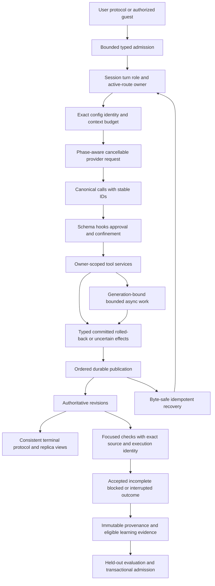

## Verification ledger — initial audits 1–5

| Executed check                                                                                                                  | Observed outcome                                       | What it does not establish                                                                                       |
| ------------------------------------------------------------------------------------------------------------------------------- | ------------------------------------------------------ | ---------------------------------------------------------------------------------------------------------------- |
| Standalone `rustc --edition=2024 --test tests/integration/architecture.rs`, with `CARGO_MANIFEST_DIR` set, then test binary | **4 passed, 0 failed**                           | Alias-regression coverage, application compilation or all Rust behavior                                          |
| `python3 scripts/test-build.py`                                                                                               | **4 passed**                                     | Real installation, fault-injected backup failure or crash-safe updater activation                                |
| `make test-bench-offline`                                                                                                     | **23 passed**                                    | Rust benchmark resume identity, real model quality or held-out admission                                         |
| `make test-python` using system Python                                                                                        | **Failed before collection: pytest unavailable** | Not a product test failure; no dependencies installed                                                            |
| `make test-python PYTHON=python/.venv/bin/python`                                                                             | **157 passed, 4 skipped** in 6.20s               | Three skips lack `mlx_vlm`; one is optional real MLX/tokenizer; no claim of real training/inference validation |

Executed output references: architecture `artifact://e1aa48cfefb51df6766438f2ba3c78d1ff577f2931aa152ded2803529d74d9ef`; build fixture `artifact://eb269153f99d128330313491496a60c9f716a91d1d250211151288bd4fbee599`; offline benchmark `artifact://2b831afd1fdcd7621c7e31d9cd71106428cc3cb84e2fa23813d3200fc4e463f0`; system-Python failure `artifact://99ddc5d39468e16e0b64cfadfc2c7940fe6a1c44cbdc8d83d7c4d39a1aed19b5`; project-Python result `artifact://07e39e0f781181815a7fb7a52d8a73202a26d1ce5c6a9d69b5023172151828ac`. These are local session evidence references, not portable repository URLs.

No production fix or new Rust regression test was implemented. The full Rust suite, Clippy, hosted CI, platform sandbox enforcement, fault injection, real browser/audio/desktop surfaces, and hardware learning remain **unexecuted** for this audit. Mermaid diagrams are source diagrams; no rendered-diagram verification is claimed. No live language server was available; source navigation used targeted reads/searches. Earlier review documents' unresolved failures are not declared fixed or pre-existing by these results.

Recommended post-implementation checks use existing entrypoints: focused `make test-module MOD=<owning-module>`, relevant cases in `make test-integration`, then `make test-rust`, `make lint`, `make test-python PYTHON=<provisioned-interpreter>`, and `make test-bench-offline`. Run cross-platform/native acceptance on the actual supported hosts and keep optional unavailability explicit. Add the finding-specific composed-boundary regressions before claiming closure; a passing old suite alone is insufficient.

**Delivered change for audits 1–5:** this report only, incrementally updated after each audit. Existing source, staged/unstaged work, architecture documents and plans are preserved. The report provides proposed changes, not implemented fixes or certification of unaudited paths.

## Follow-up scope: UX, core logic, output quality and efficiency

The follow-up request prioritizes features that directly affect the user's work: correct committed output, usable extensions/providers, retained evidence, faithful context, trustworthy completion, responsive interaction and bounded inference cost. Security/privacy findings already established are retained rather than discarded, but subsequent passes focus on these product outcomes. **No production fixes are applied.** Severity and evidence labels above continue to apply. The initial 31-finding inventory is historical, not the total for this expanded report.

| Pass | Direct product focus | Report status | Source changes |
| --- | --- | --- | --- |
| 6 | Commit output, preview semantics and review efficiency | Complete | None |
| 7 | Extension reliability and skill availability | Complete | None |
| 8 | Provider setup and live authentication transitions | Complete | None |
| 9 | Retained outputs, archive accuracy and diagnostic exports | Complete | None |
| 10 | Core context, completion and verification quality | Complete | None |
| 11 | Interactive UX and feature-state correctness | Complete | None |
| 12 | Rendered and protocol output consistency | Complete | None |
| 13 | Retrieval/tool-result quality and efficiency | Complete | None |
| 14 | Task/goal/plan workflows and output delivery | Complete | None |

## 6. Commit output, review correctness and efficiency

### Coverage and architectural diagnosis

Inspected commit command dispatch, legacy/agentic flows, index capture/restore, split-plan validation/execution, per-file inference, security preflight/coordinator and reviewer wiring. This is not a complete Git implementation audit. Existing split tests cover ordinary whole-file additions, not divergent index/worktree states (`src/commit/agentic/stage.rs:310-344`).

The primary design error is treating a staged **path list** as the selected **content snapshot**. A second error is treating preview as temporary mutation followed by unconditional restoration. Both break the user's mental model of “commit exactly what I staged” and “preview changes nothing.” Keep existing proposal validation, dependency sorting, bounded ordinary Git helper and explicit degraded fallback outcome; replace the unsafe state transitions rather than the whole commit subsystem.

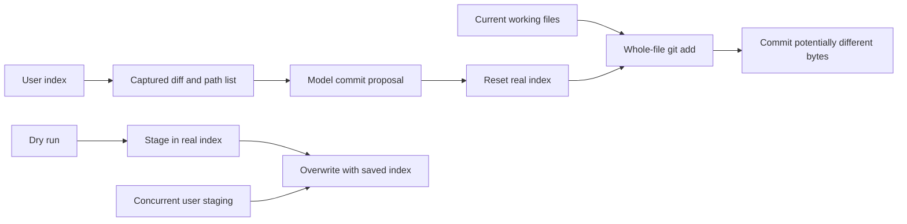

### A6-01 — Split commits include unstaged work the proposal never reviewed

- **P1 · Confirmed / source; Git mechanism reproduced.** `src/commit/agentic/mod.rs:159-183,277-284` captures the staged diff. `src/commit/agentic/stage.rs:218-232` resets the index; `151-169` handles `All` by `git add -A -- path`, reading the working tree instead of captured staged blobs. Plan validation checks path membership, not equality of index/worktree content (`src/commit/agentic/tools.rs:1122-1130`).
- **Trigger/impact:** stage one version of a file, then leave additional edits unstaged. A whole-file split group commits both, possibly including unfinished code or private scratch content. Generated descriptions can describe a different change from the one committed.
- **Proposed change:** execute against captured index tree/blob identities, retaining file modes, deletions and binary content; revalidate HEAD/index before publishing. Changelog additions must be explicit additions to that plan, not implicit rereads of unrelated worktree content.
- **Acceptance:** divergent HEAD/index/worktree bytes, binary files and modes; each produced commit contains only its approved captured selection, while unselected working changes remain uncommitted.

### A6-02 — Failed split drops remaining staging while claiming it remains staged

- **P2 · Confirmed / source; reset/failure mechanism reproduced.** `src/commit/agentic/stage.rs:224-243` clears all original staging before executing groups. On a later error it does not reconstruct pending staged content, yet reports “file(s) remain staged. No changes were lost.”
- **Trigger/impact:** a hook rejects a group or a patch fails. Later groups were never restaged. If staged bytes differ from both HEAD and the working tree, the normal index/worktree no longer retains the selected version. Git objects may still permit expert recovery; this is not a claim of immediate physical object erasure.
- **Proposed change:** retain the original index tree and explicit progress; restore the uncommitted remainder against the new HEAD after partial success, or return a durable recovery artifact with an accurate state report. Do not blindly restore an old full index after some commits succeeded.
- **Acceptance:** failures before first commit and after one successful group; preserve staged-only bytes for all remaining groups, keep unstaged bytes untouched, and report exact completed/remaining groups.

### A6-03 — Preview restoration overwrites another actor's staging

- **P2 · Confirmed / source; interleaving mechanism reproduced.** `src/commit/run.rs:168-176` snapshots the real index around the entire model-driven preview. `src/commit/execute.rs:47-65,81-107` restores bytes via replacement/removal without comparing current index identity or cooperating with `index.lock`.
- **Trigger/impact:** another terminal/editor stages changes while preview inference is running. On completion, Dial replaces that newer index with its older copy. A process crash before restoration also leaves preview staging applied.
- **Proposed change:** use a private `GIT_INDEX_FILE` initialized from the captured index for every preview command. Do not hold Git's real index lock across slow inference or “fix” this with another unconditional rollback.
- **Acceptance:** pause preview, stage another file externally, resume; real index bytes retain the external change. Kill preview after private staging; real index is unchanged. Include initially absent index and linked worktrees.

### A6-04 — Legacy dry-run can push existing commits

- **P1 · Confirmed / source; no push executed.** `src/commit/run.rs:246-251` pushes when the diff is empty and `args.push` is set; the `args.dry_run` branch occurs later at `286-291`.
- **Trigger/impact:** `dial commit --legacy --dry-run --push` in a clean repository with outgoing commits performs a remote mutation despite being a preview. Index restoration cannot undo publication.
- **Proposed change:** enforce a single dry-run effect policy before all mutation paths, including no-change push and fallback. Return an explicit would-push preview result.
- **Acceptance:** local disposable bare remote, clean working tree, unpushed commit; dry-run must not move remote refs or invoke a push hook. Normal non-preview push still works.

### A6-05 — Scoped security review sends excluded diffs to the model

- **P2 · Confirmed / source; Git mechanism reproduced.** `src/security/coordinator.rs:79-105` filters inventory by include/exclude, but separately obtains the full base-to-head diff with no path filter. `128-180` embeds that full diff in every coordinator/reviewer request.
- **Trigger/impact:** restrict a ref-diff review to one subtree while changes exist elsewhere. Excluded bytes still enter provider prompts, distracting review, consuming tokens and violating the stated scope. No actual confidential upload was performed.
- **Proposed change:** derive both inventory and diff from the same normalized scope and immutable revision pair. Bound/carry per-batch diff material rather than repeating a whole-repository patch in every batch.
- **Acceptance:** synthetic excluded marker never appears in any coordinator/batch prompt; included changed content remains available. Cover deleted/renamed files and empty scope. Measure prompt bytes across multiple batches rather than assume a speedup.

### A6-06 — “Immutable” review plan is not bound to the source actually read

- **P2 · Confirmed / source design defect; no model-quality experiment.** `src/security/ops.rs:266-270` checks freshness once. `src/security/coordinator.rs:218-249,265-330` later publishes against that plan without final source revalidation. Reviewers use the normal current-workspace task path (`src/commands/security.rs:23-25`, `src/agent/delegation.rs:277-290`), not a pinned snapshot. Ref-diff planning binds commit IDs but supplies no isolated source checkout (`src/security/preflight.rs:261-297`).
- **Trigger/impact:** source changes between plan validation and reviewer reads, or an explicit head revision differs from the checked-out tree. Findings and line locations can be associated with a fingerprint that does not identify all inspected bytes. **[INFERENCE]** Whether a particular model reads the wrong version depends on its tool choices; the absence of an enforced snapshot/revalidation boundary is source-confirmed.
- **Proposed change:** provide a read-only revision/snapshot view, or record source witnesses and reject/mark partial when those change before publication. Reference selection in prose is not equivalent to binding reads.
- **Acceptance:** alter a file while a fake reviewer pauses; never publish an unqualified completed result under the old tree identity. Explicit ref reviews resolve requested-version files, including files absent in the current checkout.

### A6-07 — Per-file commit analysis launches unbounded model concurrency

- **P2 · Confirmed / source; no load test.** `src/commit/agentic/tools.rs:750-807` builds one prompt and spawns one scoped thread per requested file, with no concurrency cap. Each prompt repeats all other requested filenames, giving quadratic aggregate related-file context. `816-835` dispatches a model call per thread; `src/commit/run.rs:35-47` constructs/releases a backend for each completion.
- **Trigger/impact:** ask the commit tool to analyze a large change set. Request/thread count scales directly with files and repeated context scales quadratically, increasing throttling, prompt cost and time before a message is produced. Exact latency/token costs are unmeasured.
- **Proposed change:** bounded worker pool and per-run request/token budget; deduplicate file requests and share a bounded repository overview rather than replicating the entire file list. Reuse the bounded eight-worker pattern already in `src/commit/ai_stage.rs:136-158` where suitable; account for backend/model ownership before pooling it.
- **Acceptance:** fake backend tracks maximum simultaneous calls for 100+ files; concurrency stays below the configured limit, output ordering is stable, cancellation stops new admissions, and aggregate prompt bytes grow within an explicit budget.

### Ideal flow and actionable queue

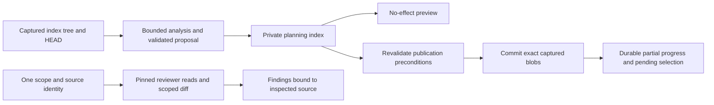

- [ ] **A6-01–A6-03** Make selected content immutable through planning, preview and split failure; regression-test divergent index/worktree and external staging.
- [ ] **A6-04** Enforce dry-run effects centrally, including empty-diff push.
- [ ] **A6-05–A6-06** Bind review context and result identity to the same scoped source.
- [ ] **A6-07** Bound per-file inference and aggregate context before tuning parallelism.

**Verification:** four disposable synthetic Git/index probes passed: unstaged-byte inclusion, lost staging after reset/failure, overwritten intervening staging, and excluded bytes retained in unfiltered diff. Evidence: `artifact://13114f3e4ec3bc94303da55f91ac75de8745cbaa713e26cf3f84bc8400c5c4ed`. These exercised the exact mechanisms, **not compiled Dial command/controller tests**. No real repository was committed/reset, no remote was contacted, and no production files were changed. No runtime claims are made for A6-04, A6-06 or A6-07.

**Report update 6:** persisted seven new findings focused on output integrity, accurate preview/failure UX, review context quality and inference efficiency.

## 7. Extension reliability and skill availability

**Coverage:** plugin manifests/install/marketplace resolution/startup; skill-package Git fetch, registry, lockfiles, shared storage and discovery; bounded pack import. Source-only review, no installation, network requests or runtime tests. These findings were collected before the narrower UX request and are retained because they affect available tools, guidance and predictable feature behavior.

### A7-01 — Removing a skill package in one project deletes another project's skills

- **P1 · Confirmed / source.** `src/storage/skills/packages/mod.rs:288-307` prunes a user-global content store using only the current project's and user's lock entries (`69-85,128-145`; `src/storage/paths.rs:59-66`). Removal/update invokes pruning (`399-434,488-496`).
- **Impact:** project B's maintenance removes project A's still-referenced skill content. A's update may say “already up to date” because commit equality is checked before missing content (`405-411`). Expected guidance disappears and repeated updates do not repair it.
- **Change:** collect against all owners or conservatively retain globally shared content; repair missing content despite matching remote commit.
- **Acceptance:** two project layouts sharing one user store; B's remove/update preserves A's discovery/bytes. Missing content is restored or clearly reported. Existing prune test (`683-706`) covers only one layout.

### A7-02 — Marketplace upgrade can silently substitute a different publisher

- **P1 · Confirmed / source.** `src/tools/plugin/marketplace.rs:343-370` falls back to the first same-name catalog entry when installed-source matching fails. Replacement preserves enabled status (`src/tools/plugin/installer.rs:237-255`); subsequent loading starts it (`src/tools/plugin.rs:84-104`). Reachable through `src/cli/plugin.rs:186-188` and `src/commands/extensions.rs:741-745`.
- **Impact:** disabling/removing the original catalog or upgrading a direct install can turn “upgrade my plugin” into publisher migration. Initial ambiguous-name installation checks do not protect this transition. Upgrade invocation and later loading are required; browsing alone does not execute code.
- **Change:** retain publisher/catalog provenance and require explicit migration when origin differs; unmatched legacy installs must not pick a replacement implicitly.
- **Acceptance:** publishers A/B offer the same name; remove A's catalog and upgrade. A's bytes/enabled state remain unchanged until explicit migration, including direct installs and multiple catalogs.

### A7-03 — Package lock entries can inject external skill roots into discovery

- **P2 · Confirmed / source.** Version-only lock validation at `src/storage/skills/packages/mod.rs:93-108` permits arbitrary `integrity`; `150-156` joins it to the store. Absolute/traversal values escape. Discovery treats those roots as user scope (`src/storage/skills.rs:249-253,262-289,369-410`).
- **Impact:** a workspace lock can make external valid skills appear installed, changing model guidance without a corresponding package installation. This establishes context injection/discovery, not arbitrary code execution or unrestricted file disclosure.
- **Change:** validate exact digest syntax on read; canonical containment and symlink checks; retain real scope/provenance instead of deriving trust from physical storage.
- **Acceptance:** absolute paths, traversal, malformed digests and escaping store symlinks expose no external skills; legitimate project packages in the shared store still load.

### A7-04 — Delayed package update overwrites a newly reinstalled package

- **P2 · Confirmed / source.** `src/storage/skills/packages/mod.rs:399-405,415-433` fetches before the mutation lock, then rechecks only package-name existence. Removal/reinstall can occur through `318-348,449-475,488-496`.
- **Impact:** old-source content overwrites a replacement package's commit/integrity/skills while retaining its new URL/ref/path. The displayed provenance and actual guidance disagree.
- **Change:** compare the complete current entry to the snapshotted entry under the existing lock before publication; report concurrent replacement instead of overwriting.
- **Acceptance:** pause old update, remove/reinstall same name from new source, resume; new entry/content remain intact. Also test reversed completion order of two updates.

### A7-05 — One malformed installed plugin disables every installed plugin

- **P2 · Confirmed / source.** Installation enables before runtime validation (`src/tools/plugin/installer.rs:222-229`); `278-303,335-374` returns the first runtime-spec error from aggregate enumeration. `src/tools/plugin.rs:89-104` then starts none of the installed runtimes. Explicit config plugins are separate.
- **Impact:** one missing/escaping program or malformed args/env makes unrelated tools disappear. Existing `installer.rs:1007-1018` test establishes install-then-runtime-failure, not isolation of healthy peers.
- **Change:** validate staged runtime declarations before activation; isolate startup/enumeration failures per plugin and name the failed component.
- **Acceptance:** healthy plugins before and after a malformed one still load; failed fresh install leaves no enabled record.

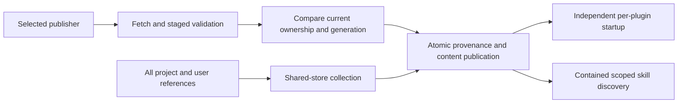

**Design correction:** global storage requires global ownership accounting; slow fetch must not authorize stale publication; a batch loader must not make independent extensions fail as one unit. Preserve existing npm integrity checks, confined executables, symlink-rejecting skill copies and pack candidate/evaluation gates. No immediate pack-activation bypass was found.

- [ ] **A7-01/A7-04** Repair cross-project ownership and compare-before-publish.
- [ ] **A7-02/A7-03** Bind publisher/root identity at installation and discovery.
- [ ] **A7-05** Validate before enabling and isolate component failure.

**Report update 7:** five new source-confirmed findings; extension availability, trustworthy guidance and predictable upgrades. No runtime reproduction claimed.

## 8. Provider setup and live authentication transitions

**Follow-up pass, source-confirmed only.** It covered shared authentication, endpoint and configuration resolution, credential persistence interfaces, provider dispatch and the UI and slash-command transitions. No commands, network or authentication actions, or real credential reads were performed. Plaintext private API-key storage is documented and intended (`src/llm/catalog.rs:1-3,471-508`), so it is not reported as a finding.

### A8-01 — Generic OAuth grants are not bound to their destination endpoint

- **P1 · Confirmed from source.**
  - Backend construction selects the stored grant by provider ID alone and skips API-key resolution (`src/agent/backend.rs:76-79,127-139`; `src/llm/oauth/mod.rs:365-372`).
  - The configured route is still used (`src/llm/provider.rs:1365-1388`).
  - Kimi supplies no endpoint override (`src/llm/oauth/kimi.rs:122-140`).
  - The Bearer header is attached in `src/llm/mod.rs:895-905`.
  - Known environment keys do get an origin check (`src/llm/catalog.rs:551-557`); grants do not.
- **Impact:** a `kimi-code`-style provider configured with a different HTTPS base URL sends the stored OAuth access token to that endpoint.
- **Change:** bind each grant to an approved origin and protocol. Validate the audience of the final resolved route before attaching credentials. Take enterprise and gateway routes from validated grant metadata.
- **Acceptance:** with a synthetic grant and a non-canonical endpoint, the request is refused before dispatch and the fake server receives no Authorization header. Canonical and explicitly authorized gateway routes keep working.

### A8-02 — OAuth routing is applied after unresolved catalog templates fail validation

- **P2 · Confirmed from source.**
  - Bundled URLs contain `<account>` and `<gateway>` (`src/llm/catalog/providers.json:67-68`), and catalog entries copy them (`src/llm/catalog.rs:2062-2075`).
  - Inference validates the configured URL (`src/llm/provider.rs:99-109,1245-1250`) before the OAuth access shape is applied (`1365-1388`).
  - The Cloudflare and Snowflake grants already contain the needed identifiers (`src/llm/oauth/cloudflare_ai_gateway.rs:49-56,73-88`; `src/llm/oauth/snowflake.rs:66-71,199-208`).
- **UX impact:** a successful login followed by selecting a bundled model fails on placeholders. The user is forced to configure the same account a second time.
- **Change:** resolve credential-derived routing before validation and URL shaping, and share that route contract between model selection and catalog routes.
- **Acceptance:** synthetic valid grants with no separate account settings resolve to the credential-owned endpoints, and invalid stored identifiers still fail before any request.

### A8-03 — `/logout` does not stop a pending login from signing back in

- **P2 · Confirmed from source.**
  - Slash logout deletes the grant but does not cancel the matching auth job (`src/commands/session.rs:609-623,649-661`).
  - Shared publication saves without a generation check (`src/llm/oauth/mod.rs:266-277,289-296`).
  - The overlay path cancels its own job (`src/app.rs:8876-8885,8269-8272`), but the publish race remains.
- **Impact:** "Signed out" can be silently reversed when the browser or device flow completes later.
- **Change:** cancel matching jobs on slash logout. Make grant publication conditional on the current login generation, which sign-out invalidates.
- **Acceptance:** with a fake login held open, logout followed by releasing the login leaves the provider signed out. Cover both the slash and overlay paths, including the window after the flow returns but before it saves.

### A8-04 — Saving or removing an API key leaves the running backend on the old credential

- **P2 · Confirmed from source.**
  - The credential is copied at backend construction (`src/agent/backend.rs:113-121,127-139`) and reused (`src/llm/provider.rs:1236-1263`).
  - The `/providers` handlers update storage and refresh only the catalog (`src/app.rs:8784-8802,8894-8909,874-889`).
  - The rebuild key and the watcher ignore credentials (`src/app.rs:5190-5208,2103-2108`; `src/storage/paths.rs:88-92`).
- **UX impact:** replacing an invalid key does not fix the current session, and a removed key keeps being sent.
- **Change:** resolve key bindings at dispatch, keeping precedence and origin checks, or publish a credential revision that invalidates affected backends at a safe boundary.
- **Acceptance:** after replacing key A with B, the next dispatch uses B. After removal, the next dispatch fails with missing authentication. Environment and CLI precedence are unchanged.

### A8-05 — OpenRouter login uses the macOS-only opener and discards its manual fallback

- **P2 · Confirmed from source.**
  - The login runs `Command::new("open")` and, on failure, returns an error that contains the URL while dropping the listener and the PKCE verifier (`src/llm/auth.rs:62-84`).
  - A portable helper with `DIAL_NO_BROWSER` support already exists (`src/llm/oauth/util.rs:308-330`).
  - The caller is `src/app.rs:8804-8815`.
- **UX impact:** on Windows and on Linux without an `open` executable, the login fails outright. Following the printed URL can never complete it.
- **Change:** reuse the shared opener, and keep the callback wait and verifier alive while showing the URL.
- **Acceptance:** with an injected opener failure, a later manual synthetic callback still completes login. No-browser mode is honored without launching a browser.

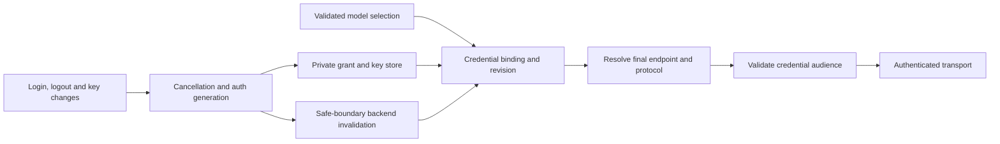

**Preserve:**
- generic refresh under a cancellable private lock (`src/llm/oauth/mod.rs:315-349`);
- bounded OAuth responses with redirects disabled (`src/llm/oauth/util.rs:219-299`; `src/llm/mod.rs:370-379`);
- the explicit ChatGPT endpoint policy (`src/agent/backend.rs:49-95`) as the model for binding other providers' grants.

- [ ] **A8-01/A8-02** Resolve the final route first, then validate the credential's audience.
- [ ] **A8-03/A8-04** Give auth state transitions a generation that invalidates stale jobs and resident backends.
- [ ] **A8-05** Reuse the portable opener and keep the manual fallback alive.

**Report update 8:** five source-confirmed provider and authentication findings integrated. Nothing was reproduced at runtime.

## 9. Retained outputs, archive accuracy and diagnostic exports

**Follow-up pass, source-confirmed only.** It covered GC and reference marking, artifact spools, anonymization, archive scanning and share and export. Nothing was deleted, uploaded or fault-injected.

### A9-01 — GC can delete the head of an artifact spool that is still being written

- **P1 · Confirmed from source.**
  - Old `.spool-*` files are deleted with no ownership claim (`src/cli/gc.rs:477-500`).
  - After the head budget fills, writes go only to the tail, so the head's mtime goes stale (`src/tools/artifact.rs:355-369`).
  - `finish` then hard-links the head that was removed (`494-511`).
  - The path is reachable from background capture (`src/tools/background/table.rs:162-187,214-221`).
- **Output impact:** long-running background commands lose their complete durable output artifact at completion.
- **Change:** a lifetime ownership claim per spool, which GC must acquire without blocking before deleting it. Reuse the claim pattern at `src/cli/gc.rs:618-637`. Raising the age threshold does not fix this.
- **Acceptance:** with an open spool whose head is full and older than the grace period, and whose tail is still being written, GC keeps both files and `finish` publishes. Abandoned, unclaimed spools are still reclaimed.

### A9-02 — Failed transitive reference reads delete reachable artifacts

- **P1 · Confirmed from source.**
  - Errors from reading referenced artifact bodies are ignored (`src/cli/gc.rs:443-450,459-466`), so B, which is reachable only through A, is swept (`488-500`).
  - The state-file scan and the sweep contract are fail-closed (`439-441,462-465`). This phase is not.
- **Impact:** a permission or I/O error deletes evidence that is still referenced.
- **Change:** propagate read errors together with the artifact identity, and model foreign or missing artifacts explicitly.
- **Acceptance:** with `session → A → B` and a read failure injected on A, nothing is deleted and the scan is reported incomplete. The happy-path test (`1139-1187`) still passes.

### A9-03 — The anonymizer keeps bare shell words because it treats them as flags

- **P1 · Confirmed from source.**
  - `is_flag_like` accepts zero leading dashes (`src/storage/anonymize.rs:302-319,499-506`).
  - The caller is `src/cli/anonymize.rs:72-85`.
  - This contradicts the default-deny contract (`src/storage/anonymize.rs:4-12,21-22`).
- **Impact:** `echo ConfidentialAcquisition`, usernames, hosts and passwords that don't match a vendor pattern survive in diagnostics that are presented as anonymized.
- **Change:** stop classifying bare words as flags. Keep the executable and genuine flags under a bounded argument policy, and replace positional values.
- **Acceptance:** `echo ConfidentialAcquisition`, `curl -u alice` and a bare password are all replaced, while the program, flags and path placeholders keep their intended structure.

### A9-04 — Opaque anonymization grants structural exceptions to arbitrary nested data

- **P1 · Confirmed from source.**
  - Any nested `name`, `type`, `role`, `kind` or `custom_type` key goes back to the label rule (`src/storage/anonymize.rs:377-402,342-349,483-488`).
  - Map keys only get credential redaction (`284-299`).
- **Impact:** `{"customer":{"name":"AliceSmith"}}` and email-keyed maps survive anonymization.
- **Change:** limit label exceptions to known envelope positions. For unknown or tool-argument objects, keep only schema-approved field names and use correlated placeholders for data keys.
- **Acceptance:** nested customer names, custom `type` values and email- or path-keyed maps are anonymized through both `session_jsonl` and `value`, while envelope roles, tool names and IDs are preserved.

### A9-05 — Bounded archive scans report a stale `Complete` status

- **P2 · Confirmed from source.**
  - When the final record is larger than the 32 KiB tail window, the tail yields no message, and the earlier head `last_role` is reported as `Complete` (`src/storage/archive.rs:613-631,717-743,766-775`).
  - The archive tool exposes this status (`src/tools/archive.rs:112-121,136-142`).
- **Output impact:** sessions whose final request is still pending, or that end in an oversized tool record, are presented to the model and the user as completed.
- **Change:** track whether the terminal status was actually observed, and return `Unknown` or a qualified status when it was not.
- **Acceptance:** a short completed exchange followed by an oversized user, tool-call or tool-result record never inherits `Complete`. The tests also cover a record ending exactly at the boundary and a truncated last record.

### A9-R1 — Sharing includes abandoned branches and internal records (product decision)

- **Mechanism confirmed; whether it is intended is unresolved.**
  - CLI and interactive share serialize every journal record (`src/main.rs:648-657`; `src/commands/collab.rs:294-310`).
  - Rewind keeps abandoned messages in the journal (`src/storage/session.rs:2776-2802,4324-4346`).
  - Export, by contrast, uses only the active branch and excludes `dial_state` (`1407-1417`).
  - Share redacts credential patterns only (`src/storage/share.rs:35-39`).
- No disclosure was attempted or observed.
- **Suggested default:** a branch-aware snapshot shared by both adapters, plus an explicitly named whole-journal diagnostic mode.

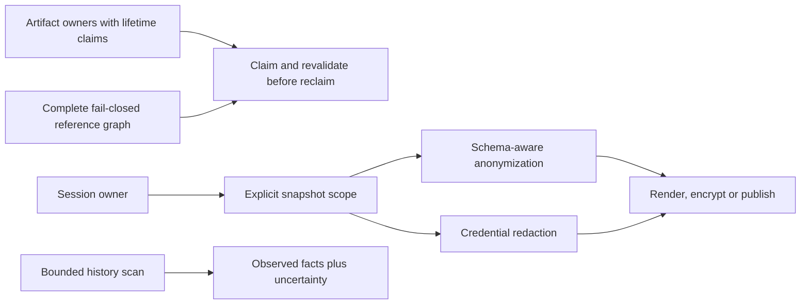

**Preserve:**
- encrypt-before-upload share (`src/storage/share.rs:35-67,101-133`);
- owner-only, non-overwriting export (`src/storage/session.rs:1396-1404`);
- escaped HTML with verified images (`src/storage/export.rs:10-14,48-62,120-145`);
- pin locks (`src/storage/session_pins.rs:35-60`);
- archive cross-project approval (`src/tools/archive.rs:68-85,172-174`).

- [ ] **A9-01/A9-02** Give spools lifetime claims and make reference marking fail closed.
- [ ] **A9-03/A9-04** Use default-deny anonymization based on known envelopes.
- [ ] **A9-05** Report scanned status with uncertainty.
- [ ] **A9-R1** Decide the share scope, then implement a branch-aware default.

**Report update 9:** five source-confirmed retention, accuracy and privacy findings plus one product-contract risk integrated. No deletion, upload or fault injection was executed.

## 10. Core context, completion and verification quality

**First of the five specifically requested UI/UX and quality passes (10–14).** Inspected compaction cut/replacement, portable-summary folding and harness notes; request/evidence projection; plain-final completion and repair/stop-hook control; focused-check selection/classification; supporting checkpoint and LSP mutations. Source-confirmed findings, not executed regressions. Native provider compaction serialization, every worker completion route and every test-runner dialect remain coverage gaps.

### A10-01 — Checkpointed LSP edits bypass verification and change disclosure

- **P1 · Confirmed / source.** `src/agent/turn.rs:1947-1951` counts only `write`, `edit`, `ast_edit`, `solve`. Extension fallback (`1958-1967`) uses `may_modify_workspace`, but checkpoint-observed LSP rename/rename-file/code-action operations intentionally return false there (`src/tools/lsp/mod.rs:1347-1355`). Actual committed paths exist (`src/tools/edit_transaction.rs:18-33`; LSP `593-599,819-827`).
- **Output impact:** an LSP-only refactor leaves all tracked mutation epochs zero; automatic checks (`src/agent/turn_loop.rs:586-601`) and changed-file disclosure (`src/agent/checks.rs:274-284`) are skipped, yet a plain final can complete (`src/agent/turn.rs:1367-1411`). This is distinct from earlier LSP session-ownership findings.
- **Change:** invalidate verification/disclosure from committed mutation facts or checkpoint generation, not a tool-name allowlist. Keep uncheckpointed effects as a separate explicit generation.
- **Acceptance:** each LSP mutation alone requires appropriate checks/disclosure; preview/no-op does not manufacture edits; a later LSP edit invalidates an earlier pass.

### A10-02 — Successful shell repair is rejected before final verification can rerun

- **P2 · Confirmed / source.** Finalizer saves pre-repair epochs (`src/agent/turn_loop.rs:598-602`); shell repair advances only the shell epoch (`src/agent/turn.rs:1958-1962`). `src/agent/checks.rs:471-476` rejects an outstanding failure using only `mutations <= checked`. Explicit test logging (`59-94`) does not reconcile failed-check obligations.
- **Output impact:** failure → shell repair → successful exact-command rerun → plain final is classified Incomplete (`src/agent/turn.rs:1367-1368`); outer repair returns before automatic recheck (`src/agent/turn_loop.rs:632-649`). The user gets unresolved failure despite a real repair, or must trigger an unnecessary edit/new turn.
- **Change:** consider all effect generations before rejecting a candidate; let fresh verification run. Discharge a failure only with the exact check and current source generation, never unrelated passing output.
- **Acceptance:** scripted failure/repair/pass/final succeeds without artificial edits, while unrelated failures remain open; cover shell and extension repairs.

### A10-03 — Renamed/deleted Python files generate impossible syntax checks

- **P2 · Confirmed / source.** Rename records old and new paths (`src/tools/lsp/mod.rs:593-599`); checkpoint paths (`src/storage/checkpoint.rs:184-194`) feed planning (`src/agent/checks.rs:192-212`). Every `.py` path gets an unconditional `Path.read_text` AST check (`src/agent/verification.rs:522-549`).
- **Output impact:** with another edit activating checks, intentionally removed `old.py` raises `FileNotFoundError`, becomes CodeFailed (`verification.rs:88-99`) and enters repair (`checks.rs:345-359`, `turn_loop.rs:605-619`). The controller can ask the model to undo a correct rename or reject correct work.
- **Change:** plan syntax against post-change file states; retain deletions for affected-test mapping. Confirm absence rather than treating permission failures as absence, and retire obsolete path-specific check obligations.
- **Acceptance:** rename/delete Python files without reading or recreating the removed path; parse the destination and run affected tests. Inaccessible existing files still fail explicitly.

### A10-04 — One testless Go package invalidates a successful mixed test run

- **P2 · Confirmed / source.** `src/agent/verification.rs:322-340` calls the entire run empty when any line ends with `[no test files]`. `79-97` then returns Unverified despite successful tests in other packages; `src/agent/checks.rs:339-359` and `src/agent/turn_loop.rs:674-702` reject completion.
- **Output impact:** normal successful `go test ./...` across tested and testless packages becomes an unresolved obligation. This is incorrect aggregation, not a request to ignore genuinely empty tests.
- **Change:** runner-aware whole-run aggregation; retain per-package coverage limits separately from run success. Preserve process failure/cancellation as authoritative.
- **Acceptance:** mixed `ok example/tested ...` and `? example/helper [no test files]` passes; all-testless remains Unverified; failing/cancelled/truncated execution never passes.

### A10-05 — Compaction accumulates an unbounded artifact index until it cannot compact

- **P2 · Confirmed / source.** `src/agent/compaction_ops.rs:532-551` unions source references with all prior summary references. `565-573` regenerates the entire list without a prompt budget; commit appends it (`293-304`) and rejects oversized projection (`322-334`) after summary generation.
- **Output/efficiency impact:** long sessions, especially on small-window models, reach a point where mandatory bookkeeping dominates context. Shorter model summaries cannot fix it; a paid summary can be rejected, and foreground continuation eventually stops (`src/agent/turn.rs:477-506,521-529`). No token-saving magnitude was measured.
- **Change:** retain the complete index durably behind a retrievable reference, keep a bounded relevant selection in prompts, and budget regenerated notes before summary inference. Do not delete underlying evidence.
- **Acceptance:** repeated compactions with many unique artifacts under a fixed small window keep freeing room; omitted references remain retrievable; no summary request is spent on a known-impossible final projection.

### Relationships and intended design

Current: actual committed paths and tool-name mutation counters are separate accounts; completion trusts the latter. The check planner assumes every changed path still exists; classifier treats one package's absence of tests as whole-run absence. Compaction bounds model prose but not regenerated metadata.

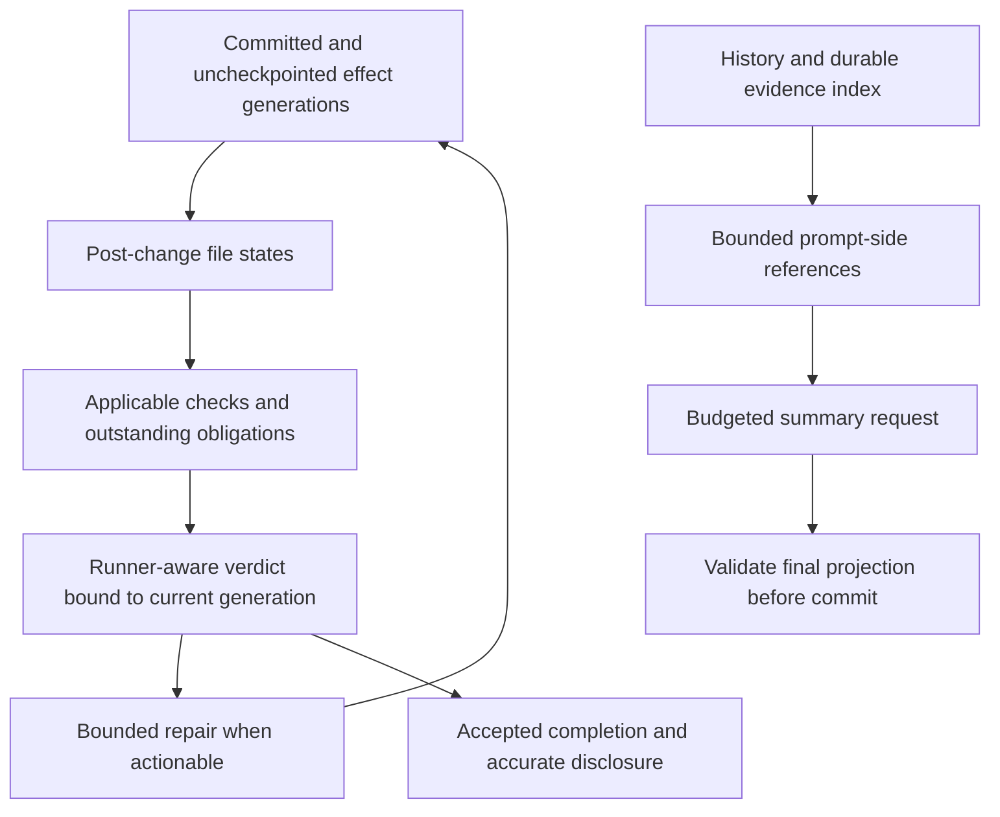

Preserve complete tool-boundary compaction, final projection checks, typed process results and finite repair/hook budgets. Fix composition in existing owners rather than introduce another completion engine.

- [ ] **A10-01/A10-02** Unify effect-generation invalidation and completion admission.
- [ ] **A10-03/A10-04** Correct post-change check planning and whole-run verdict aggregation.
- [ ] **A10-05** Bound regenerated compaction context while preserving evidence retrieval.

**Report update 10:** five new output-quality/efficiency findings, their exact failure paths and regression acceptance persisted. Reviewer performed source inspection only; no test execution or model-quality measurement is claimed.

## 11. Terminal interaction UX and feature-state correctness

**Second requested UX/quality pass.** Inspected terminal input/queue dispatch, busy overlays, compute/model-preparation/user-shell waits, session/command routing and completion notification projection; nearby composer/keybinding tests were read. Three source-confirmed P2 defects. No rendered terminal session, screenshot or injected-event regression was executed; visible consequences are inferred from dispatch and presentation code, not visual proof.

### A11-01 — Compute-wait controls open a panel the wait loop cannot operate

- **P2 · Confirmed / source.** `src/app.rs:4814-4866` routes `/compute`, `/settings` and `/model` through busy-command handling, which opens `busy_overlay` (`5431-5516,5864-5911`). The wait loop still paints without it and sends keys to the composer. Ordinary execution does prioritize overlay stepping (`9400-9424`).
- **UX impact:** when another process owns local compute, the advertised controls cannot be navigated while the lock remains unavailable. Keys intended for settings reach the composer instead; the control is broken exactly when needed.
- **Change:** reuse existing overlay rendering/input/cancellation dispatch inside compute wait; preserve pending prompt and safe-boundary settings adoption.
- **Acceptance:** hold a disposable compute lease, open `/compute` and `/settings`, navigate/change controls before releasing it. Escape closes panel without cancelling the request; explicit interrupt cancels waiting.

### A11-02 — Quiet shell/model-preparation waits silently discard typed and pasted work

- **P2 · Confirmed / source.** User-shell timeout handling (`src/app.rs:3979-3990`) drains all terminal events and recognizes only literal Ctrl+C, then calls heartbeat after consuming events the shared dispatcher needed. Noisy iterations instead use `tool_output → repaint → pump`. Model preparation has a similar non-cancel/non-resize discard (`4898-4909`). Shared behavior lives at `9374-9502`; busy composer cancellation at `src/ui/composer.rs:402-406,625-627`.
- **UX impact:** while `!sleep 10`/`!!sleep 10` is quiet, typing and bracketed paste disappear instead of entering draft/queue/history; Escape or a rebound interrupt may fail. Behavior changes with output cadence. Preparation/download waits also lose drafts.
- **Change:** one state-aware event owner; remove competing drains, preserve draft/paste events and reuse configured interrupt handling. Keep specialized preparation cancellation without discarding other user input.
- **Acceptance:** controlled quiet/noisy process with identical text/paste/Escape/rebound-key/resize events; draft preservation and cancellation are independent of output timing. Preparation completion/cancel preserves typed work.

### A11-03 — Failed verification emits a successful completion notification

- **P2 · Confirmed / source.** `src/app.rs:4621-4632` distinguishes `Err` from `Ok` and interruption, not `TurnReport.outcome`. Failed verification and blocked/incomplete hook outcomes intentionally return `Ok` reports (`src/agent/turn_loop.rs:674-702,757-775`). Warp notification mapping is at `src/ui/termcaps.rs:195-212`; transcript receives the real outcome at `src/app.rs:9837-9847`.
- **UX/output impact:** failed work generates Completion/“Turn finished” and Warp `stop` rather than `stop_failure`; `notify_errors=false` does not suppress it. Notification and transcript disagree about task success.
- **Change:** classify notification kind, eligibility and wording from authoritative outcome, not Rust transport success. Define blocked/incomplete behavior explicitly and retain interrupted-turn suppression.
- **Acceptance:** table-driven Completed/Failed/Blocked/Incomplete/Interrupted/Err with both notification settings. Failed verification never emits success; disabled failure notifications suppress failures.

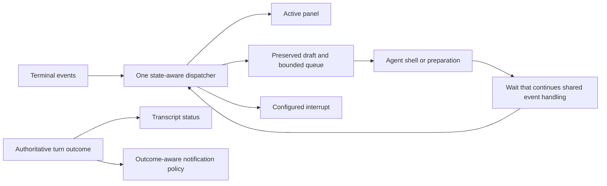

**Preserve:** bounded queued prompts (`src/ui/composer.rs:728-752`), explicit send-now (`701-710`), restoration of cancelled queue edits (`480-506`) and configuration adoption at safe boundaries. The problem is specialized loops bypassing these contracts, not a need for a visual redesign.

- [ ] **A11-01/A11-02** Unify event ownership during every wait; keep overlays usable and input lossless.
- [ ] **A11-03** Project one outcome consistently across transcript, notifications and external terminal integration.

**Report update 11:** three additional UX defects and behavioral regressions persisted. Source-only review; no live screen verification claimed.

## 12. Rendered and protocol output consistency

**Third requested UX/quality pass, performed directly by the parent.** This pass traced one turn through the shared runtime tree (`src/runtime.rs`, `src/agent/state_ui.rs`), the terminal transcript and Markdown renderer (`src/ui/transcript.rs`, `src/ui/markdown.rs`, `src/ui/text.rs`, `src/ui/tool_cards.rs:1-180`), the RPC observer (`src/rpc.rs:217-311,925-953`) and the ACP adapter (`src/acp.rs:17-80,519-767`), and compared them with `docs/rpc-and-acp.md`. The three findings below are confirmed from source only. No ACP or RPC client was run, and no rendered terminal session was captured. The terminal renderer was read, and this pass found no defect in it.

### A12-01 — An ACP prompt reports `end_turn` for failed, blocked and incomplete turns

- **P2 · Confirmed from source.** The RPC prompt result includes the authoritative `outcome` (`src/rpc.rs:949`). The ACP adapter derives `stopReason` only from `interrupted` and otherwise returns `end_turn` (`src/acp.rs:611-621`). Failed verification is returned as `Ok` with `TurnOutcome::Failed` (`src/agent/turn_loop.rs:674-702`). The completion node is published as RPC `state_node` (`src/agent/state_ui.rs:226-236`), but the ACP adapter drops every unrecognised event (`src/acp.rs:764`). The replacement unsettled report is not streamed either. ACP receives only the earlier streamed candidate text plus a notice chunk.
- **Output impact:** ACP clients such as editors receive the model's candidate answer and a normal `end_turn` for every non-interrupted outcome. Programmatically, failed, blocked, needs-input, incomplete and completed turns look identical. A step-budget exhaustion is not reported as `max_turn_requests`. This is the protocol counterpart of A11-03.
- **Change:** project `TurnOutcome` once in the adapter. Use a standard stop reason where one exists, for example `max_turn_requests` when the step budget is exhausted. Otherwise keep `end_turn` but add `_meta.dial.outcome` and final report text, without inventing nonstandard stop reasons. Preserve `cancelled` for interruption.
- **Acceptance:** a table-driven adapter test runs each `TurnOutcome` through the prompt response. Failed and blocked turns are distinguishable to clients, interrupted remains `cancelled`, and completed remains a plain `end_turn`.

### A12-02 — The RPC tree drops presentation and data updates on running nodes

- **P2 · Confirmed from source.**
  - `Body::update` increments the revision for metadata-only edits: presentation, execution, call ID and progress data (`src/runtime.rs:95-140,212-223`).
  - `RpcUi::result_node` sends `state_delta` whenever a running, non-worker node already has a cursor (`src/rpc.rs:236-244`). It does this even when the text is unchanged, so the delta carries an empty `append` and no metadata.
  - Example: `tool_call_with_args` first publishes the new node (full `state_node`). It then sets the registry presentation and publishes again (`src/agent/state_ui.rs:79-93,253-261`). That second publication becomes an empty delta.
- **Output impact:** RPC clients follow the documented advice to choose the tree projection (`docs/rpc-and-acp.md:21-30`). While a tool runs, they keep the provisional or empty label and target, and do not see progress or phase data for running non-worker nodes. The snapshot only becomes correct when the node settles. The text itself remains consistent.
- **Change:** emit `state_delta` only when the sole change is appended text. Track the last emitted non-text snapshot, or compare text length with the revision. Emit `state_node` when metadata changed. Keep deltas for token streaming.
- **Acceptance:**
  - The observer sequence `start → present → append → progress → settle` produces a full node after `present` and after `progress`, and text-only deltas in between.
  - The final client state equals `Tree::snapshots()`.
  - Worker nodes still use bounded replacement snapshots.

### A12-03 — ACP plans show abandoned and blocked tasks as pending

- **P3 · Confirmed from source.** The todo state has `Abandoned` and `Blocked`, serialized in snake case (`src/agent/todo.rs:22-56,569-600`). The ACP mapping recognises only `done`/`completed` and `in_progress`/`running`, and turns everything else into `pending`. It also sets the priority to `medium` for every entry (`src/acp.rs:757-760`).
- **UX impact:** a dropped task stays visible as outstanding work, so the editor's plan never converges. A blocked task loses its blocked state and reason. The terminal and the model see different plan state from the ACP client.
- **Change:** map `abandoned` to a terminal state, or omit it, and mark the change with `_meta.dial.status`. Keep `blocked` as `pending`, but add `_meta.dial.status` and the reason. Add an exhaustive match over `Status` so that a new variant cannot silently fall back to `pending`.
- **Acceptance:** a todo with pending, in-progress, completed, abandoned and blocked entries renders in ACP with distinguishable terminal and blocked states, and the plan reaches a fully closed state when the todo does.

### A12-R1 — ACP approval correlation by tool name (risk, `[INFERENCE]`)

The RPC `approval` event carries `approval_id`, `tool` and `summary` but no `call_id` (`src/rpc.rs:188`). ACP attaches the permission request to the latest active tool with the same name. If none exists, it creates a `pending` entry, and the next same-named `tool_call` adopts that entry's ID (`src/acp.rs:671-724`). The main sequential path emits `tool_call_with_args` before authorization (`src/agent/turn.rs:1762`; `src/agent/dispatch.rs:533`), so in that path the attachment is correct. An approval that has no matching call card, such as one raised through a worker or a wrapped approval surface (`src/agent/live_tasks.rs:170-192`), could leave a stale pending entry. A later, unrelated parent call could then reuse its ID. This path was not traced end to end. Smallest correction: add `call_id` to the approval event when one exists, and expire pending entries when the decision returns.

**Documented limitation, not a new finding:** extension `tool_output` events that carry only a name attach to the latest active call with that name, in both the tree and ACP (`src/agent/state_ui.rs:281-288`; `src/agent/delegation.rs:59-60`; documented at `docs/rpc-and-acp.md:62-64`). Parallel native calls pass a no-op output sink (`src/agent/dispatch.rs:190-193`), so they do not interleave.

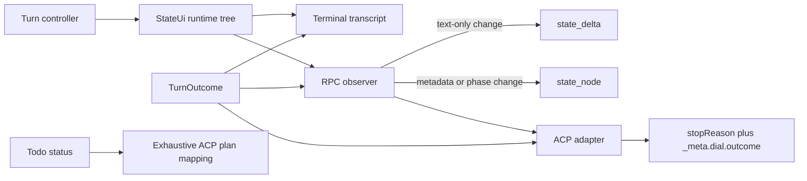

**Preserve:** call-ID correlation for overlapping same-name calls (`src/acp.rs:793-818`), publication only after journal persistence (`src/agent/state_ui.rs:29-34`), `_meta.dial` source metadata on notice chunks (`src/acp.rs:58-68`) and complete-frame ordered stdout.

- [ ] **A12-01** Carry the authoritative outcome through the ACP prompt response.
- [ ] **A12-02** Separate text deltas from metadata snapshots in the RPC observer.
- [ ] **A12-03** Map todo statuses exhaustively to ACP plan entries.
- [ ] **A12-R1** Add call identity to approval events, then retire name-based approval attachment.

**Report update 12:** added three source-confirmed findings on protocol and rendered output consistency, one risk, and one documented limitation. No client run or rendered-terminal capture is claimed.

## 13. Retrieval and tool-result quality and efficiency

**Fourth requested UX/quality pass (delegated reviewer, source only).**

- **Inspected:**
  - `src/tools/search.rs`: glob/grep pagination, footer and edit witnesses
  - `src/tools/files.rs`: read, `read_paths` and `read_plain`
  - the `src/tools/hashline.rs` read budget
  - `src/agent/guard.rs`: clipping
  - the `src/agent/turn.rs` result pipeline and batch duplicates
  - `src/agent/engine.rs` settle
  - `src/agent/investigation.rs`
  - `src/agent/recovery_checkpoint.rs`
  - `src/agent/evidence.rs`
  - projection policy and `src/agent/efficiency.rs`
  - child result shaping
  - `src/tools/navigation.rs`
  - the tool schemas
- **Not inspected:** walker multi-root ordering, semantic reranking, artifact retrieval paging, `parallel_tools` and the SSH grep path.
- **Verification:** no tests were run.

### A13-01 — An `[Unchanged read]` pointer replaces the real read as the "latest" observation

- **P2 · Confirmed / source (path high confidence; frequency medium).**
  - An edit clears the duplicate-observation memory (`src/agent/investigation.rs:21-24`), but the "same range already returned" check survives.
  - That check substitutes `[Unchanged read] … still shown above` (`119-146`; swapped in at `src/agent/engine.rs:159-164`).
  - `settle` reports no duplicate, so the pointer is tagged with the original's observation key (`src/agent/turn.rs:2153-2159`). The pointer text, not the content, also becomes this call's "complete evidence" artifact (`2081`).
- **Output/efficiency impact:**
  - Evidence projection treats the pointer as newest and marks the real read stale (`src/agent/evidence.rs:106-124`). Under context pressure, default pruning drops it (`220-231,256`; defaults `src/agent/compaction.rs:320-321`), and `supersede_reads` replaces it outright (`evidence.rs:129-142`).
  - The model is left with a placeholder and a pointer to text that is no longer shown. Recovering the content costs at least one more round trip; otherwise the model reasons from evidence it can no longer see.
- **Change:** `settle` reports pointer substitution, and pointers never carry an observation key or mark earlier copies stale.
- **Acceptance:** read → edit another file → identical re-read → pressured request. The original read remains in full, or no pointer is emitted. The existing separate tests (`investigation.rs:163-182`, `evidence.rs:278-288`) do not cover the combination.

### A13-02 — Edit witnesses are granted for clipped read lines the model never saw

- **P2 · Confirmed / source.**
  - The per-result model budget is about window/2 bytes, clamped to 4–48 KiB (`src/tools/mod.rs:173-184`). The read tool's own page budget is 48 KiB (`src/tools/select.rs:21-24`).
  - `paths` reads check their 96 KiB cap only before each target, so one call can return about 144 KiB (`src/tools/files.rs:322-337,343-344`).
  - Every returned row becomes a witness (`files.rs:441-451,485-495`; `src/tools/hashline.rs:2440-2442,2467-2469`) before the middle is clipped (`src/agent/turn.rs:2092-2100`; child `src/agent/child.rs:2776-2781`).
- **Output impact:**
  - On models under about 96k tokens, a normal 2000-line read is clipped. The seen-line guard (`src/tools/editing.rs:734-744`) still accepts hashline edits to invisible lines.
  - The footer still claims the full `[lines A-B of N]`, so the continuation range is wrong.
  - Grep already does this correctly: only rows that survive the final page budget become witnesses (`src/tools/search.rs:6-8,997-1027`).
- **Change:** pass the model-facing byte budget into the read tools so pages stop there with a truthful footer. Otherwise, witness only the rows that survive the clip.
- **Acceptance:** on a 32k-window model, a 2000-line read is rejected for edits to clipped lines, and the footer range equals the visible range. Multi-path reads respect the total cap.

### A13-03 — Grep silently caps at 20 matches per file and 20 files per page, despite `max_results`

- **P2 · Confirmed / source; intended code behavior that contradicts the model contract.**
  - Fixed caps (`src/tools/search.rs:30-31`) become a page stop (`527-547`) that ends the walk for all later files (`1163-1171`).
  - The schema promises `max_results` (default 400) and a 2 MiB per-file limit (`src/tools/mod.rs:1096,1106`). The code uses 4 MiB (`search.rs:24`).
  - A test pins `max_results: 5000` → 20 rows (`1509-1517`).
- **Efficiency impact:**
  - A one-file grep asking for 400 matches returns 20.
  - One match-dense file early in sort order hides every later file. Each continuation is another model round trip.
  - The reviewer, the parent and this report's own investigation hit this repeatedly.
- **Change:** when a file hits its cap, continue to the next file with a per-file cursor rather than ending the page. Otherwise, apply the caps only when `max_results` is defaulted. Either way, make the schema text match the constants.
- **Acceptance:** a single-file grep with `max_results: 200` returns 200 rows. When the first file has 100 matches, later files still appear on the same page. The schema matches the constants.

### A13-04 — The duplicate-observation guard survives mid-turn compaction and withholds evidence that is gone

- **P2 · Confirmed / source (medium-high).**
  - The engine owning the duplicate memory and the withheld-call list (`src/agent/engine.rs:17`; `src/agent/recovery_checkpoint.rs:7-11`) is created once per turn (`src/agent/turn.rs:57`).
  - It is reset only on steering, auto-continue or user-directed recovery (`186,2467,2494`). Mid-turn compaction simply loops (`397-430`).
  - `repeat_known` never checks visibility (`src/agent/investigation.rs:55-65`), unlike the same-range check (`src/agent/tool_exposure.rs:568-575`).
- **Output impact:**
  - After compaction removes a read, re-reading it is withheld with "Reuse that evidence; do not reread it".
  - Identical retries are refused without running (`recovery_checkpoint.rs:104-109`). Only the first refusal carries an artifact link (`turn.rs:2111-2116`).
  - The model is told to reuse evidence that no longer exists, which can trigger recovery checkpoints or work from memory.
- **Change:** after successful compaction, or whenever the referenced result is no longer fully visible, clear the duplicate memory, cached observations and withheld list. Keep the failure counters.
- **Acceptance:** read X → mid-turn compaction removes it → the same read executes, returns full content, and no recovery checkpoint fires.

### A13-05 — Subagent result shaping uses the parent window and links every result

- **P3 · Confirmed / source; token impact `[INFERENCE]`.**
  - Child clipping uses `env.config.context_window` (`src/agent/child.rs:2776-2789`, also `2837`), not the child's computed `child_window` (`60-69`, used for compaction at `1377`).
  - It appends `[Complete evidence: artifact://…]` to every result, including small and pointer results. The parent adds the link only when it clips (`src/agent/turn.rs:2111-2117`) and honors `tool_preview_bytes` (`src/agent/efficiency.rs:40-70`).
- **Efficiency impact:**
  - Smaller-window workers receive results sized for the parent, which accelerates their compaction or overflow.
  - Every child result costs about 30 extra tokens. The reviewer's own tool outputs showed this on every result.
- **Change:** share one result-shaping helper between parent and child: limit from `child_window`, link only when clipped.
- **Acceptance:** a 32k child under a 200k parent config clips at 16 KiB, and unclipped child results carry no link.

### A13-06 — An LSP metadata failure marks a successful lexical `find` as an error

- **P3 · Confirmed / source (medium).**
  - `src/tools/navigation.rs:83-86,112-117` sets `is_error = metadata.is_error` for the whole output, even though the lexical results succeeded.
  - Error results feed retry coaching and repeat-failure counts and are kept verbatim in projection.
- **Impact:** good evidence is treated as failure, so the model retries a call that worked, and the error copy stays in context.
- **Change:** keep the result successful and add an inline note that language-server metadata failed.
- **Acceptance:** `find` with `lsp_path` against a failing server returns `is_error=false`, the lexical rows and the failure note.

```mermaid
flowchart LR
    Tool[Tool page with model budget] --> Witness[Witness only visible rows]
    Tool --> Shape[Shared result shaping: window, clip, link when clipped]
    Shape --> Settle[Settle: duplicate pointer flagged]
    Settle --> Evidence[Evidence projection: pointers never supersede content]
    Compact[Successful compaction] --> Reset[Reset duplicate and withheld state]
    Reset --> Settle
    Search[Search walker] --> Cursor[Per-file cursor, honors max_results]
```

**Preserve:**
- post-trim grep witnesses (`src/tools/search.rs:997-1033`);
- pruning that never touches errors, mutations, artifact-less results or the newest window/5 tokens, with immutable placeholders (`src/agent/evidence.rs:110-111,125-127,209-219`);
- the visibility check for same-range reads (`src/agent/tool_exposure.rs:568-575`);
- diagnostic-preserving `clip_evidence`;
- inclusive match-counted search cursors (`src/tools/search.rs:546,569-581`).

- [ ] **A13-01/A13-04** Duplicate/withheld state must follow actual visibility, before and after compaction.
- [ ] **A13-02/A13-05** Apply one model-facing budget to tool paging, witnesses and child shaping.
- [ ] **A13-03** Align grep caps and schema; continue past per-file caps.
- [ ] **A13-06** Separate auxiliary metadata failure from primary result status.

**Report update 13:** six source-confirmed retrieval/evidence findings were persisted. The token impact is inferred; no tests were executed.

## 14. Task, goal, plan workflows and output delivery

**Fifth requested UX/quality pass.** A delegated reviewer traced the code and reported findings from source only. The parent then spot-checked the four highest-impact anchors against the current tree:
- `src/agent/todo.rs:327-334`
- `src/agent/turn_loop.rs:55-64,471-477`
- `src/agent/turn.rs:302-307,531`
- `src/agent/modes/goal.rs:422-436`

No tests, commands or provider calls were run.

### A14-01 — A completed turn closes every open todo, including work that was never started

- **P2 (P1 in goal mode) · Confirmed / source; intent conflict.**
  - A `Completed` turn calls `complete_reported_work()` (`src/agent/turn_loop.rs:55-64`). That marks every `Pending` and `InProgress` task as `Completed` (`src/agent/todo.rs:327-334`), then persists and publishes the list.
  - `CompletionGuard::stopped` refuses only `Blocked` (`src/agent/completion.rs:186-196`). Text-only recovery never consults the todo list (`src/agent/turn_recovery.rs:43-69`).
  - The tool descriptions announce this closure (`src/agent/todo.rs:665`; `src/agent/completion.rs:104`; `src/agent/todo_recovery.rs:85`). The module contract says the opposite: "Text alone does not close a todo list" (`src/agent/completion.rs:1-2`).
- **Output impact:**
  - The model plans six steps, does two, and answers in plain prose. All six are saved and shown as done, and the task panel disappears.
  - In goal mode, continuations ask the model to record deliverables in the todo list (`src/agent/modes/goal.rs:78-84`). The next audit (`500-504`) then sees a checklist that already looks complete, which invites a false `goal complete`.
- **Change:** auto-close only the single `InProgress` entry. Leave `Pending` entries open, or give them a distinct "closed by report, unverified" status. Never auto-close in goal mode. Update either the tool text or the module contract so the two agree.
- **Acceptance:** with a three-task plan, a turn that finishes task 1 and gives a plain answer leaves tasks 2–3 open across save and restore. In goal mode, the next continuation lists the open deliverables.

### A14-02 — `goal complete` bypasses the checks that guard `finish completed`

- **P2 · Confirmed / source.**
  - The goal dispatch (`src/agent/dispatch.rs:743-751`) calls `State::complete` (`src/agent/modes/goal.rs:422-436`), which rejects only goals that are `Dropped` or already `Complete`. It accepts `Paused`, even though the tool text requires resuming first.
  - `validate_completion` checks for blocked todos, running background or live tasks, and failed focused checks (`src/agent/checks.rs:440-483`). It runs only on the normal end-of-turn path (`src/agent/turn.rs:1367-1369`).
- **Impact:**
  - The goal is persisted as "Goal achieved", and `follow_up` ends the loop (`goal.rs:498-513`).
  - The same turn may still end `Incomplete` when `finish` is refused, so the user sees an achieved goal on top of a refused turn.
- **Change:** for `op == "complete"`, run a side-effect-free form of `validate_completion` first. A denial is returned as a tool error and the goal state is left unchanged. `Paused` goals are rejected.
- **Acceptance:** with an active goal plus either a running live task, a blocked todo or a failed check, `goal complete` errors and the goal status stays `Active`. Completing a paused goal errors.

### A14-03 — A background worker result reaches the model for one request attempt and can be lost entirely

- **P2 · Confirmed / source.**
  - Finished worker results go to `LiveTasks.completed` (`src/agent/live_tasks.rs:1107-1110`). `pump_subagents` moves them into `background_notices` (`src/agent/delegation.rs:24-29`).
  - Those notices are injected as `dial_transient` user messages (`src/agent/turn.rs:302-307`), and the pending list is cleared before dispatch (`531`).
  - The context-overflow path compacts and restarts the step without them (`940-989`). A generation error ends the turn (`991-1001`).
  - Transient messages are never persisted, so even a successful request loses the result on every later step.
  - The same channel carries `bg` job completion notices.
- **Output/efficiency impact:**
  - The worker's findings can vanish, or remain visible for only one step, with nothing to remind the model.
  - The model then redoes the paid work, or answers without it, unless it happens to call `task status`.
- **Change:** persist worker results as non-transient harness messages, or keep them queued until a response succeeds and re-inject them on overflow or retry.
- **Acceptance:**
  - A scripted overflow on the request that carries a worker result: the retried request still contains the result.
  - The result is still in context two steps later.

### A14-04 — A worker result is delivered twice after `task wait` or `task status`

- **P3 · Confirmed / source.**
  - `LiveTasks::wait` consumes the `Done` event, which pushes the result to `completed` (`src/agent/live_tasks.rs:1109,1167-1206`), and also returns the full status.
  - `status` pumps first and then returns the same content (`src/agent/delegation.rs:173,211`).
  - The next step pumps it again as "[Worker result from Dial…]" (`src/agent/turn.rs:203`). Each copy is up to 5000 characters (`live_tasks.rs:1260-1276`).
- **Efficiency impact:** a few thousand duplicate tokens per worker, plus a confusing instruction to "use these findings before repeating" that arrives right after the model has read them.
- **Change:** mark the result delivered when `wait` or `status` returns a finished job, and drop it from `completed` and the pending notices.
- **Acceptance:** start → wait until done → the next request contains no duplicate worker-result notice.

### A14-05 — Workers are briefed with the session's first message instead of the current request

- **P2 · Confirmed / source.**
  - `original_goal` is written only while it is null (`src/agent/turn_loop.rs:473-475`), so it stays as the first message of the session. `current_instruction` is refreshed on every turn (`477`).
  - `Handoff::capture` copies `original_goal` and the working state but not `current_instruction` (`src/agent/subagents.rs:431-439`). `Job::brief` labels it "Parent goal (background, not your assignment)" (`597-603`).
  - Task packets already handle this correctly: they include the current instruction and give it precedence (`src/agent/task_packet.rs:100-107`).
- **Output impact:** if turn 1 was "explain the repo" and turn 9 is "fix the CSS regression", the workers are framed by the stale, unrelated goal. That can skew their scope and priorities.
- **Change:** add a bounded `current_instruction` to `Handoff` and render it first. Label `original_goal` as session-start context, or omit it once a newer instruction exists.
- **Acceptance:** after two turns with different requests, a brief for a task delegated in turn 2 contains the turn-2 text and labels the turn-1 text as historical.

### A14-06 — A worker that exhausts its step budget discards all of its findings

- **P3 · Confirmed code; impact partly `[INFERENCE]`.**
  - At its budget (`src/agent/child.rs:1781,1794`), the child returns `Tick::Exhausted`, which produces only "used all N steps without a final answer" (`3009-3012`).
  - There is no last-step warning and no tool-free summary request. The parent sees only "subagent incomplete: …" (`src/agent/subagents.rs:2797-2798`).
- **Efficiency impact:** paid exploration disappears and the parent usually redoes it. Isolated edits survive in recovery copies; read-only findings do not.
- **Change:** reserve the final step for a transient "summarize findings now" request with no tools. Otherwise, return the last non-empty assistant text as an incomplete report.
- **Acceptance:** a child with `max_steps=2` that keeps calling tools returns a summary, not only the exhaustion message.

### A14-07 — `/guided-goal` interview ends on any tool call, which removes the `goal` tool

- **P3 · Confirmed / source.**
  - `State::record` stores activity during the interview (`src/agent/modes/goal.rs:454-467`). `follow_up` clears `interview` whenever there was any activity (`489-492`).
  - After that, `tool_offered` is false while no goal exists (`286-294`).
  - The interview rules ask for questions grounded in the real stack (`135`), so reading a file is expected.
- **UX impact:** after a single grounding `read`, a `goal get`, or a failed `goal create`, the user's next answer arrives with the `goal` tool gone. Guided goal setup then fails without any message.
- **Change:** end the interview only when `goal create` succeeds or the user explicitly declines.
- **Acceptance:** an interview turn containing one `read` call, followed by a user reply: the next request still offers `goal`.

### A14-08 — Implementation starts on the planner model after a mid-turn plan approval

- **P3 · Confirmed code; impact depends on configuration.**
  - Approval (`src/agent/dispatch.rs:518-523` → `src/agent/modes/plan_review.rs:9-20`) leaves plan mode and sets `pending_plan`. `src/agent/turn.rs:2305-2307` then injects "Approved plan… Proceed with implementation." within the same turn.
  - The planner model is restored only at turn start (`src/agent/accessors.rs:569-597`; `src/agent/turn_loop.rs:541-548`). The backend is held for the whole loop (`544-548`).
  - `--plan-yolo` does switch models (`src/agent/modes/plan_yolo.rs:69-82`).
- **Output/cost impact:** with a separate `planner` role configured, the edits are made by the planner model, at a different cost and quality from the main model.
- **Change:** end the turn after an approval when `plan_model_prior` is set, or apply the existing restore at the next step boundary.
- **Acceptance:** with planner ≠ main, the first implementation request after approval goes to the main model.

### A14-09 — Finishing while live workers run hard-stops the turn instead of continuing

- **P3 · Confirmed / source.**
  - Running `bg` jobs get a nudge and the turn continues (`src/agent/dispatch.rs:1159-1180`; `src/agent/turn.rs:1347-1349`).
  - Live workers are not in `awaited_background_jobs`. Instead, `validate_completion` errors (`src/agent/checks.rs:456-470`), and `stop_turn` replaces the result with `Incomplete` (`src/agent/projection.rs:214-229`).
- **UX impact:** "cannot finish completed while live tasks are running" ends the turn. The user must type "continue", and the worker results arrive only on a later turn.
- **Change:** treat running live tasks like `bg` jobs. Nudge the model ("wait with `task wait` or continue independent work") and continue within the step budget.
- **Acceptance:** finishing while a worker runs produces a nudge, the same turn waits for the result and incorporates it, and the turn does not end `Incomplete`.

```mermaid
flowchart LR
    Turn[Turn outcome] --> Todo[Todo: close only verified or in-progress entries]
    Goal[goal complete] --> Validate[Shared side-effect-free completion validation]
    Finish[finish completed] --> Validate
    Validate --> Live[Live tasks: nudge and wait like bg jobs]
    Worker[Worker done] --> Delivery[Persisted, deduplicated delivery ledger]
    Delivery --> Context[Model context survives overflow and later steps]
    Handoff[Handoff] --> Current[Current instruction first; original goal as history]
    Approval[Plan approval] --> Boundary[Restore main model at the next step boundary]
```

**Preserve:**
- transactional todo updates and persist-before-swap (`src/agent/todo.rs:472-493`; `src/agent/dispatch.rs:735-739`);
- goal stall and budget-limit prompts (`src/agent/modes/goal.rs:493-513`);
- `/plan-review` sharing the `exit_plan` approval path (`src/agent/modes/plan_review.rs:23-38`);
- session rebinding that cancels old workers (`src/agent/live_tasks.rs:528-535`);
- approvals routed to the controller thread (`976-1017`);
- resume identity checks (`626-634`);
- conflict-checked, revalidated isolated merges (`src/agent/isolation.rs:566-621`);
- full-report artifacts before trimming (`src/agent/subagents.rs:2751-2785`).

**Coverage gaps:** the full child main loop, `worker_resume.rs`, `mailbox.rs`, `solve.rs`, review workflow, concurrent runs, `/tasks` rendering in `app.rs`, and RPC/ACP delivery of worker results.

- [ ] **A14-01/A14-02/A14-09** Use one completion contract for todo closure, goal completion and live-task waits.
- [ ] **A14-03/A14-04** Add a persisted, exactly-once worker-result delivery ledger.
- [ ] **A14-05/A14-06** Brief workers with the current request and salvage partial results at budget.
- [ ] **A14-07/A14-08** Exit modes at the right state boundary: interview on goal creation, planner model on approval.

**Report update 14:** nine findings were persisted. Eight are source-confirmed; A14-06's impact is partly inferred, and A14-01 is also a contract conflict. The four main anchors were spot-checked by the parent. No runtime reproduction is claimed.

## Consolidated follow-up assessment — audits 6–14

**Inventory:** 48 main findings, plus three risks or product decisions (A9-R1, A12-R1 and the A12 documented `tool_output` limitation).
- By severity: **10 P1**, **30 P2** and **8 P3**.
- All 48 are source-confirmed; none was reproduced end to end at runtime.
- A6's Git mechanisms were exercised with synthetic probes.
- Impact is partly inferred, as labelled, for A13-05, A14-06 and A14-08.

| Pass | P1 | P2 | P3 | Findings |
| --- | --- | --- | --- | --- |
| 6 Commit output and review | 2 | 5 | 0 | A6-01..07 |
| 7 Extensions and skills | 2 | 3 | 0 | A7-01..05 |
| 8 Provider setup and auth transitions | 1 | 4 | 0 | A8-01..05 |
| 9 Retained outputs, archive, exports | 4 | 1 | 0 | A9-01..05, risk A9-R1 |
| 10 Context, completion, verification | 1 | 4 | 0 | A10-01..05 |
| 11 Terminal interaction UX | 0 | 3 | 0 | A11-01..03 |
| 12 Rendered and protocol output | 0 | 2 | 1 | A12-01..03, risk A12-R1 |
| 13 Retrieval and tool results | 0 | 4 | 2 | A13-01..06 |
| 14 Task, goal, plan, delegation | 0 | 4 | 5 | A14-01..09 |
| **Total** | **10** | **30** | **8** | **48** |

**P1 queue:**
- A6-01 — split commits include unreviewed work
- A6-04 — dry-run push
- A7-01 — cross-project store prune
- A7-02 — publisher substitution
- A8-01 — unbound OAuth destination
- A9-01 — live spool GC
- A9-02 — fail-open reference marking
- A9-03 and A9-04 — anonymizer leaks
- A10-01 — LSP edits skip verification

### Cross-cutting root causes

1. **Completion is decided in several places with different rules.** Todo auto-closure, `goal complete`, `finish`, notifications and the ACP `stopReason` each interpret "done" independently (A10-01/02, A11-03, A12-01/03, A14-01/02/09). The target is one outcome contract, owned by `checks.rs`/`turn_loop.rs` and projected by the adapters.
2. **Model-visible evidence and bookkeeping drift apart.** Witnesses, duplicate memory, pointers and withheld calls are recorded independently of what the model actually sees after clipping, compaction or overflow (A10-05, A13-01/02/04/05, A14-03/04). The target is one shaping step after which visibility is recorded, plus state reset at compaction.
3. **Snapshots and generations are missing at state transitions.** Commit staging, package updates, auth jobs, resident credentials, spools and plan or model swaps act on state that changed underneath them (A6-01..03, A7-04, A8-03/04, A9-01, A14-08). The target is an explicit generation or ownership claim at each transition, not a new framework.
4. **The public contract disagrees with behavior.** Examples are the grep caps vs the schema, the anonymizer contract vs flag heuristics, archive `Complete` vs the observed tail, and the todo module doc vs the tool text (A9-03/05, A13-03, A14-01). Fix whichever side is wrong, and add a regression test for the contract, not the prose.
5. **Failures are absorbed into success, or successes are flagged as failures.** Ignored reads (A9-02), whole-run classification (A10-04), metadata errors (A13-06) and exhausted workers (A14-06) all lose useful outcomes. The target is to report a partial result with a qualifier.

### Priority roadmap

| Order | Change | Findings closed | Owner |
| --- | --- | --- | --- |
| 1 | Fail-closed retention: spool claims and reference-read errors | A9-01, A9-02 | `src/cli/gc.rs`, `src/tools/artifact.rs` |
| 2 | Snapshot-bound commit and preview: private index, refuse dry-run push | A6-01..04 | `src/commit/` |
| 3 | Default-deny anonymizer and branch-aware share scope | A9-03, A9-04, A9-R1 | `src/storage/anonymize.rs`, `share.rs` |
| 4 | Credential audience and auth generations | A8-01..04 | `src/llm/`, `src/agent/backend.rs` |
| 5 | Unified completion contract | A10-01, A10-02, A11-03, A12-01, A12-03, A14-01, A14-02, A14-09 | `src/agent/checks.rs`, `turn_loop.rs`, adapters |
| 6 | Visibility-bound evidence: one shaping budget, pointer and compaction reset | A13-01, A13-02, A13-04, A13-05, A10-05 | `src/agent/turn.rs`, `evidence.rs`, `child.rs` |
| 7 | Exactly-once persisted worker delivery and current-request handoff | A14-03..06 | `src/agent/live_tasks.rs`, `delegation.rs`, `subagents.rs` |
| 8 | Extension ownership and isolation | A7-01..05 | `src/storage/skills/packages/`, `src/tools/plugin/` |
| 9 | Contract alignment: grep caps, archive status, find status, Go and Python check planning | A13-03, A13-06, A9-05, A10-03, A10-04 | tool and verification owners |
| 10 | Interaction-state fixes | A11-01, A11-02, A12-02, A14-07, A14-08, A8-05, A6-05..07 | `src/app.rs`, `src/rpc.rs`, modes, `src/security/` |

### Coverage matrix

| Area | Inspected in depth | Not inspected or not executed |
| --- | --- | --- |
| Commit and security review | `src/commit/`, `src/security/` coordinator, ops and plan | Live model review quality; load behavior |
| Extensions | Package store, lock, marketplace, installer, discovery | Real registry or network installs |
| Providers and auth | Shared OAuth, catalog routing, backend construction, UI and slash transitions | Every provider's external protocol; live refresh; browsers on other platforms |
| Retention and exports | GC, spools, anonymizer, archive scan, share and export | Concurrent GC; fault injection; derivatives of history and media |
| Turn core | Mutation allowlist, verification planning, completion checks, compaction notes | Native provider compaction; every runner dialect |
| TUI | Busy-command routing, wait loops, composer, notifications | Rendered screen capture; every overlay |
| Protocols | ACP replay and emit, RPC tree and state delta, todo projection | Live ACP/RPC clients |
| Retrieval | read, grep, glob, find, clipping, duplicates, evidence pruning, child shaping | Walker multi-root order; semantic reranking; artifact paging; SSH grep |
| Workflows | todo, goal, plan review, delegation, live tasks, isolation merge | Full child loop; `worker_resume.rs`; `mailbox.rs`; `solve.rs`; `/tasks` rendering |

### Verification ledger — audits 6–14

| Evidence | Outcome | What it does not establish |
| --- | --- | --- |
| A6 synthetic Git probes in temporary repositories (`artifact://13114f3e4ec3bc94303da55f91ac75de8745cbaa713e26cf3f84bc8400c5c4ed`) | All mechanism probes passed | Dial's commit command end to end; no push executed |
| Source traces by delegated reviewers and the parent (A7–A14) | Line ranges cited per finding; the parent spot-checked A14's anchors and A12 directly | Runtime reproduction, platform behavior, model-quality effects |
| Report structural check and `git diff --no-index --check` on this file | Pass: 48 unique follow-up findings (10 P1, 30 P2, 8 P3, matching the inventory); numbered sections 1–14 and report updates 1–15 all present; 22 Mermaid blocks with balanced fences; every cited `src/`, `tests/`, `scripts/`, `python/` and `docs/` path exists, with line ranges inside the current file length; no whitespace diagnostics (exit 1 is expected for a no-index diff) | Whether each cited range still says what the finding claims after later edits |

No production code, tests or configuration were changed by audits 6–14. No new regression tests were written; the acceptance criteria above define them. Recommended checks after implementation are the same as for audits 1–5: focused `make test-module MOD=<owner>`, then `make test-integration`, `make test-rust` and `make lint`.

**Report update 15 (consolidation):** follow-up passes 6–14 are integrated, with inventory, root causes, roadmap, coverage matrix and verification ledger.
