# Five architecture and deep implementation audits

## Scope and evidence contract

This is an actionable audit of the **current working tree**, including pre-existing staged and unstaged changes. It is not a review of HEAD alone. Production code, existing plans and user changes are left untouched. **All implementation changes below are proposed, not applied.** The delivered change is this report, updated after each completed audit.

Five complementary passes cover: (1) architecture/build/release contracts; (2) agent/provider/configuration orchestration; (3) tools, permissions and process ownership; (4) durable state, provenance and learning; (5) external protocols, runtimes and presentation. This is a broad source-based audit with deep selected traces, not a claim to have executed every branch or certified every platform.

Evidence labels:

- **Confirmed / source**: a concrete trigger and consequence follow from inspected code; not necessarily reproduced at runtime.
- **Confirmed / executed**: a named local check exercised the behavior.
- **Risk / [INFERENCE]**: plausible impact requiring the stated experiment or product decision.
- **Coverage gap**: an absent guarantee or unexercised boundary, not itself a demonstrated runtime defect.

Severity: **P1** security, data loss, or materially wrong completion; **P2** correctness/reliability or a significant assurance gap; **P3** maintainability/documentation. Priorities do not imply an exploit was executed. Source locations are working-tree references and can drift after later edits.

## Audit completion ledger

| Pass | Scope                                | Report status | Source changes |
| ---- | ------------------------------------ | ------------- | -------------- |
| 1    | Architecture, build and release      | Complete      | None           |
| 2    | Agent, providers and configuration   | Complete      | None           |
| 3    | Tool authority and execution         | Complete      | None           |
| 4    | Persistence, provenance and learning | Complete      | None           |
| 5    | External runtimes and surfaces       | Complete      | None           |

## 1. Architecture, build and release audit

### Coverage and method

Inspected the declared boundaries and invariants in `ARCHITECTURE.md`, crate exports (`src/lib.rs`), CLI entry declarations (`src/main.rs:1-200`), all of the dependency-boundary checker, Cargo features/profiles, `build.rs`, Make build/install/test targets, CI, release packaging/publication through its signing step, self-update verification/activation, build tests, package manifests, and release documentation. Existing review prose was treated as context, not proof. Installer internals, hosted CI results, live releases, Docker/Nix builds and signing credentials were not exercised.

The project is one Rust crate with module-level rather than compiler-enforced subsystem boundaries. `main` mounts binary-only CLI modules; `app` and protocol adapters compose the agent, tools, providers and storage. Optional integrations are Cargo features; platform-specific desktop behavior also uses build-script cfgs. Runtime facts and presentation are intentionally separate. This is a reasonable shape for the current product: no evidence here justifies a multi-crate rewrite.

### Current relationships and data flow

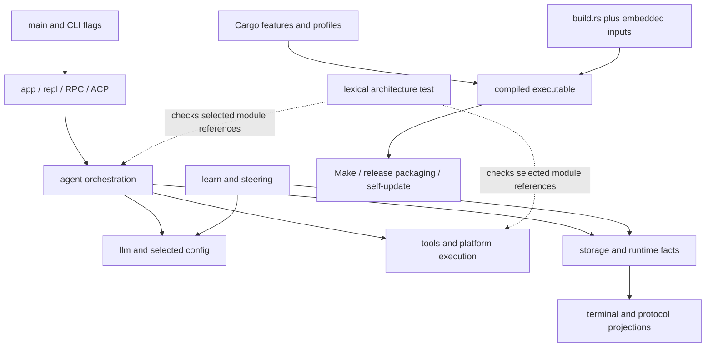

**Preserve:** provider/tool/UI boundaries; role adapters over shared execution; typed effect certainty; private durable state; immutable evidence; fail-closed sandboxing; exact signed-manifest verification; package-manager ownership; tests that distinguish unavailable environments from success. `src/cli/update.rs:91-105,135-146` verifies signature before trusting the selected digest; `122-134` avoids overwriting recognized package-manager installations. These are positive implementation observations, not full supply-chain certification.

### A1-01 — Architecture guard misses ordinary module aliases

- **P2 · Confirmed / source · high confidence.** `tests/integration/architecture.rs:285-328` only records a module when its name is followed by `::`. Consequently `use crate::tools;`, `use crate::tools as t;`, or `use crate::{tools, config::types::Config};` can introduce the forbidden module without a recorded dependency. Calls through the alias do not contain `crate::tools::`. Whitespace between `crate` and `::`, relative paths, and deliberately excluded `$crate::` paths are additional lexical limits.
- **Trigger/consequence:** introduce a forbidden module import in `ui` using one of these legal forms; the architecture test can remain green while the documented boundary is violated. This is a defect in the guard, **not evidence that the present production graph already violates it**.
- **Proposed change:** extend import/path recognition to module imports and aliases, ideally using an already available Rust syntax parser rather than growing a bespoke token heuristic. Explicitly document macro/relative-path coverage if it remains incomplete. Fail on source enumeration errors rather than silently treating unreadable directories as empty (`13-24`).
- **Acceptance:** positive/negative fixtures for direct module imports, aliases, grouped imports, whitespace, nested test modules, macro paths and relative references; production code after tests must remain checked. Keep comments/string exclusions. Report missing/unreadable module roots distinctly.
- **Existing evidence:** all four current architecture tests passed in a standalone Rust test harness. They do not cover alias imports (`381-442`).

### A1-02 — Native Windows release lacks a Rust test gate on Windows

- **P2 · Coverage gap · high confidence.** `.github/workflows/ci.yml:15-16` runs Rust build/test on two macOS variants and Linux. The Windows CI job (`115-131`) only runs installer tests. `.github/workflows/release.yml:98-153` builds/packages Windows and runs version/help and installer checks, but not Rust library/integration tests.
- **Trigger/consequence:** Windows-only process, filesystem, projected-isolation or UI regressions can compile and pass installer checks without their behavioral tests being run before publication. **[INFERENCE]** This increases release risk; it does not demonstrate that those implementations currently fail.
- **Proposed change:** add a Windows Rust job, initially a supported focused contract suite plus a clearly tracked exclusion list; gate publication on that job. Expand to the portable full suite as fixtures become supported. Keep unsupported capability reporting explicit.
- **Acceptance:** execute native process-group/job ownership, filesystem replacement, cancellation and protocol tests on Windows; fail on real regressions rather than globally ignoring platform errors. Record exact skipped tests and reasons.

### A1-03 — Self-update removes the active executable before replacement

- **P1 · Confirmed / source · high confidence.** `src/cli/update.rs:256-284` deletes an old backup, renames the current executable to the backup, then renames the staged executable into place. Error returns attempt rollback, but a process crash or power loss between those two renames leaves the normal executable path absent. `docs/release-and-install.md:15` describes activation as atomic, which is stronger than this implementation.
- **Trigger/consequence:** interruption immediately after line 261; subsequent invocations cannot find the executable even though a backup may remain. No crash injection was executed in this audit. Windows uses a separate deferred two-move script (`217-234`) and needs its own design and validation.
- **Proposed change:** under an install-location mutation lock, preserve a verified backup without first removing the active name; atomically replace that name with the same-filesystem staged file and perform the appropriate directory durability barrier. Use platform-specific replacement primitives. Recovery must retain both the original failure and any failed rollback.
- **Acceptance:** inject failures/crashes before and after backup creation, replacement, durability barrier and post-check; active path must always be a complete old/new executable or have a documented recoverable startup path. Include concurrent update attempts. Signed-content and package-manager checks must remain unchanged.

### A1-04 — Make update can continue after backup failure and overwrite same-second backups

- **P2 · Confirmed / source · high confidence.** `Makefile:44-55` runs `cp -p` followed by `printf` without fail-fast handling. A failed copy can be masked by the succeeding print/loop status, allowing install recipes (`62-64`) to replace the original without the promised backup. Backup names have only second resolution; two updates within a second overwrite the same backup. Pruning also happens before activation (`56-60`).
- **Trigger/consequence:** make an existing backup destination unwritable, or run two quick updates with an unchanged timestamp; backup preservation can fail or the older rollback point can be lost. These paths are source-confirmed but not fault-injected here.
- **Proposed change:** make each backup failure fatal before any install, use collision-safe backup creation, then activate and prune only after successful replacement/checks. Do not consolidate development installation with the signed updater unless their distinct contracts remain explicit.
- **Acceptance:** extend `scripts/test-build.py` with failed backup, timestamp collision, partial multi-location activation, invalid retention input, and failed post-install check. Existing four build tests pass but cover happy backup creation and build failure, not these failure paths.

### A1-05 — Nix package identity can disagree with its compiled source

- **P3 · Confirmed / source · high confidence.** `flake.nix:14-16` labels the package `0.1.7` while building `self`; `Cargo.toml:3` is `0.1.8`. A build from this tree therefore has package metadata detached from the Rust version. The Homebrew formula also references 0.1.7, but it downloads explicitly versioned 0.1.7 assets; **that alone is not a defect** because a released formula can intentionally lag unreleased source.
- **Proposed change:** derive the source-built Nix version from `Cargo.toml`; keep release-fed binary formula updates separate. Add a packaging consistency check. Do not blindly bump Homebrew hashes without actual release artifacts.
- **Acceptance:** evaluate Nix package metadata against Cargo version; build/version agreement where Nix is available. No Nix command was executed here.

### Target architecture and change relationships

This is an evolutionary target, not a new framework. A1-01 strengthens the existing architecture owner; A1-02 makes platform support an executable contract; A1-03/A1-04 align the two installation paths around explicit publication guarantees without conflating their trust models; A1-05 removes duplicated source-package identity.

### Verification performed for audit 1

- Standalone harness: `CARGO_MANIFEST_DIR="$PWD" rustc --edition=2024 --test tests/integration/architecture.rs -o <temporary-binary>` followed by that binary with `--nocapture`: **4 passed, 0 failed**. This runs the exact checker against the current source without compiling the whole application.
- `python3 scripts/test-build.py`: **4 passed**. This uses its disposable fake-Cargo fixture; it did not build/install Dial or modify the real installation.
- No full Rust suite, hosted CI, release signing/publication, installer execution against the real installation, cross-platform runtime, or performance measurement was run. Existing review documents mention earlier unresolved suite failures; those claims are not replaced by these focused results.

### Audit 1 actionable queue

- [ ] **A1-03** Fix crash-safe updater publication; add fault and concurrency tests.
- [ ] **A1-04** Fail closed on backup failure; preserve collision-safe rollback points.
- [ ] **A1-01** Close architecture-checker alias and source-enumeration gaps.
- [ ] **A1-02** Add native Windows behavioral CI with explicit supported coverage.
- [ ] **A1-05** Derive Nix source-package version from Cargo.

**Report update 1:** completed the architecture/build/release pass, recorded five findings, current/target diagrams, preserved invariants, and the two executed checks. No implementation fix is represented as applied.

## 2. Agent lifecycle, delegation, context and provider audit

### Coverage and preserved relationships

Deep traces covered parent lifecycle/turn settlement, the shared engine, serial and parallel admission, steering and interruption, completion verification, role configuration, startup fallback, worker slots/isolation/resume, compaction commit, provider retry and usage binding. Every provider serializer/OAuth implementation, every mode, native/speculative compaction, all live-task messaging and platform isolation backends were **not** exhaustively audited. No live provider or Rust regression execution was performed for this pass.

| Owner / relationship                                             | Inspected invariant to preserve                                                                                                        |
| ---------------------------------------------------------------- | -------------------------------------------------------------------------------------------------------------------------------------- |
| `agent/engine.rs:53-73,105-123` → parent/child adapters       | Shared recovery stops automatic continuation/completed publication after uncertain effects.                                            |
| `agent/dispatch.rs:365-437,491-539` → tools                   | Pre-hook rewrite is followed by argument revalidation, fresh authorization and cancellation checking.                                  |
| `agent/turn.rs:1765-1788`; `agent/child.rs:2644-2660`        | Parallel candidates are admitted individually; pre-tool hooks disable the batching path.                                               |
| `agent/turn.rs:1599-1616` → conversation                      | Superseded pending calls receive closure before steering is appended; actual prefetched results remain results.                        |
| `agent/turn_loop.rs:545-805` → completion                     | Repairs share the turn budget; stop-hook continuations reenter verification.                                                           |
| `config/mod.rs:1101-1121` → workers                           | Role configuration inherits controls and disables main-only steering/adaptation.                                                       |
| `agent/task_slots.rs:18-35`; `agent/child.rs:2041-2092`      | Worker counts are bounded; provider slots bracket inference, not nested execution.                                                     |
| `agent/isolation.rs:553-620`; `agent/subagents.rs:2331-2364` | Cooperating merges are serialized, parent content rechecked, conflicts/recovery copies retained, owned resources stopped before merge. |
| `agent/worker_resume.rs:64-102,120-155`                        | Workspace/execution identity and unresolved effects are checked before resume.                                                         |
| `agent/compaction_ops.rs:267-290,321-406`                      | Compaction validates snapshot/config/history/tool groups, fit, replay and cancellation before commit.                                  |

All paths in this table are under `src/`. These are source observations, not newly executed guarantees.

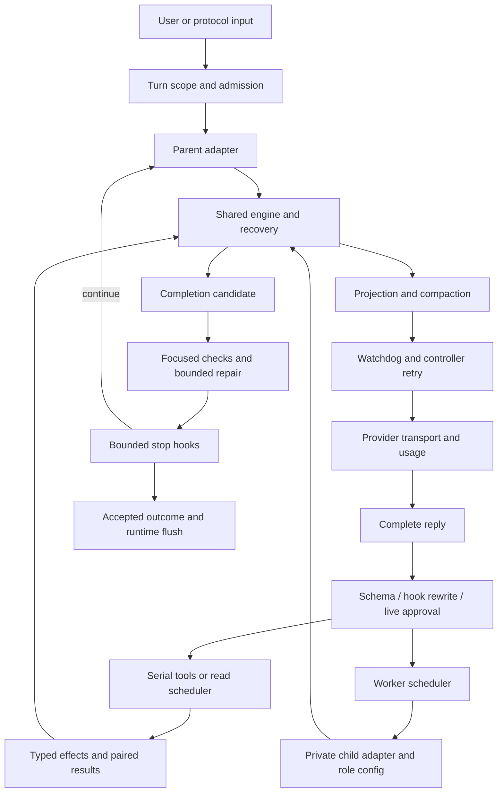

### A2-01 — Silence recovery interrupts legitimate provider backoff

- **P2 · Confirmed / source · high confidence.** `src/agent/chat.rs:66-71,343-350,550-568` arms remote silence detection and resets its clock for a retry event, but retains no backoff-active state. `src/llm/provider.rs:1668-1687` emits one waiting event and then sleeps until the retry deadline. `chat.rs:151-164` can restart an empty silent failure.
- **Trigger/consequence:** a valid provider retry delay exceeds the agent silence timeout while remaining within the configured transport maximum. The documented 180-second maximum and 120-second silence default permit this. The controller cancels a healthy wait, potentially resends before `Retry-After`, or pauses unnecessarily. Transport compliance in isolation does not establish controller compliance (`docs/llm-transport.md:5,64-70`).
- **Proposed change:** retain explicit request phase; suspend generation-silence detection during transport backoff and rearm on `waiting: false`. Keep user cancellation/heartbeat responsive; do not fabricate token progress.
- **Acceptance:** test the full chat wrapper with a scaled/injected clock, retry delay greater than silence threshold, no premature resend, prompt explicit cancellation, and genuine post-backoff silence still bounded. Nearby backend-delay tests (`provider.rs:4037-4063`) and silent-agent tests (`tests/integration/agent.rs:476-515`) do not establish this composed contract.

### A2-02 — Parent fallback retains primary context and output planning

- **P2 · Confirmed / source · high confidence.** `src/agent/turn.rs:53-55` computes output budget once; `889-899` resolves `next_config` but replaces only the backend. `src/agent/accessors.rs:244-260` still derives context planning from primary `auth_config`/`context_cap`; `turn.rs:215-235,351-355,455-469,509-529` uses that identity/capacity in preparation/admission.
- **Trigger/consequence:** a fallback has a smaller context/output capacity. The request can be prepared and compacted for the primary, rejected by the fallback, and retried against the same wrong capacity. Qualification: adaptive selection does receive `backend.model_profile()` at `turn.rs:232`; not every profile field is stale.
- **Proposed change:** retain active resolved configuration with the backend, and recompute request bounds/compaction identity on route transitions. Preserve the operator's primary selection separately. Reuse `Config::with_selection` (`src/config/mod.rs:1008-1024`) and the worker startup pattern that supplies alternate `Env.config` (`src/agent/subagents.rs:2010-2037`).
- **Acceptance:** large-window primary fails, small-window fallback succeeds with a request within its own context plus output reserve; exercise same-provider/different-model and alternate-provider routes, and verify overflow recovery does not keep primary-sized requests.

### A2-03 — Fallback backend outlives the state needed to restore the primary

- **P2 · Confirmed / source · high confidence.** `src/agent/turn.rs:53-54` stores fallback index/deadline locally; `607-615` requires those locals to restore primary; `894-899` installs fallback/cooldown. `src/agent/turn_loop.rs:544-548,824` retains the backend across turns.
- **Trigger/consequence:** fallback completes before cooldown expires; the next turn starts after expiry. It receives the fallback backend but initializes index zero/no deadline, so the restoration branch cannot run. Verification/stop-hook loop reentry has the same lifetime mismatch. The session can remain on fallback while configured selection still names primary.
- **Proposed change:** either persist temporary-route state at agent/session lifetime or restore primary when leaving the owning loop. Do not persist a backend without its routing state.
- **Acceptance:** primary failure → fallback completion → advance clock past cooldown → next turn uses primary; repeat across verification and stop-hook reentry. Before expiry, retained fallback must be explicitly represented and reported.

### A2-04 — Replacing a backend loses runtime usage attribution

- **P2 · Confirmed / source · high confidence.** Fresh backends start with `usage_scope: None` (`src/llm/provider.rs:285-315`), and accounting is conditional on scope (`941-955`). Parent turn binding happens before the loop (`src/agent/turn_loop.rs:43-49`); replacements at `src/agent/turn.rs:611-612,899` do not rebind it.
- **Trigger/consequence:** fallback or in-loop primary restoration makes subsequent ordinary requests disappear from runtime-ledger request counts, coverage, model/purpose breakdown and observed cost. **This is not a demonstrated budget bypass:** parent legacy metrics and successful-reply cost still update at `turn.rs:1038-1048`; the finite step limit remains separate.
- **Proposed change:** one backend-installation helper binds current session identity and usage scope for every route transition. Reuse `Backend::set_usage_scope` (`provider.rs:497-525`) and child scope handling (`src/agent/child.rs:1578-1591`).
- **Acceptance:** scripted primary failure → fallback success → restoration records every request/attempt/outcome exactly once, under the correct model and original turn; cover ordinary and repair-purpose inference.

### A2-05 — Duplicate-call identity strips meaningful nested fields

- **P2 · Confirmed / source · high confidence.** `src/agent/guard.rs:78-94` recursively deletes `i` and `__intent` keys. That identity drives streak detection/result matching (`154-179,195-219`); `src/agent/turn.rs:1532-1563` suppresses matched calls and substitutes earlier-result pointers. `src/agent/stream_guards.rs:71-73` sets the repeat threshold.
- **Trigger/consequence:** an admitted tool receives distinct payloads such as `{"filter":{"i":1}}`, `{"filter":{"i":2}}`, etc. They collapse to one identity; after the repeat threshold, a genuinely new call can be withheld and answered with a result pointer for different arguments.
- **Proposed change:** use one deterministic normalizer stripping only defined **top-level** harness metadata. `normalized_arguments` already preserves nested fields (`guard.rs:7-26`); the second implementation contradicts it. Reconcile legacy `__intent` and `_intent` without stripping application data.
- **Acceptance:** varying nested `i`/`__intent` never forms a duplicate streak or short-circuits a new call; top-level presentation-only differences still count as repeats. Run an admitted nested-schema tool through the parent loop and assert distinct calls execute. Existing tests (`guard.rs:237-268,280-303`) cover ordinary paths/top-level intent, not this boundary.

### Ideal architecture and change relationships

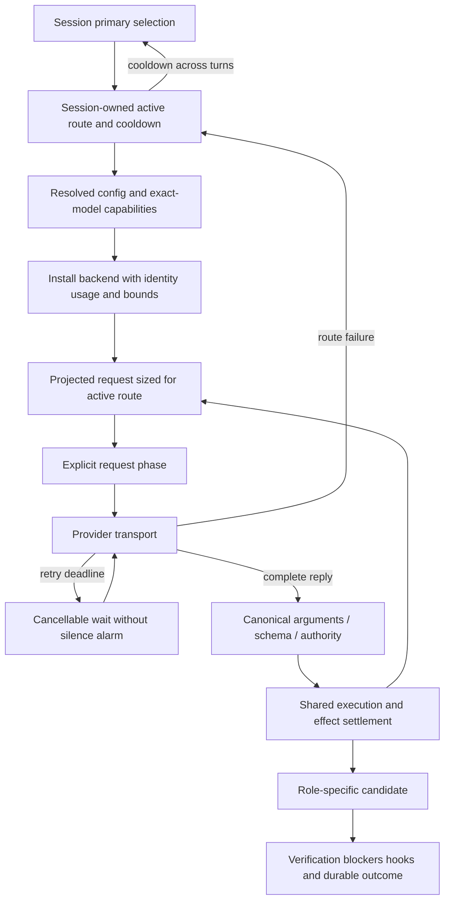

A2-02 through A2-04 have one root architectural problem: route transitions update the backend independently of its configuration, lifetime and accounting. A small active-route owner and installation helper are justified; a replacement orchestration framework is not. A2-01 needs consumption of existing retry-phase events; A2-05 needs removal of contradictory normalization, not another guard layer.

**Additional risks / [INFERENCE]:** worker teardown joins cooperatively cancelled tasks (`src/agent/live_tasks.rs:1224-1230`); end-to-end liveness depends on tool cancellation and must be evaluated with audit 3. A completed isolated worker and its merge outcome are separate contracts: conflict metadata does not mean all changes landed. This appears intentional, not a confirmed defect. Large parent/child adapters alone do not justify mechanical deduplication.

### Tests and actionable queue

Inspected nearby coverage includes shared-engine uncertainty (`src/agent/engine.rs:183-246`), recovery bounds (`turn_recovery.rs:87-147`), complete tool-group compaction (`compaction.rs:1613-1641`), stop-hook finite budget (`tests/integration/agent.rs:6956-6979`), worker startup fallback without replay (`10192-10243`), isolation conflicts (`src/agent/isolation.rs:748-781`), backend partial-tool discard (`src/llm/provider.rs:4084-4125`), session model pinning (`src/config/session_models.rs:118-150`) and worker slots (`src/agent/task_slots.rs:41-65`). These tests were **not executed** in this audit; their existence is not evidence that the five composed-boundary regressions pass.

- [ ] **A2-02, A2-03, A2-04** Implement one coherent route-state transition with context, cooldown and accounting tests.
- [ ] **A2-01** Make provider backoff an explicit watchdog phase; test cancellation and deadline precedence.
- [ ] **A2-05** Share the top-level-only argument-identity policy and test nested application fields.

**Report update 2:** completed the agent/provider/configuration pass; added five source-confirmed defects, preserved invariants, both flows, explicit risks, regression criteria and coverage limits. Production changes remain unapplied.

## 3. Tool authority, confinement and process ownership audit

### Coverage and existing architecture

Deeply traced native execution/registry lifecycle, workspace and protected paths, Unix transaction staging/rollback, process capture and foreground/background transfer, LSP write-through/forks/formatting, MCP event framing/listener lifetime, and web resolver/redirect credentials. Sampled Linux mount policy, Windows Job Objects/initial edit handling, DAP admission/launch, embedded-shell state, and tool-contract identity. No commands, sandbox probes or Rust tests were executed for this pass. Browser internals belong to audit 5; SSH/plugin runtime internals, the whole Windows rollback/PTY/ACL implementation, and every protocol action were not comprehensively examined.

| Boundary                       | Inspected protection / relationship                                                                                                                                                                                                                                                                                   |
| ------------------------------ | --------------------------------------------------------------------------------------------------------------------------------------------------------------------------------------------------------------------------------------------------------------------------------------------------------------------- |
| Controller → native tools     | `src/tools/ext.rs:13-36,63-69,173-187` separates mutation authorization/controller callbacks from native tool dispatch; `execution.rs:93-181` owns pre-start cancellation, panic containment and typed effects.                                                                                                   |
| Registry → external contracts | `src/tools/ext.rs:424-448` validates registration and semantic revisions. MCP read-only hints are masked by operator trust (`src/tools/mcp/mod.rs:529`, `tool.rs:153-159`).                                                                                                                                     |
| Workspace → private state     | `src/tools/mod.rs:711-839` checks canonical confinement, traversal, symlink escape and protected paths, including mutation of protected ancestors.                                                                                                                                                                  |
| Edit → publication            | `src/tools/edit_transaction.rs:18-33` acquires leases/checks cancellation; `edit_transaction_unix.rs:439-554` validates/observes/stages before installation; `556-644` retains originals and explicitly reports unsettled recovery. This is rollback atomicity, not simultaneous multi-file or crash atomicity. |
| Locks                          | `src/tools/document_transaction.rs:20-49` sorts reentrant leases and rejects nested lock-order inversion.                                                                                                                                                                                                           |
| Sandbox                        | `src/tools/sandbox/linux.rs:29-165` uses explicit mounts/masks and refuses unsafe overlaps; `src/tools/sandbox.rs:297-300` refuses unsupported Windows isolation.                                                                                                                                                 |
| Web                            | `src/tools/web/fetch.rs:59-68,164-214` disables proxy/automatic redirects, rechecks hops and scopes credentials to origin; `guard.rs:133-155` checks resolved addresses. Operator-configured MCP local endpoints intentionally have a different trust model.                                                      |
| Processes                      | `src/runtime/process.rs:303-540` owns bounded nonblocking capture/deadlines/group cleanup. `src/platform/unix.rs:249-268` reserves the unreaped leader PID; `windows_process.rs:29-68` assigns a suspended process to a kill-on-close job before resuming.                                                      |
| Extensions / shell             | DAP requires approval/fresh session state (`src/tools/dap.rs:130-139,355-394`). Embedded shell skips profiles (`src/embedded_shell/mod.rs:108-115`); returned state/cwd is bounded/validated (`state.rs:26-65`, `src/tools/shell.rs:662-691`).                                                                |

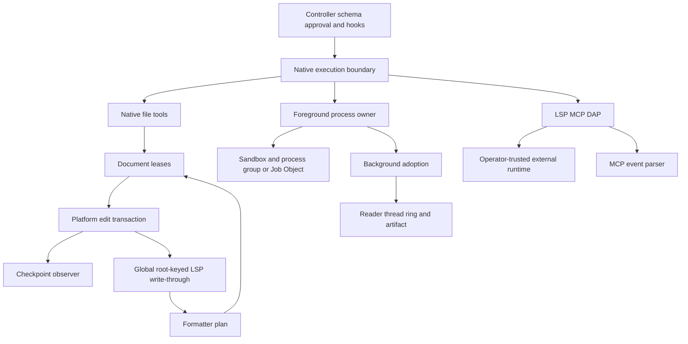

### A3-01 — MCP SSE events are unbounded despite individual line limits

- **P1 · Confirmed / source · high confidence.** `src/tools/mcp/http.rs:595-633` appends each `data:` field to an unbounded vector; the GET stream uses `limit(u64::MAX)` (`415-424`). Cancellation is checked at completed-event delivery, not during accumulation.
- **Trigger/consequence:** a configured server sends indefinitely many short legal `data:` lines without an empty event terminator. Aggregate memory grows until failure, including while shutdown is requested. The per-line cap does not bound an event.
- **Proposed change:** enforce cumulative event bytes/field count before allocation, check cancellation during incremental parsing, and close malformed/oversized streams with an explicit transport failure.
- **Acceptance:** aggregate-over-budget multiline input fails with bounded `InvalidData`, including without a final blank line; cancellation between lines releases transport; preserve CRLF/multiline semantics. Existing tests at `http.rs:655-679` cover assembly/event names, not aggregate exhaustion.

### A3-02 — Background capture readers outlive their job indefinitely

- **P2 · Confirmed / source · high confidence.** `src/tools/background/table.rs:163-241,515-545,661-668` sets a process stop flag but does not give it to `spawn_reader`; pipe reads block and PTY `WouldBlock` retries can continue. `finish_reader` waits 300 ms then drops an unfinished thread handle. Completion requires `ring.closed` (`601-612`).
- **Trigger/consequence:** a POSIX descendant escapes the original process group/session and retains stdout/PTY, on macOS or an explicitly unsandboxed execution. Killing/dropping the job can leave Dial's reader, spool and ring alive, and never publish completion. The documented limitation on escaped descendants does **not** require leaking Dial-owned resources.
- **Proposed change:** owner-cancellable/nonblocking readers, bounded post-kill drain, close read side, finalize incomplete artifact and join. Reuse foreground bounded drain (`src/tools/shell.rs:582-613`). Correct the stronger guarantee at `src/tools/background/mod.rs:10-14` only together with an explicit contract.
- **Acceptance:** controlled `setsid` writer retains output; drop/kill finishes reader within the grace bound, produces one terminal notification and a retrievable partial artifact; repeated cycles do not grow resources. Clean up the escaped fixture child explicitly. Existing ordinary-descendant test (`background/tests.rs:450-487`) does not establish this boundary.

### A3-03 — Workspace-global LSP write-through bypasses forked session ownership

- **P2 · Confirmed / source · high confidence.** `src/tools/lsp/mod.rs:44-69,1370-1382`, `src/tools/ext.rs:317-338` and `src/tools/edit_transaction.rs:43-44` show fresh forked client/action state, but native commits consult global `WRITE_THROUGH[workspace_root]`. Only initial `lsp::tools(config)` registers there, not the fork.
- **Trigger/consequence:** child starts its own server and edits, or two registries share a root with different config. Formatting/diagnostics use the parent or most recently registered service rather than the executing owner. Child cancellation targets its own running map (`lsp/mod.rs:1363-1367`), not the foreign service used by write-through. This is an ownership defect, not a demonstrated workspace escape.
- **Proposed change:** attach post-commit LSP services to the execution/workspace owner; preserve fresh-session lifecycle and the existing observer. If sharing is desired, make it explicit and multiplexed rather than last-registration-wins.
- **Acceptance:** distinguishable parent/child fake-server diagnostics and settings; child edits reach only the intended owner; cancelling/dropping one owner does not affect another; same-root and copy-isolated cases both behave correctly.

### A3-04 — Format-on-write recursively formats its own commits

- **P2 · Confirmed / source · high confidence.** Cycle: `src/tools/lsp/mod.rs:217-245` requests formatting and commits a plan → `src/tools/lsp/workspace_edit.rs:497-535` uses the native transaction → `src/tools/edit_transaction.rs:18-48` calls write-through again. Reentrant document leases do not break this cycle.
- **Trigger/consequence:** format-on-write is enabled and a server returns changed content on every pass (toggle or changing generated text). Repeated requests/commits continue until error, cancellation or resource/stack exhaustion. Idempotent formatters stop because unchanged results are omitted (`workspace_edit.rs:428-439`), not because there is an explicit bound.
- **Proposed change:** separate notification from formatting or mark formatter-origin commits to suppress recursive formatting. Keep final synchronization/diagnostics and checkpoint observation. If multipass is intended, make it iterative and strictly bounded.
- **Acceptance:** toggling fake formatter returns after a bounded number of requests; idempotent format applies once; formatting failure reports the original committed edit honestly; formatter edits remain observed/checkpointed.

### A3-05 — Idle MCP event listeners have no bounded shutdown lifetime

- **P2 · Confirmed / source · high confidence.** `src/tools/mcp/http.rs:356-420,473-510,536-556` spawns listeners retaining `Arc<Http>`/protocol state; GET/body reads have no shutdown handle or finite read deadline. Stop flags are observed only after events, and listeners are not joined.
- **Trigger/consequence:** server accepts SSE then stays idle, or legacy startup never announces the endpoint. Caller timeout/cancellation returns while a thread/socket/state graph survives; reconnect/replacement repeats the leak. Unlike A3-01, this requires no incoming data.
- **Proposed change:** own a cancellable socket/transport or a finite lifetime with explicit reconnect semantics. Caller timeout is not cleanup. Session-end DELETE remains best effort, not the only way to release an unresponsive stream.
- **Acceptance:** fake endpoint sends headers then stalls; cancelled startup and session drop release listener/socket within a bound; repeated failures remain bounded; preserve legacy endpoint/session semantics.

### A3-06 — Named embedded-shell sessions busy-poll after auto-background deadline

- **P2 · Confirmed / source · high confidence.** `src/tools/shell.rs:503-508` permits adoption only when `session.is_none()`, but `563-575` always includes the adoption deadline in wait budgeting. `src/tools/execution.rs:157-164` forwards the configured threshold for named sessions too.
- **Trigger/consequence:** a named session lasts beyond a nonzero automatic-background threshold. It correctly stays foreground, but `saturating_sub` repeatedly yields zero waits, producing CPU-intensive polling until completion.
- **Proposed change:** derive one effective adoption deadline only when adoption is allowed; use it for both eligibility and waiting.
- **Acceptance:** instrument wait durations or a pure deadline helper; named sessions beyond the threshold retain state without zero-timeout loops, unnamed commands still adopt, and cancellation/deadline latency remains bounded. Avoid host-dependent CPU assertions.

### A3-R1 — Hard-cancel versus adoption ordering needs controller-level proof

**P2 · Risk / [INFERENCE].** `src/tools/shell.rs:503-534` checks adoption before hard cancellation. If both become true in one iteration, this routine transfers the live child and returns adoption success; `src/tools/execution.rs:93-125` aggregates facts but does not itself kill that child. The enclosing controller may still clean it up, so **survival across session cancellation is not established**. Add simultaneous hard-cancel/steering and hard-cancel/threshold tests asserting the documented policy and eventual owner cleanup.

### Documentation and contract findings

- **A3-D1 · P3:** qualify sandbox prose (`ARCHITECTURE.md:62-70`, `src/tools/mod.rs:6-7`) as **no implicit unsandboxed fallback**. An explicit operator opt-out exists at `src/tools/mod.rs:485-488`; that is a separate trust mode, not proof of approval bypass.
- **A3-D2 · P3:** background bounded-drain/incomplete-output prose (`src/tools/background/mod.rs:10-14`) exceeds the A3-02 implementation. Make the guarantee executable.
- **A3-D3 · P3:** LSP description (`src/tools/lsp/mod.rs:251-255`) says create/rename/delete resource edits are refused, while `workspace_edit.rs:320-325` dispatches them and `src/tools/lsp/tests.rs:510-559` covers transactions. Reconcile model-facing description, policy and implementation; do not silently broaden permission through a prose-only edit.

### Ideal flow and actionable changes

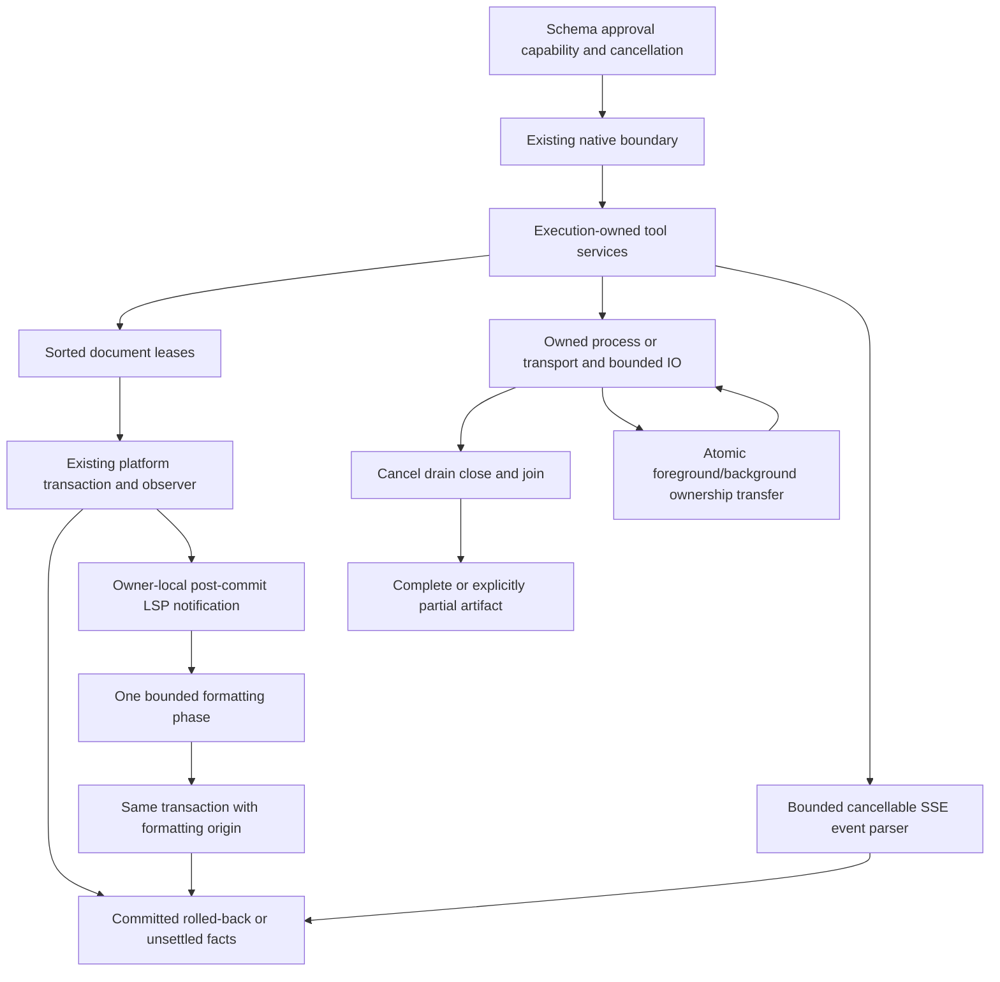

The cohesive work is owner association and finite lifetimes, not a universal new execution framework. A3-03/A3-04 share the native post-commit boundary; A3-01/A3-05 share transport ownership but require separate event-budget and idle-shutdown fixes. A3-02 ties directly to worker teardown liveness from audit 2.

- [ ] **A3-01** Bound full MCP events and incremental cancellation.
- [ ] **A3-02, A3-05** Close/join capture and transport resources independently of external EOF.
- [ ] **A3-03, A3-04** Make write-through owner-local and formatting nonrecursive.
- [ ] **A3-06** Share effective adoption deadline calculation.
- [ ] **A3-R1** Resolve hard-cancel/adoption precedence with end-to-end ownership evidence.
- [ ] **A3-D1–D3** Align documented trust and resource-operation contracts with tested behavior.

**Report update 3:** completed tool/security/process pass; added six source-confirmed defects, a separately qualified cancellation risk, three documentation findings, relationship diagrams and concrete regression criteria. No claim is made that platform security or these regressions were executed.

## 4. Persistence, provenance, learning and recovery audit

### Coverage and ownership

Deeply traced atomic publication/locks, session ownership/append/flush/reclamation/recovery/relocation, checkpoints, runtime bodies and execution/cancellation facts, provenance revisions and source freshness, harvest admission/splitting/torn-tail recovery, held-out gating and activation transactions, immutable training snapshots, compute handoff/accounting, steering promotion and benchmark resume/scoring. Sampled archive/retention/history, local and managed memory backends, exercise registration and adjacent tests.

Not exhaustive: all session FTS/media retention, dump/export/share/GC, semantic/Hindsight/Sharpshooter backends, platform private-directory implementations, full Python training algorithms or weight-integrity execution. No crash injection, permission experiment, multiprocess race, oversized-stream probe or real training was executed. Exact prompt/group separation does not prove semantic held-out disjointness.

| Owner                                                                  | Inspected responsibility and invariant                                                                                                                                                       |
| ---------------------------------------------------------------------- | -------------------------------------------------------------------------------------------------------------------------------------------------------------------------------------------- |
| `src/storage/session.rs:792-820,2022-2035`                           | Claim the real journal before parsing; partial append removes writer ownership before returning.                                                                                             |
| `src/runtime.rs:95-108,202-210`                                      | Journal changes before exposing body revisions; failed publication remains visible.                                                                                                          |
| `src/storage/session.rs:2295-2315` → stream reclamation             | Main-journal `sync_data` precedes durable revision acknowledgements. Ordinary visible appends are not all independently fsynced.                                                           |
| `src/storage/session.rs:2318-2381`                                   | Recover active branch, reserve abandoned IDs, connect reachable stream parents and mark unfinished bodies interrupted.                                                                       |
| `src/storage/atomic.rs:65-95,104-129`                                | Separate private/workspace/checkpoint policies; reject private-target links/foreign ownership and sync directory on Unix. Atomic file replacement is not a transaction across several files. |
| `src/storage/checkpoint.rs:407-440,574-596`                          | Original bytes precede manifest/public mutation; restore validates added-root membership.                                                                                                    |
| `src/storage/provenance.rs:289-359`                                  | SQLite transactions, revision-qualified corrections, history, expiry and logical deletion; do not promise physical erasure.                                                                  |
| `src/storage/codebase.rs:753-819,877-927,1291-1317`                  | Recheck source/dependency scope and expected revision; freshness is not behavioral verification.                                                                                             |
| `src/storage/memory_backend/local.rs:97-116,169-189,248-265`         | Redact before persistence; commit extraction only with matching lease and source digest.                                                                                                     |
| `src/storage/memory_backend/managed.rs:159-174,261-290`              | Immutable generation staging plus SQLite revision/transaction publication; clean uncommitted staging.                                                                                        |
| `src/learn/harvest.rs:118-196,251-342`                               | External outcomes and repair evidence have distinct admission; connected groups constrain train/validation crossover.                                                                        |
| `src/learn/improve.rs:1001-1043` → `src/storage/store.rs:483-565` | Bounded immutable train/validation inputs; lineage/active-baseline CAS; activation, audit and consumed training window commit together.                                                      |
| `src/learn/gate.rs:368-454,531-569`                                  | Distinguish infrastructure/model failures, bound paired exclusions, abort unknown/fatal failures; incomplete evaluation is not a pass.                                                       |
| `src/learn/compute.rs:55-76,169-216`                                 | Live locks determine pending ownership; foreground handoff discards/retries partial background generation.                                                                                   |
| `src/steering.rs:95-117,172-195,445-473`                             | Pending/active leases, exact-strength evaluation and regression checks precede promotion; failed automatic replacement preserves incumbent.                                                  |
| `src/benchmark.rs:876-979`                                           | Frozen source, per-case isolation, explicit unavailable checks and successful-agent completion in result eligibility.                                                                        |

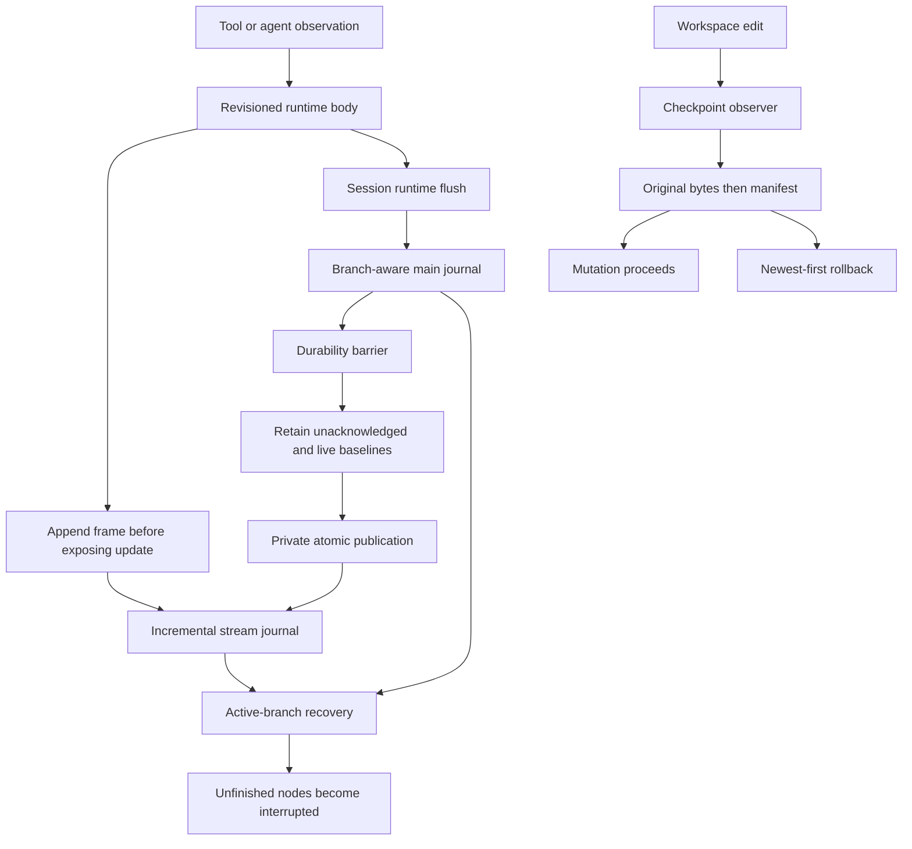

```mermaid
flowchart LR
    Live[Live trajectories and exact requests] --> Outcomes[External outcomes or validated repair]
    Practice[Isolated practice verifier] --> Outcomes
    Outcomes --> DB[Per-model learning store]
    DB --> Harvest[Screen group deduplicate split]
    Harvest --> Dataset[Training and validation JSONL]
    Dataset --> Snapshot[Immutable bounded snapshot]
    Snapshot --> Candidate[Harness or adapter candidate]
    Candidate --> Gate[Paired held-out and regression gate]
    Gate --> CAS[Transactional baseline CAS]
    CAS --> Active[Admitted version and watermark]
    Active --> Serving[Serving selection and runtime confirmation]
    Archives[Archived sessions] --> Advice[Advisory memory]
    Sources[Current source identity] --> Advice
    Advice -. not proof or success labels .-> Live
```

### A4-01 — Benchmark resume forgets nonsecret token-budget changes

- **P2 · Confirmed / source · high confidence.** `src/benchmark/records.rs:75-116` recursively strips keys containing `token`/`env` before computing config digest; `134-174` accepts equal contracts and reuses completed cases. The real caller supplies serialized `Config` (`src/cli/benchmark/mod.rs:178-190`).
- **Trigger/consequence:** resume after changing only `harness.max_tokens`. That legitimate execution limit is scrubbed, so the digest can stay equal and old/new-budget cases are mixed under one purported contract. Privacy redaction has erased evaluation identity.
- **Proposed change:** typed credential-free execution config or precise secret exclusions. Retain all outcome-affecting limits; reuse `Contract`/`Recorder` and private publication.
- **Acceptance:** token-budget changes (including nested ones) alter the digest and reject resume; API-key-only changes do not expose credentials or unnecessarily change the public contract. Preserve existing credential-omission coverage (`records.rs:214-240`).

### A4-02 — Retrying partial multi-turn rollback can reintroduce an undone edit

- **P2 · Confirmed / source · high confidence.** `src/storage/checkpoint.rs:485-510` retains failed newer manifests but proceeds to older manifests; successful entries within the retained manifest are not marked consumed. Added-root detachment provides a recoverable failure (`580-587`); retry restores originals again (`600-615`).
- **Concrete trigger:** A starts at A0; turn 1 writes A1; turn 2 writes A2 and B in an added root. Detach B's root and roll back two turns: turn 2 restores A1 but fails B and remains; turn 1 restores A0 and is deleted. Reattach the root and retry the retained turn: it restores A1, undoing the already successful rollback to A0.
- **Proposed change:** conservatively stop traversing older manifests after any selected manifest fails. If cross-turn partial progress is required, persist a per-entry consumption/rollback plan making retry idempotent. Reuse the existing restore engine.
- **Acceptance:** detached-root scenario cannot move A0 back to A1; repeat across restart; test single-turn retry and checkpoint-directory deletion failure. Existing tests cover normal multistep rollback (`808-864`) and single-manifest detached roots (`1023-1055`), not their composition.

### A4-03 — Torn multibyte UTF-8 prevents harvest's intended tail recovery

- **P2 · Confirmed / source · high confidence.** `src/learn/harvest.rs:98-99,1118-1129` reads existing digests with `read_to_string` before handling an unterminated record. Byte-oriented truncation exists later (`1161-1169`) but is unreachable after UTF-8 decode failure.
- **Trigger/consequence:** a crash/short write cuts the last JSONL record inside a multibyte character. Every later harvest fails before repairing the tail, even though earlier records are valid.
- **Proposed change:** delimit records as bytes, strictly decode complete records, repair/discard only a malformed unterminated final record. Share this policy between digest scanning and append; preserve fail-closed interior corruption.
- **Acceptance:** truncate after every byte of 2/3/4-byte characters; keep all complete records and accept the next append; preserve complete JSON missing only newline; reject malformed complete/interior records without rewriting; cover train and validation files. Existing recovery tests (`2175-2200`) use torn ASCII, not invalid UTF-8.

### A4-04 — Stream reclamation's helper limit can poison a valid live session

- **P2 · Confirmed / source · high confidence.** `src/runtime/stream_journal.rs:37,232-260` starts reclaiming at 4 MiB, retains every running baseline and publishes them together through a private-file helper; `src/storage/atomic.rs:67-70` rejects files above 8 MiB. Non-worker body text has no corresponding aggregate limit (`src/runtime.rs:175-210`). Reclamation error is latched, blocking body updates (`95-108`) and normal session appends (`src/storage/session.rs:2078-2097,2275-2283`).
- **Trigger/consequence:** several individually valid running bodies (for example three roughly 3 MiB bodies) flush to valid individual main-journal entries but require an aggregate retained baseline above 8 MiB. Optional reclamation hits an unrelated settings-style whole-file limit and turns into a permanent journal failure. Typical-workload frequency was not measured.
- **Proposed change:** define a stream-owned capacity contract. Defer reclamation without poisoning a still-usable writer when retained data cannot fit, or use a dedicated bounded streaming publisher. Do not remove the generic private-state cap for every caller. Keep fsync-before-reclaim.
- **Acceptance:** aggregate live baselines above 8 MiB survive append/settle/flush/reopen with revisions intact; capacity refusal does not block unrelated messages; real I/O/fsync failures still fail visibly/closed.

### A4-05 — File-absence verifier treats inaccessible files as successfully deleted

- **P2 · Confirmed / source · high confidence.** `src/learn/verify.rs:88-90` treats every `symlink_metadata` error as absence; confinement also fails to reject metadata errors while walking (`121-127`). Curriculum uses this verifier (`src/learn/curriculum.rs:2193,2717`).
- **Trigger/consequence:** a still-existing target is under a non-searchable directory for a normal non-root account. Metadata returns `PermissionDenied`, but deletion verification passes. Inaccessible evidence can become a successful learning/evaluation outcome.
- **Proposed change:** only definite `NotFound` proves absence; other errors yield false or an explicitly unavailable check. Keep confinement errors separate.
- **Acceptance:** missing passes, existing fails, permission/I/O errors never pass, symlink components remain rejected. Restore fixture permissions before cleanup; use injected metadata or explicitly skip privileged real-permission cases. Nearby tests (`verify.rs:255-305`) establish normal absence, not error classification.

### A4-06 — Concurrent compute settlement loses usage when compute locks are disabled

- **P2 · Confirmed / source, conditional configuration · high confidence.** `src/learn/resources.rs:189-200` does read-add-atomic-replace without a lock. `src/learn/compute.rs:284-303,326-338` still accounts leases with `compute_locks=false` but without exclusive compute ownership. Daily admission consults persisted usage plus the current thread's lease (`src/learn/auto.rs:73-78`).
- **Trigger/consequence:** two background leases sharing a user directory settle concurrently, both read U and publish U+A/U+B. Last replacement omits one job, undercounting daily usage and permitting excess work. Default exclusive compute ownership mitigates the enabled-lock path; this is not a claim that all jobs race.
- **Proposed change:** lock `compute-usage.json` read-modify-write with the existing stable settings lock, independently of optional scheduling exclusion. Decide corrupt-state handling explicitly instead of silently treating corruption as zero.
- **Acceptance:** deterministic concurrent threads and separate processes with compute locks disabled produce U+A+B; preserve rollover and error behavior. Atomic file validity alone is insufficient.

### A4-07 — Oversized stream row silently hides all following valid frames

- **P2 · Confirmed / source · high confidence.** `src/runtime/stream_journal.rs:285-294` reads at most 32 MiB and breaks when that chunk lacks newline, conflating a cap hit with an actual torn EOF tail. Publication has no matching serialized-frame bound (`176-185`); reclamation retains only recovered nodes (`228-251`).
- **Trigger/consequence:** a row above 32 MiB precedes valid terminated frames. Recovery reports success without reading the later frames; subsequent reclamation can permanently erase that unseen suffix. The row may be corrupt or an oversized unbounded snapshot.
- **Proposed change:** distinguish capped partial scan from true EOF. Explicitly drain/skip an oversized row with a defined error policy, or fail closed and preserve the stream. Never compact a source whose scan was incomplete.
- **Acceptance:** oversized malformed and valid rows followed by valid snapshots/deltas; true torn final row still recovers prefix; no reclamation erases unexamined records.

### A4-D1 — Automatic steering's documented switch differs from its tested policy

**P3 · Documentation/intent conflict, not counted as an accidental implementation defect.** `docs/improvement.md:420-424` describes automatic-vector control as governing creation and use, while `src/steering.rs:208-241` permits an automatic-origin admitted vector when `enabled=true, automatic=false`; `875-889` explicitly tests that policy. Clarify whether manual enable means using the selected admitted vector regardless of origin. Align docs/UI with the deliberate decision rather than changing a tested policy by assumption.

### Ideal data flow and actionable changes

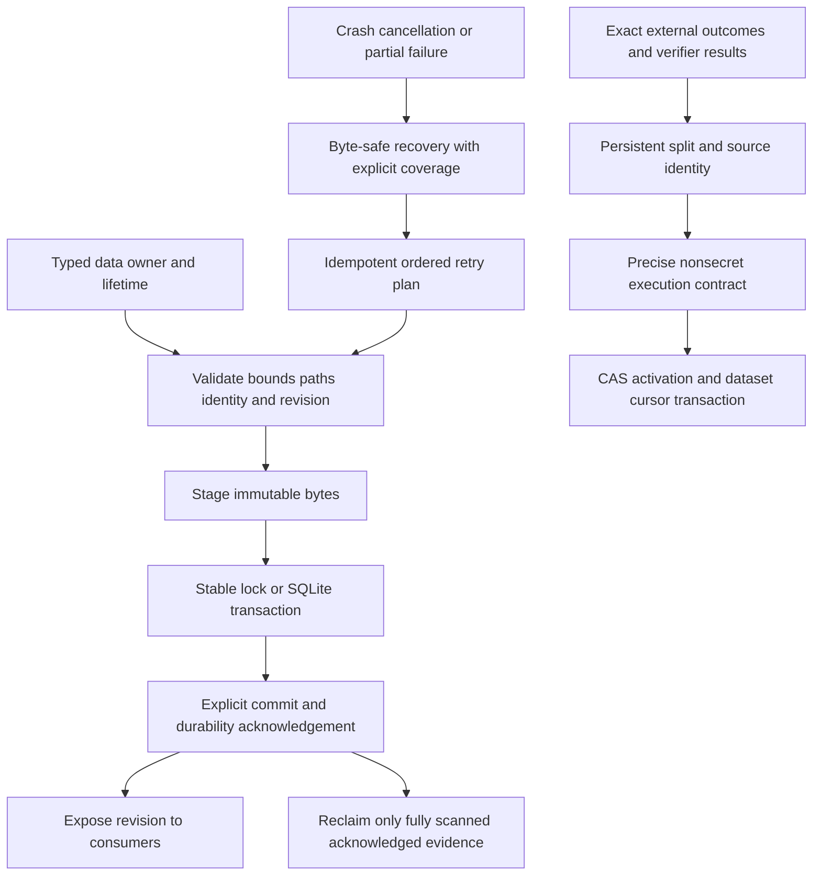

A4-01/A4-05 protect evaluation integrity before improving models. A4-02/A4-03 make recovery repeatable rather than merely best effort. A4-04/A4-07 must be addressed together as stream capacity, scan-completeness and reclamation contracts. A4-06 separates accounting serialization from scheduling policy. Existing owner-specific publication helpers are appropriate; a generalized new persistence platform is unnecessary.

- [ ] **A4-01, A4-05** Preserve exact evaluation configuration and reject unavailable evidence as success.
- [ ] **A4-02, A4-03** Make rollback retries ordered/idempotent and JSONL tail recovery byte-safe.
- [ ] **A4-04, A4-07** Align stream limits and preserve data when recovery/reclamation is partial.
- [ ] **A4-06** Serialize usage accounting in every compute-lock mode.
- [ ] **A4-D1** Resolve the documented steering-switch contract without weakening admission.

**Report update 4:** completed persistence/learning pass; added seven source-confirmed defects, one explicit intent/documentation conflict, three relationship/data-flow diagrams and implementation acceptance criteria. Existing Python/offline benchmark passes do not reproduce these Rust recovery scenarios.

## 5. External runtimes, protocols, collaboration and presentation audit

### Coverage and preserved boundaries

Inspected RPC control/admission/cancellation/cache paths, ACP session/resource/event mapping, collaboration host/guest/socket/relay/crypto/protocol, browser relay authentication/session lifecycle/discovery and extension background worker, selected terminal bridge/transcript/sanitizer paths, computer supervisor/Node transport, voice capture/dictation/live/STT/process ownership, and Python protocol/grammar/thinking entrypoints. Narrow caller traces in commands, agent delegation and managed runtime launch validated the cross-boundary findings.

Not exhaustive: every terminal overlay/event combination, collaboration registry persistence, every CDP route, Python training/vision-cache internals, native desktop backends, every voice backend, or the full output spool. No Chrome/Playwright/extension, ACP client, rendered terminal/PTY, remote TLS deployment, real microphone/STT, native accessibility/screen-capture API, MLX inference/LoRA training or Laya checkpoint loading was exercised. Portable Python tests are not hardware integration proof.

| Owner / boundary        | Inspected safeguards and relationships                                                                                                                                                                                                                                   |
| ----------------------- | ------------------------------------------------------------------------------------------------------------------------------------------------------------------------------------------------------------------------------------------------------------------------ |
| RPC / ACP               | One RPC actor, bounded input lines/command queue, separate abort/approval/query handling; approval IDs match pending requests (`src/rpc.rs:1443-1464`). ACP checks bridges/cwd and uses `open_beneath` for local resources (`src/acp.rs:205-218,299-341,431-455`). |
| Runtime → terminal     | Shared bodies bind through `src/app.rs:9511-9527` and `src/ui/transcript.rs:700-740`; `src/ui/text.rs:9-91` sanitizes split escape sequences statefully.                                                                                                           |
| Collaboration           | Relay rewrites peer IDs and bounds recipient queues/stalled writes (`src/collab/server.rs:249-287,299-331`). Host gates steering on write token and operator setting (`host.rs:51-59,295-315`); plaintext remote links are refused (`protocol.rs:69-90`).          |
| Browser relay           | Token checked before routing; CDP Origin rejected and extension Origin checked (`src/browser_relay/server.rs:84-125,240-277`). Probe clients disable proxies/redirects and have deadlines (`client.rs:74-81`).                                                       |
| Computer                | Existing generations, frame/write limits, cancellation grace and process-group ownership are valuable; fake-worker tests (`src/computer/supervisor.rs:1052-1139`) cover stalled/partial transport, not asynchronous cross-generation callbacks.                        |
| Voice                   | `src/voice/process.rs:92-130` reuses shared bounded process policy; cancellation semantics above that primitive are the issue below.                                                                                                                                   |
| Python inference        | Rust embeds pinned helpers and launches loopback services with parent-PID ownership (`src/llm/server.rs:465-487,651-705`). Malformed tool arguments become non-executable null rather than invented empty objects (`python/dial_server.py:184-215`).                 |
| Python worker / grammar | Eight-MiB request cap, parent-death watcher, diagnostic fd redirection and finite JSON result (`python/dial_worker.py:17-32,1133-1174`). Grammar documents unsupported constraints and authoritative Rust validation (`python/dial_tool_grammar.py:13-22`).          |

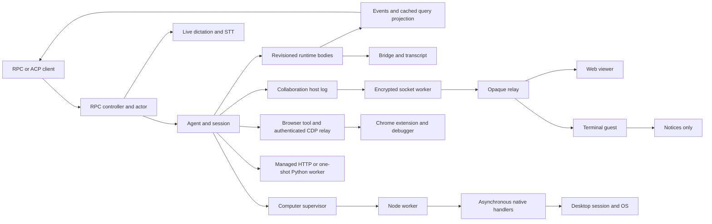

### A5-01 — Computer native replies can cross worker generations

- **P1 · Confirmed / source · high confidence; race not executed.** `src/computer/supervisor.rs:588-635` checks incoming generation but dispatches handlers without it; `782-808` retrieves the current desktop session inside the new thread; `816-828` sends through whichever worker is current. Termination removes the old session/worker without joining these handlers (`967-996`). Each Node process resets `nativeSeq` and correlates only by `native-N` (`src/computer/js/worker.mjs:93-115`).
- **Trigger/consequence:** generation 1's handler is delayed, timeout restarts the worker, and generation 2 reuses the request ID. The old completion can settle the new promise, or the delayed old handler can obtain the replacement desktop session. Even an old cancellation error can fail an unrelated new request; post-cancel OS mutation need not be demonstrated to establish miscorrelation.
- **Proposed change:** capture generation/session at admission, bind response to that generation's writer, discard stale replies, and carry cancellation into handlers. Reuse `Worker.generation`, `stopped` and existing generation-filtered reply patterns.
- **Acceptance:** hold generation-1 response/handler, restart, issue identical ID in generation 2, release old work; no stale result resolves the new promise and no old handler uses the replacement session. Extend the fake-worker harness (`supervisor.rs:1023-1049`).

### A5-02 — RPC voice abort ignores transcription cancellation

- **P1 · Confirmed / source · high confidence.** `src/rpc.rs:866-873` passes interrupt through `src/voice/live.rs:74-77`, but `src/voice/dictation.rs:92-105,117-124` supplies an always-false flag to segment/final transcription. STT timeout can reach 3,600 seconds (`src/voice/stt.rs:175-209`); RPC control fails after ten seconds of cancellation and exits after further cleanup timeout (`src/rpc.rs:1236-1243,1638-1645`).
- **Trigger/consequence:** abort live listening during stalled STT or before final speech flush. Capture can stop while STT ignores abort, tripping process-level cleanup instead of leaving the RPC session usable. Push-to-talk **key release** intentionally flushes speech; protocol **abort** is not the same operation (`docs/voice.md:48-50`).
- **Proposed change:** distinguish finish-recording-and-transcribe from cancel-operation. Preserve held-key release, propagate real abort to STT and skip final transcription after cancellation; reuse existing cancellable process/HTTP primitives.
- **Acceptance:** fake recorder plus stalled transcriber; RPC abort stops promptly, never starts a turn from partial text and leaves `state`/next request usable. Independently retain release-to-transcribe behavior.

### A5-03 — Terminal collaboration guest discards conversation replication

- **P2 · Confirmed / source · high confidence.** Host sends welcome/snapshot (`src/collab/host.rs:263-292`), live entries and reset (`118-133`). `src/collab/guest.rs:45-69,78-100` handles only welcome/notice/error/bye; `src/collab/room.rs:24-30` exposes notices, displayed by `src/app.rs:3141-3146`. `/join` installs this guest (`src/commands/collab.rs:249-262`).
- **Trigger/consequence:** terminal joins successfully but never projects historical/subsequent conversation or rewind. The guest also exposes no prompt/abort sending method, so writable status does not provide functional remote terminal steering.
- **Proposed change:** typed replica reducer for snapshot/entry/reset, separate from the local writable session. Implement remote prompt/abort routing or explicitly present the supported terminal surface as read-only; do not claim writable support that silently runs local turns.
- **Acceptance:** join after two messages, project history exactly once, receive a new entry and rewind/reset replay; ensure guest input targets the advertised owner rather than silently becoming local-agent work.

### A5-04 — Delayed browser attachment resurrects a disconnected client's session

- **P2 · Confirmed / source · high confidence.** Requests run independently of the socket loop (`src/browser_relay/server.rs:369-375`). Disconnect removes currently registered sessions (`src/browser_relay/bridge.rs:303-317`); attach waits outside the lock and later checks only tab existence before inserting a client-owned session/refcount (`550-579`). Detach depends on releasing that refcount (`1011-1045`).
- **Trigger/consequence:** client sends `Target.attachToTarget`, disconnects, then extension reply succeeds. Completion installs an orphan owner/session after disconnect cleanup already ran, retaining debugger attachment state.
- **Proposed change:** revalidate client and extension generation before committing; release successful orphan attach when no live owner needs it. Use a per-tab attach reservation for concurrent first attachments.
- **Acceptance:** delay fake extension response until after client disconnect; no orphan session/refcount and appropriate detach. Also exercise simultaneous clients attaching one initially unattached tab.

### A5-05 — Browser relay lacks slow-consumer and request-fanout bounds

- **P2 · Confirmed / source · high confidence.** `src/browser_relay/server.rs:291-308` sets read but not write timeout with default WebSocket config; `349-375,396-407` uses unbounded output channels and a thread per request. Extension pending RPCs have no admission cap (`src/browser_relay/bridge.rs:984-1003`).
- **Trigger/consequence:** authenticated CDP client stops reading events or floods extension-bound commands. Blocked writes pin socket threads while queues, threads and pending calls grow. This is local/authenticated availability risk, not an unauthenticated remote execution claim.
- **Proposed change:** byte/frame/in-flight budgets, finite stalled-write handling and explicit overload/disconnect scoped to the offending client. Reuse collaboration's bounded recipient queue and write-deadline design (`src/collab/server.rs:22-27,71-75,249-287`).
- **Acceptance:** stalled recipient/flood cannot exceed configured memory/work limits or disrupt healthy peers; overload has an explicit result instead of unbounded thread creation.

### A5-06 — Collaboration snapshot batches evade byte accounting

- **P2 · Confirmed / source · high confidence.** Each hello clones serialized history (`src/collab/host.rs:286-287`); `snapshot_chunks` owns that vector although frame production is lazy (`src/collab/protocol.rs:269-287`). `Pending::Batch` reports zero retained bytes (`src/collab/socket.rs:100-122`), then enters a count/byte-bounded queue (`222-252`).
- **Trigger/consequence:** multiple guests or repeated hellos queue snapshots while a large history drains slowly. The 16 MiB byte limit ignores each retained history copy; the 256-item limit can still permit roughly 256 such copies. Lazy serialization is not bounded retained memory.
- **Proposed change:** immutable shared snapshot storage/cursors or truthful retained-byte charging; coalesce/reject repeated pending admission for a peer.
- **Acceptance:** repeated admissions with a large history and stalled transport stay within retained-memory budget; preserve snapshot order, exactly-once reduction and final markers.

### A5-07 — RPC polling cache stays stale after idle/background mutations

- **P2 · Confirmed / source · high confidence.** `QueryProjection` is materialized JSON (`src/rpc.rs:574-578`). Idle pumping (`744-787`) can mutate worker/runtime/messages via `src/agent/delegation.rs:6-45` without refreshing it; refresh happens after worker commands (`rpc.rs:1153-1154`). `state`/`messages`/`messages_page` answer directly from cache (`1276-1314`).
- **Trigger/consequence:** launch a delayed background worker then only poll state. Idle pumping finishes it, but polling can retain running state indefinitely until an unrelated actor-handled command refreshes the cache. Idle compaction can similarly stale messages. Push events and snapshots disagree.
- **Proposed change:** publish projection after idle mutation, preferably by revision/dirty signal rather than cloning history every 100 ms. Preserve the single canonical projector.
- **Acceptance:** delayed task completes with no status/other actor command; state polling converges to terminal phase/revision. Add idle-compaction cache coverage.

### A5-08 — Collaboration steering is unbounded beyond the transport queue

- **P2 · Confirmed / source · high confidence.** `src/collab/host.rs:43-46,247-258,295-315` accumulates valid prompts/aborts in a plain vector without count/byte limits. During active turns only aborts are removed (`184-189`); running-turn pumping admits frames (`src/app.rs:9383-9388`) while prompts await idle.
- **Trigger/consequence:** when guest steering is explicitly enabled, a writable guest supplies prompts faster than a long-running turn settles. Bounded socket queues do not bound the drained application queue.
- **Proposed change:** independent steering count/byte and individual-prompt limits, coalesced aborts, explicit overload replies. Reuse RPC admission (`src/rpc.rs:1345-1357`) with byte accounting.
- **Acceptance:** prompt flood during stalled turn stays within fixed budget, rejects excess visibly, and preserves abort responsiveness.

### Separate threat-model and integration risks

- **A5-R1 · P2 · Conditional security mechanism:** AES-GCM authenticates ciphertext but no replay/sequence state is retained (`src/collab/crypto.rs:65-98`, `src/collab/socket.rs:653-672`). Valid replayed commands are processed (`src/collab/host.rs:263-315`). A compromised relay could replay captured ciphertext without knowing the key. **[INFERENCE]** Deployment exposure depends on whether the relay is trusted for integrity. Define that assumption; if not trusted, authenticate role/epoch/command identity, maintain replay windows and deduplicate execution. Test identical-ciphertext and old-epoch replay.
- **A5-R2 · P2 · Integration hypothesis:** Rust clears attachment bookkeeping on extension disconnect (`src/browser_relay/bridge.rs:952-974`) while extension reconnect does not explicitly detach/reconcile debugger ownership (`assets/browser-extension/background.js:165-174`; attach at `80-87`). Whether Chrome rejects reattach depends on actual runtime semantics. Test real attached-tab disconnect/reconnect; do not report a confirmed Chrome failure yet.
- **A5-R3 · P2 · Integration hypothesis:** web collaboration viewer has no reconnect reducer and uses independent async decrypt handlers (`assets/collab-web/index.html:21-39`). Out-of-order WebCrypto completion was not demonstrated. Test ordering, reconnect and reset under delayed decrypt, then introduce sequence-aware serialized reduction if needed.
- **A5-R4 · P3 · Latent correlation weakness:** ACP maps by tool name (`src/acp.rs:684-720`) despite RPC call IDs. Ordinary parallel execution presents callbacks serially (`src/agent/turn.rs:1754-1835`), so two reads alone do **not** establish corruption. Test nested/interleaved callbacks before promoting the risk; prefer stable call IDs if overlap is supported.
- **A5-D1 · P3 · Documentation conflict:** `docs/collab.md:3` and crypto prose describe fragment-only keys, but `src/collab/protocol.rs:93-108` formats compact `/r/id.key` links. Parsed socket URLs strip the secret, so this is not proof that current clients send keys to the relay. Explain application links versus browser fragment wrappers and test key-free network URLs.

### Ideal architecture and implementation queue

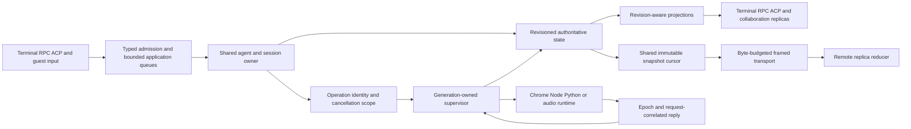

Use existing RPC/queue/process/generation primitives; do not introduce a universal adapter framework. A5-01/A5-04 share stale-owner publication, A5-02 needs distinct cancellation semantics, A5-03/A5-07 require consistent projections, and A5-05/A5-06/A5-08 show why every queue layer needs its own truthful budget.

- [ ] **A5-01, A5-02** Fix generation binding and true abort semantics with fake-runtime regressions first.
- [ ] **A5-03, A5-07** Implement typed guest replication and revision-aware idle projections.
- [ ] **A5-04, A5-05, A5-06, A5-08** Enforce owner validation and retained-byte/in-flight limits across transport and application layers.
- [ ] **A5-R1** Decide relay integrity trust and implement/test replay resistance if required.
- [ ] **A5-R2, A5-R3, A5-R4** Exercise Chrome reconnect, viewer ordering and interleaved ACP callbacks before changing behavior on speculation.
- [ ] **A5-D1** Correct link/key documentation without weakening secret isolation.

**Report update 5:** completed external-runtime/surface pass; added eight source-confirmed defects, four qualified risks, one documentation conflict, current/target flow diagrams and regression criteria. All five audit sections are now complete.

## Consolidated architecture assessment

### Finding inventory

| Audit           |         Main prioritized findings | Additional separately tracked items                                             |
| --------------- | --------------------------------: | ------------------------------------------------------------------------------- |
| 1               | 5 (including one CI coverage gap) | Package-manager lag explicitly distinguished from a source-package mismatch     |
| 2               |                                 5 | Cooperative teardown and worker-completion/merge semantics qualified separately |
| 3               |                                 6 | 1 cancellation risk; 3 documentation/contract items                             |
| 4               |                                 7 | 1 steering intent/documentation conflict                                        |
| 5               |                                 8 | 4 threat-model/integration risks; 1 documentation conflict                      |
| **Total** |        **31 main findings** | **Not 31 runtime-reproduced bugs**                                        |

There are four P1 main findings (A1-03, A3-01, A5-01, A5-02), twenty-six P2 main findings (including the Windows coverage gap), and one P3 main finding (A1-05). Severity is triage, not proof of exploitability or frequency. Related symptoms remain separately tracked when they require different acceptance tests.

### Cross-system root causes

1. **Identity without matching lifetime:** fallback backend versus local routing state; global LSP service versus fork; native callback versus worker generation; attach completion versus disconnected client. The smallest fix is explicit owner/epoch identity at admission and revalidation before publication.
2. **Local bounds mistaken for end-to-end bounds:** line-limited SSE but unlimited event, bounded transport but unlimited steering, lazy snapshot iteration but retained full copies, per-entry journal capacity but incompatible aggregate publication. Budget retained bytes and in-flight work at every accumulation boundary.
3. **Publication mistaken for recoverable transaction:** backup rename gaps, retryable manifests without consumed-state semantics, atomic accounting writes without serialization, reclamation after partial scan. Define commit, durability, retry and reclamation separately.
4. **Distinct states collapsed:** key release versus abort, provider backoff versus silence, unavailable metadata versus absence, freshness versus verification, completed worker versus merged changes. Preserve typed distinctions rather than adding prose-based heuristics.
5. **Component tests miss composition:** provider retry and agent silence are independently tested; child fallback does not cover parent route transitions; single-manifest failure does not cover multi-turn retry; ordinary process descendants do not cover escaped-output holders. Add tests at the owning interface, not redundant unit tests of the same helper.

### Prioritized implementation roadmap

Each row is a coherent change packet with an existing owner. Checkboxes above remain open until implementation and regression evidence exist.

| Order | Packet / existing owner                  | Findings                                 | Exit criterion                                                                                                                         |
| ----- | ---------------------------------------- | ---------------------------------------- | -------------------------------------------------------------------------------------------------------------------------------------- |
| 1     | Supervisor/voice ownership               | A5-01, A5-02                             | Stale generation cannot settle/use new session; abort stops STT and leaves RPC usable.                                                 |
| 2     | Bounded MCP transport lifetime           | A3-01, A3-05                             | Incremental event budget and idle shutdown both release owned resources.                                                               |
| 3     | Safe installation and rollback           | A1-03, A1-04, A4-02                      | Crash points preserve runnable old/new install; backup failures stop; rollback retry never reintroduces a superseded state.            |
| 4     | Evaluation evidence and identity         | A4-01, A4-05                             | Nonsecret execution changes invalidate resume; inaccessible evidence never passes verification.                                        |
| 5     | Active-route ownership                   | A2-01 through A2-04                      | Backoff/cooldown/bounds/accounting remain correct across requests, turns and reentry.                                                  |
| 6     | Execution and argument identity          | A2-05, A3-02, A3-03, A3-04, A3-06, A3-R1 | Distinct payloads execute; readers settle; LSP uses the right owner without recursive formatting; waits/cancel precedence are bounded. |
| 7     | Durable stream/dataset recovery          | A4-03, A4-04, A4-07                      | Byte-safe tails, explicit scan completeness, and reclamation capacity cannot lose valid suffixes or poison ordinary writes.            |
| 8     | Projection and collaboration correctness | A5-03, A5-07                             | Terminal replica and polling state converge on authoritative revisions without unrelated commands.                                     |
| 9     | Relay/application budgets                | A5-04, A5-05, A5-06, A5-08               | Attach commits require a live owner; stalled/flooding peers remain within byte and work limits.                                        |
| 10    | Accounting and enforcement               | A4-06, A1-01, A1-02, A1-05               | Usage updates serialize, boundary aliases are checked, Windows behavior is gated, and source-package identity agrees.                  |
| 11    | Threat-model/integration closure         | A5-R1–R4 and documentation items        | Deliberate trust decisions, real-runtime acceptance evidence and documentation consistent with supported behavior.                     |

Do not move directories, split crates, replace the shared engine, introduce a second persistence platform, weaken approval/sandboxing, suppress errors, or change model-facing defaults solely to make this report's checklist shorter. No measured performance gain is claimed. **[INFERENCE]** These ownership and boundedness fixes should improve maintainability because the state transitions already belong to identifiable existing modules.

### Unified target data flow

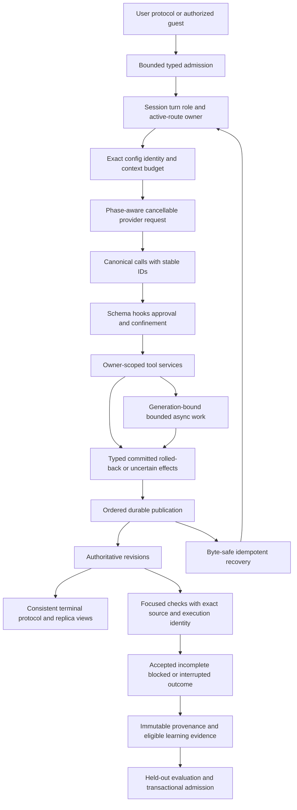

## Verification ledger and remaining acceptance work

| Executed check                                                                                                                  | Observed outcome                                       | What it does not establish                                                                                       |
| ------------------------------------------------------------------------------------------------------------------------------- | ------------------------------------------------------ | ---------------------------------------------------------------------------------------------------------------- |
| Standalone `rustc --edition=2024 --test tests/integration/architecture.rs`, with `CARGO_MANIFEST_DIR` set, then test binary | **4 passed, 0 failed**                           | Alias-regression coverage, application compilation or all Rust behavior                                          |
| `python3 scripts/test-build.py`                                                                                               | **4 passed**                                     | Real installation, fault-injected backup failure or crash-safe updater activation                                |
| `make test-bench-offline`                                                                                                     | **23 passed**                                    | Rust benchmark resume identity, real model quality or held-out admission                                         |
| `make test-python` using system Python                                                                                        | **Failed before collection: pytest unavailable** | Not a product test failure; no dependencies installed                                                            |
| `make test-python PYTHON=python/.venv/bin/python`                                                                             | **157 passed, 4 skipped** in 6.20s               | Three skips lack `mlx_vlm`; one is optional real MLX/tokenizer; no claim of real training/inference validation |

Executed output references: architecture `artifact://e1aa48cfefb51df6766438f2ba3c78d1ff577f2931aa152ded2803529d74d9ef`; build fixture `artifact://eb269153f99d128330313491496a60c9f716a91d1d250211151288bd4fbee599`; offline benchmark `artifact://2b831afd1fdcd7621c7e31d9cd71106428cc3cb84e2fa23813d3200fc4e463f0`; system-Python failure `artifact://99ddc5d39468e16e0b64cfadfc2c7940fe6a1c44cbdc8d83d7c4d39a1aed19b5`; project-Python result `artifact://07e39e0f781181815a7fb7a52d8a73202a26d1ce5c6a9d69b5023172151828ac`. These are local session evidence references, not portable repository URLs.

No production fix or new Rust regression test was implemented. The full Rust suite, Clippy, hosted CI, platform sandbox enforcement, fault injection, real browser/audio/desktop surfaces, and hardware learning remain **unexecuted** for this audit. Mermaid diagrams are source diagrams; no rendered-diagram verification is claimed. No live language server was available; source navigation used targeted reads/searches. Earlier review documents' unresolved failures are not declared fixed or pre-existing by these results.

Recommended post-implementation checks use existing entrypoints: focused `make test-module MOD=<owning-module>`, relevant cases in `make test-integration`, then `make test-rust`, `make lint`, `make test-python PYTHON=<provisioned-interpreter>`, and `make test-bench-offline`. Run cross-platform/native acceptance on the actual supported hosts and keep optional unavailability explicit. Add the finding-specific composed-boundary regressions before claiming closure; a passing old suite alone is insufficient.

**Delivered change:** this report only, incrementally updated after each of the five audits. Existing source, staged/unstaged work, architecture documents and plans are preserved. The report provides proposed changes, not implemented fixes or certification of unaudited paths.
